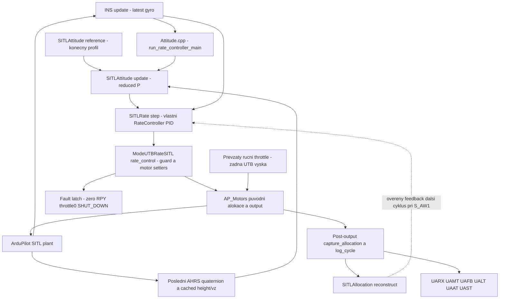
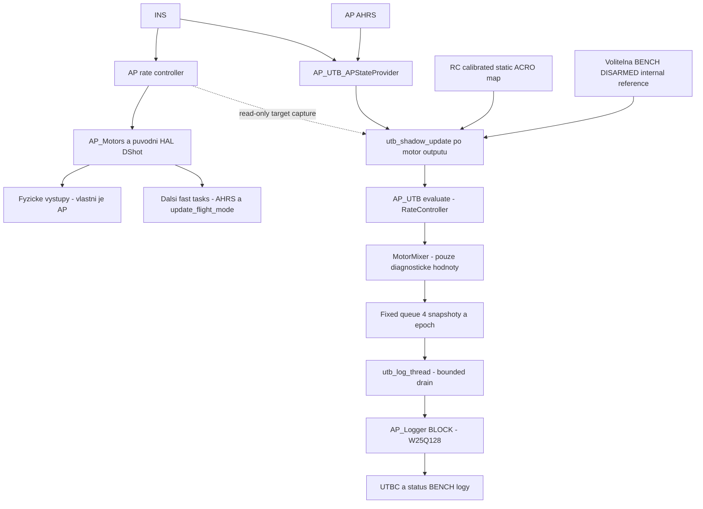
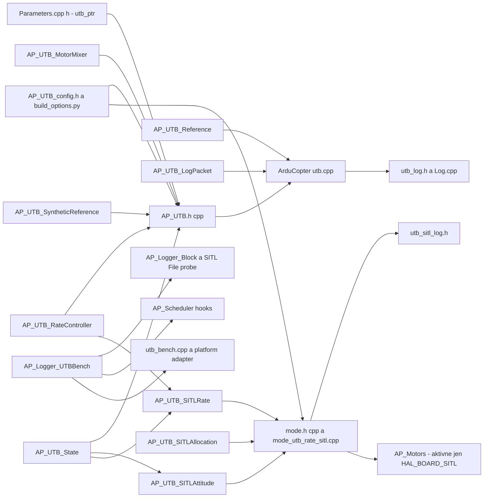
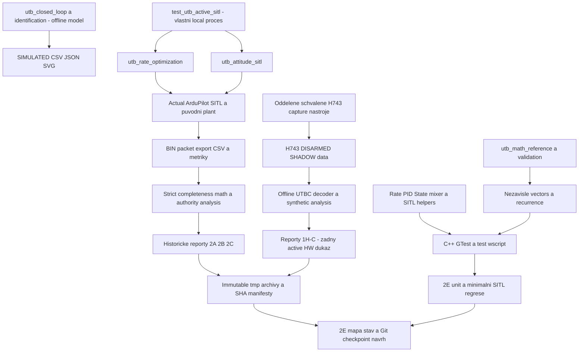

# UTB: mapa souborů, funkcí a regulačních cest

## Doplnění2I: experimentální pilotní profil

| Soubor | Úloha a vazby | Rozsah |
|---|---|---|
| [AP_UTB_PilotRates.h](../libraries/AP_UTB/AP_UTB_PilotRates.h), [.cpp](../libraries/AP_UTB/AP_UTB_PilotRates.cpp) | Pevný AP_Param profil a čistá Actual Rates mapa; G2 var_info2 index22, stávající UTB indexy zachované. | pouze aktivníSITL; žádný motorový setter |
| [utb_pilot_rates_sitl.py](../Tools/utb/tools/utb_pilot_rates_sitl.py) | SHA-vázaný DISARMED gate, stupňované rates/náklony, přechody a nativní failsafe; oddělený skriptovaný ruční throttle experiment. | pouze vlastní lokálníSITL |
| [test_utb_pilot_rates.py](../Tools/utb/tests/test_utb_pilot_rates.py) | Nezávislá fyzikální mapa, expo, doména a inverze. | Python unit |
| [actual_670_sitl.parm](../Tools/utb/profiles/actual_670_sitl.parm) | Výslovný příklad profilu, nikoli přesná kopie osobního BF nastavení nebo firmware pro FC. | pouzeSITL |

Pilotní adaptér zmrazí profil při vstupu; rozšířené helper domény jsou opt-in.
Mode41 a legacy helper defaults zůstávají původní. C++ regresní scénáře jsou
v existujících `test_utb_acro_rc.cpp` a `test_utb_sitl_rate.cpp`.
[Matematika, testy a neověřené rozsahy2I](UTB_PILOT_RATES_CS.md).

## Aktuální doplnění2H

[Společný pilotní tune](UTB_PILOT_PID_TUNING_CS.md) popisuje `UTB_P_*` banku
v [manageru](../libraries/AP_UTB/AP_UTB.cpp) a frozen snapshots v
[pilotním adaptéru](../libraries/AP_UTB/Copter/mode_utb_angle_sitl.cpp).
[Řízené experimenty](../Tools/utb/tools/utb_pilot_tuning.py) a
[analytické unit testy](../Tools/utb/tests/test_utb_pilot_tuning.py) zůstávají
oddělené od C++. Původní PID/mixer/attitude matematika a nativní AP cesty
se nemění. [Přesný manifest2H](UTB_PHASE_2H_SUMMARY_CS.md).

Audit FÁZE 2E, 16. 10. 2026; aktualizace cest 17. 10. 2026. [Rozcestník](UTB_README_CS.md) ·
[Stav](UTB_PROJECT_STATUS_CS.md) · [Git checkpoint](UTB_GIT_CONSOLIDATION_CS.md).

Rozsah je **pracovní strom** nad HEAD `5a32da404dafd19546439bf6886ab9adb831f4c0`.
Projektový baseline `36874030af9f8fd86c089ea6aed6fd5f03dff7f1` je poslední
commit před zavedením AP_UTB. Tím se do počtu UTB zásahů nemíchají starší
fork změny ani odstraněné ostatní typy vozidel. Původní inventura FÁZE 2E má **123 nových
UTB souborů** (včetně testů, konfigurace a 36 dokumentů), **22 upravených
původních source/build souborů** a dva upravené existující setup dokumenty.
Z nových souborů je **77 C++/header/Python source a testů**, 3 další build/
atributové soubory, 5 parametrických a 2 JSON datové soubory.
Metadata sidecar `README_ARDUPILOT_UTB_SETUP_BUILD_CS.md:Zone.Identifier`
existoval už před AP_UTB; není UTB source, nebyl měněn ani zahrnut do nového
staging návrhu. Strojová inventura leží v checkpointu 2E jako file-map-inventory.json.

C++ knihovna a Copter adaptéry jsou v `libraries/AP_UTB/`; Python je
oddělený pod `Tools/utb/` ([přehled](../Tools/utb/README_CS.md)).
Organizace/čitelnost je uložená v checkpointu `9824542e73bbfb193b21fd4388f74e14ba24439c`.
FÁZE 2F je nyní v commitu `671ccad97050115e87b9d8451313dd7403fc1e72`.
Číselná inventura výše a historické údaje „dosud untracked“ níže patří
původnímu auditu2E; nejsou aktuální Git status. 2G je nyní commit e9a003cb532c65c0acc54b5bd4f5930d4ce0fdd8; inventura zůstává historická.

Každý řádek níže odpovídá jednomu skutečnému souboru. `.h` deklaruje kontrakt,
`.cpp` implementuje popsanou komponentu. Údaj první commit dokládá vznik
souboru, nikoli automaticky všechny pozdější úpravy. Untracked soubory mají
původ doložený source/phase manifesty 1H-D/1H-E/2A/2B/2C, nikoli nově
rekonstruovanými commity. Žádná historie se nepřepisuje.

SOURCE = audit implementace, UNIT = unit/nezávislý matematický model,
SITL = actual ArduPilot proces, H743 = fyzický experiment v daném rozsahu,
BUILD = cross-build/compile guard, UNVERIFIED = nedoloženo. H743 SHADOW
nikdy neznamená aktivní hardware closed loop. U dokumentů a nástrojů
je ověření konkrétního experimentu vždy v příslušném reportu.

## Doplnění2G: pilotní ACRO a sdílené vstupy

| Soubor | Úloha a vazby | Rozsah |
|---|---|---|
| [AP_UTB_AcroRC.h](../libraries/AP_UTB/AP_UTB_AcroRC.h) | AP AngleRC validace → normalizované sticks × samostatné rate limity; hard caps a failsafe policy predicate. | pouze aktivníSITL, žádné motorové setters |
| [mode_utb_acro_sitl.h](../libraries/AP_UTB/Copter/mode_utb_acro_sitl.h) | Samostatný mode43 wrapper, sdílí pilotní lifecycle/adaptér; nevyžaduje předchozíANGLE. | pouze aktivníSITL |
| [mode_utb_angle_sitl.cpp](../libraries/AP_UTB/Copter/mode_utb_angle_sitl.cpp), [.h](../libraries/AP_UTB/Copter/mode_utb_angle_sitl.h) | Společné RC/throttle/rate/capture;42 volá attitude,43 přímé rates bez attitude update. | aktivníSITL, původní jedinýAP_Motors output |
| [AP_UTB.cpp](../libraries/AP_UTB/AP_UTB.cpp), [.h](../libraries/AP_UTB/AP_UTB.h) | Nové parametry index40–45, zachované staré indexy. | runtime parametry pouze aktivníSITL |
| [test_utb_acro_rc.cpp](../libraries/AP_UTB/tests/test_utb_acro_rc.cpp) | SkutečnéRC_Channel, lineární rates, guards, nulovárate při náklonu a historie. | 11novýchCpp testů |
| [utb_pilot_sitl.py](../Tools/utb/tools/utb_pilot_sitl.py) | Skutečné RC/GCS/FLTMODE, konečné scénáře a společný manuální runner. | vlastní lokálníSITL, žádný hardware endpoint |
| [test_utb_pilot_sitl.py](../Tools/utb/tests/test_utb_pilot_sitl.py) | SHA-vázaný gate, důkazy a zachování nonzero sticks při switch. | 6novýchPython testů |
| [utb_angle_sitl.py](../Tools/utb/tools/utb_angle_sitl.py) | Znovu použitý AP transport/throttle/arming a rozšířená úplná analýza42/43. | starýANGLE runner zachovaný |

Nativní integrační body2G jsou `ArduCopter/{Attitude.cpp,Copter.h,mode.h,mode.cpp,
motors.cpp,GCS_MAVLink_Copter.cpp}`. Žádné přemístění funkcí z původníhoAP;
žádná změnaAP_Motors/HAL/DShot. Úplný manifest je v
[souhrnu2G](UTB_PHASE_2G_SUMMARY_CS.md), nikoli v historických počtech2E.

## 1. AP_UTB: sdílená matematika a SITL helpery

| Soubor / symboly | Účel | Caller → závislosti / účinek | Platforma a autorita | Původ a ověření |
|---|---|---|---|---|
|[libraries/AP_UTB/AP_UTB.cpp](../libraries/AP_UTB/AP_UTB.cpp) AP_UTB::{init,evaluate,update,capture_target}, Queue::{publish,pop,read_status}|Manager SHADOW, parametry, reset, oddělená matematická/logging policy, bounded queue a epochy.|Copter::utb_shadow_update/utb_log_update → State, RateController, MotorMixer, SyntheticReference; publikuje Snapshot, motorové API nevolá|SITL/H743; SHADOW diagnostika|0/1→1H-C; parametry SITL rozšířené 2A–2C; vznik 761a38d704 SOURCE/UNIT/SITL/H743 SHADOW|
|[libraries/AP_UTB/AP_UTB.h](../libraries/AP_UTB/AP_UTB.h) AP_UTB::{init,evaluate,update,capture_target}, Queue::{publish,pop,read_status}|Manager SHADOW, parametry, reset, oddělená matematická/logging policy, bounded queue a epochy.|Copter::utb_shadow_update/utb_log_update → State, RateController, MotorMixer, SyntheticReference; publikuje Snapshot, motorové API nevolá|SITL/H743; SHADOW diagnostika|0/1→1H-C; parametry SITL rozšířené 2A–2C; vznik 761a38d704 SOURCE/UNIT/SITL/H743 SHADOW|
|[libraries/AP_UTB/AP_UTB_LogPacket.cpp](../libraries/AP_UTB/AP_UTB_LogPacket.cpp) UTBLogPacket::encode|Bezeztrátové zabalení Snapshot do UTBC payloadu.|Copter::utb_log_update → AP_UTB::Snapshot a utb_log.h; bez vlastní backend nebo output autority|SITL/H743; diagnostika|packed c97884464f; vznik c97884464f SOURCE/UNIT/SITL/H743|
|[libraries/AP_UTB/AP_UTB_LogPacket.h](../libraries/AP_UTB/AP_UTB_LogPacket.h) UTBLogPacket::encode|Bezeztrátové zabalení Snapshot do UTBC payloadu.|Copter::utb_log_update → AP_UTB::Snapshot a utb_log.h; bez vlastní backend nebo output autority|SITL/H743; diagnostika|packed c97884464f; vznik c97884464f SOURCE/UNIT/SITL/H743|
|[libraries/AP_UTB/AP_UTB_MotorMixer.cpp](../libraries/AP_UTB/AP_UTB_MotorMixer.cpp) AP_UTB_MotorMixer::{supports_frame,mix}|Diagnostická alokace class 1 BF_X=12/BF_X_REV=18, společné škálování R/P/Y a posun collective.|AP_UTB::evaluate, matematické testy → RateController command/thrust; vrací čtyři diagnostické hodnoty a achieved; není aktivní AP_Motors allocator|SITL/H743; pouze diagnostika|1, explicitní typ18 feb5b68361; vznik 761a38d704 SOURCE/UNIT/SITL/H743|
|[libraries/AP_UTB/AP_UTB_MotorMixer.h](../libraries/AP_UTB/AP_UTB_MotorMixer.h) AP_UTB_MotorMixer::{supports_frame,mix}|Diagnostická alokace class 1 BF_X=12/BF_X_REV=18, společné škálování R/P/Y a posun collective.|AP_UTB::evaluate, matematické testy → RateController command/thrust; vrací čtyři diagnostické hodnoty a achieved; není aktivní AP_Motors allocator|SITL/H743; pouze diagnostika|1, explicitní typ18 feb5b68361; vznik 761a38d704 SOURCE/UNIT/SITL/H743|
|[libraries/AP_UTB/AP_UTB_RateController.cpp](../libraries/AP_UTB/AP_UTB_RateController.cpp) AP_UTB_RateController::{configure,reset,update,feedback}, Gains::valid|Tříosý PID, IMAX, D z gyro derivace s filtrem a jednokrokový directional integration gate.|AP_UTB::evaluate a AP_UTB_SITLRate::step → State; přijímá explicitní dt a achieved feedback; vrací normalizované R/P/Y, bez motorových závislostí|SITL aktivní přes adaptér / H743 SHADOW|1→1H-B; komentář feedback kontraktu 2B; vznik 761a38d704 SOURCE/UNIT/SITL/H743 SHADOW|
|[libraries/AP_UTB/AP_UTB_RateController.h](../libraries/AP_UTB/AP_UTB_RateController.h) AP_UTB_RateController::{configure,reset,update,feedback}, Gains::valid|Tříosý PID, IMAX, D z gyro derivace s filtrem a jednokrokový directional integration gate.|AP_UTB::evaluate a AP_UTB_SITLRate::step → State; přijímá explicitní dt a achieved feedback; vrací normalizované R/P/Y, bez motorových závislostí|SITL aktivní přes adaptér / H743 SHADOW|1→1H-B; komentář feedback kontraktu 2B; vznik 761a38d704 SOURCE/UNIT/SITL/H743 SHADOW|
|[libraries/AP_UTB/AP_UTB_Reference.cpp](../libraries/AP_UTB/AP_UTB_Reference.cpp) AP_UTB_Reference::rates|AP-derived UTB shadow reference: circular roll/pitch limit a statická ACRO rate/expo mapa.|Copter::utb_shadow_update → RC calibrated norm_input_dz a AP ACRO rate/expo; bez traineru/dynamic shaping; dodává rate reference|SITL/H743; SHADOW vstup|1; vznik 8dc66c8d18 SOURCE/UNIT/SITL/H743|
|[libraries/AP_UTB/AP_UTB_Reference.h](../libraries/AP_UTB/AP_UTB_Reference.h) AP_UTB_Reference::rates|AP-derived UTB shadow reference: circular roll/pitch limit a statická ACRO rate/expo mapa.|Copter::utb_shadow_update → RC calibrated norm_input_dz a AP ACRO rate/expo; bez traineru/dynamic shaping; dodává rate reference|SITL/H743; SHADOW vstup|1; vznik 8dc66c8d18 SOURCE/UNIT/SITL/H743|
|[libraries/AP_UTB/AP_UTB_SITLAllocation.cpp](../libraries/AP_UTB/AP_UTB_SITLAllocation.cpp) AP_UTB_SITLAllocation::{Capture,Result,reconstruct}|Read-only rekonstrukce přiděleného normalized AP povelu Bᵀ(T/G), finite/linearity/sequence validace.|ModeUTBRateSITL::capture_allocation; AP_UTB_SITLRate::step → Skutečné AP_MotorsMatrix capture + kompensační gain/actuator consistency; feedback do sdíleného PID|Pouze SITL; feedback aktivnímu PID, žádný writer|2B; dosud untracked SOURCE/UNIT/SITL; H743 compile-out|
|[libraries/AP_UTB/AP_UTB_SITLAllocation.h](../libraries/AP_UTB/AP_UTB_SITLAllocation.h) AP_UTB_SITLAllocation::{Capture,Result,reconstruct}|Read-only rekonstrukce přiděleného normalized AP povelu Bᵀ(T/G), finite/linearity/sequence validace.|ModeUTBRateSITL::capture_allocation; AP_UTB_SITLRate::step → Skutečné AP_MotorsMatrix capture + kompensační gain/actuator consistency; feedback do sdíleného PID|Pouze SITL; feedback aktivnímu PID, žádný writer|2B; dosud untracked SOURCE/UNIT/SITL; H743 compile-out|
|[libraries/AP_UTB/AP_UTB_SITLAttitude.cpp](../libraries/AP_UTB/AP_UTB_SITLAttitude.cpp) AP_UTB_SITLAttitude::{configure,update,reference,reset,invalidate}|Vlastní reduced rotation P: error z RᵀRd·ez, common XY rate limiter, explicitní yaw body rate.|ModeUTBRateSITL::rate_control/run → State; vrací body rate do SITLRate; nezávisí na AP attitude controlleru, loggeru ani motorech|Pouze SITL; aktivní outer matematika|2C; dosud untracked SOURCE/UNIT/SITL; H743 compile-out|
|[libraries/AP_UTB/AP_UTB_SITLAttitude.h](../libraries/AP_UTB/AP_UTB_SITLAttitude.h) AP_UTB_SITLAttitude::{configure,update,reference,reset,invalidate}|Vlastní reduced rotation P: error z RᵀRd·ez, common XY rate limiter, explicitní yaw body rate.|ModeUTBRateSITL::rate_control/run → State; vrací body rate do SITLRate; nezávisí na AP attitude controlleru, loggeru ani motorech|Pouze SITL; aktivní outer matematika|2C; dosud untracked SOURCE/UNIT/SITL; H743 compile-out|
|[libraries/AP_UTB/AP_UTB_SITLRate.cpp](../libraries/AP_UTB/AP_UTB_SITLRate.cpp) AP_UTB_SITLRate::{configure,step,transport,reference,reset,invalidate}|SITL rate adaptér: frozen config, čerstvost/IMU/frame/dt/envelope guard, fault latch, delay a konečné reference.|ModeUTBRateSITL::rate_control/run → RateController, State, SITLAllocation::Result; volitelný ověřený feedback; vrací povel adaptérům, sám motorové setters nevolá|Pouze SITL; součást aktivního řízení|2A, allocation/AW 2B; nové faults 2C; dosud untracked SOURCE/UNIT/SITL; H743 compile-out|
|[libraries/AP_UTB/AP_UTB_SITLRate.h](../libraries/AP_UTB/AP_UTB_SITLRate.h) AP_UTB_SITLRate::{configure,step,transport,reference,reset,invalidate}|SITL rate adaptér: frozen config, čerstvost/IMU/frame/dt/envelope guard, fault latch, delay a konečné reference.|ModeUTBRateSITL::rate_control/run → RateController, State, SITLAllocation::Result; volitelný ověřený feedback; vrací povel adaptérům, sám motorové setters nevolá|Pouze SITL; součást aktivního řízení|2A, allocation/AW 2B; nové faults 2C; dosud untracked SOURCE/UNIT/SITL; H743 compile-out|
|[libraries/AP_UTB/AP_UTB_State.cpp](../libraries/AP_UTB/AP_UTB_State.cpp) AP_UTB_State::valid, AP_UTB_APStateProvider::sample|Read-only stav FRD→NED, primární gyro, health a stáří obou monotónních časů.|AP_UTB::sample_state a aktivní SITL adaptér → AP_AHRS_View a INS; dodává quaternion/rates/čas, bez EKF nebo output writeru|SITL/H743; vstup|0/1; oprava post-sampling času 40b47c8d30; vznik 761a38d704 SOURCE/UNIT/SITL/H743|
|[libraries/AP_UTB/AP_UTB_State.h](../libraries/AP_UTB/AP_UTB_State.h) AP_UTB_State::valid, AP_UTB_APStateProvider::sample|Read-only stav FRD→NED, primární gyro, health a stáří obou monotónních časů.|AP_UTB::sample_state a aktivní SITL adaptér → AP_AHRS_View a INS; dodává quaternion/rates/čas, bez EKF nebo output writeru|SITL/H743; vstup|0/1; oprava post-sampling času 40b47c8d30; vznik 761a38d704 SOURCE/UNIT/SITL/H743|
|[libraries/AP_UTB/AP_UTB_SyntheticReference.cpp](../libraries/AP_UTB/AP_UTB_SyntheticReference.cpp) AP_UTB_SyntheticReference::{update,signal,phase,abort}|Konečný DISARMED no-RC diagnostický generátor s eligibility, PREROLL/RUNNING/COMPLETE/ABORTED.|AP_UTB::prepare_synthetic → AP_UTB bench eligibility; reference metadata, žádné změny senzorů nebo RC health|SITL/H743; pouze BENCH SHADOW|1H-C f9cc3bcc0f; vznik f9cc3bcc0f SOURCE/UNIT/SITL/H743 profil1|
|[libraries/AP_UTB/AP_UTB_SyntheticReference.h](../libraries/AP_UTB/AP_UTB_SyntheticReference.h) AP_UTB_SyntheticReference::{update,signal,phase,abort}|Konečný DISARMED no-RC diagnostický generátor s eligibility, PREROLL/RUNNING/COMPLETE/ABORTED.|AP_UTB::prepare_synthetic → AP_UTB bench eligibility; reference metadata, žádné změny senzorů nebo RC health|SITL/H743; pouze BENCH SHADOW|1H-C f9cc3bcc0f; vznik f9cc3bcc0f SOURCE/UNIT/SITL/H743 profil1|
|[libraries/AP_UTB/AP_UTB_config.h](../libraries/AP_UTB/AP_UTB_config.h) AP_UTB_ENABLED, AP_UTB_RATE_SITL_ENABLED, AP_UTB_RATE_SITL_AVAILABLE|Default OFF a centrální platformový guard.|AP_UTB a ArduCopter includes/registrace → Build defines; AVAILABLE vyžaduje skutečný HAL_BOARD_SITL; BENCH default žije v AP_Logger_UTBBench.h|SITL/H743; compile-time autorita|0→2A; vznik 761a38d704 SOURCE/BUILD, runtime absence SITL|

## 2. Copter integrace

| Soubor / symboly | Účel | Caller → závislosti / účinek | Platforma a autorita | Původ a ověření |
|---|---|---|---|---|
|[ArduCopter/AP_Arming_Copter.cpp](../ArduCopter/AP_Arming_Copter.cpp) AP_Arming_Copter::mandatory_checks|Trvalý zákaz armingu mode40 také při force-arm.|Původní AP arming → ModeUTBAcro/Mode::Number; nerozvolňuje původní kontroly|Obě; bezpečnost|0/1; vznik a073941b2c SOURCE/SITL|
|[ArduCopter/Attitude.cpp](../ArduCopter/Attitude.cpp) Copter::run_rate_controller_main|Výhradní výběr rate controlleru; mode41 dostává jeden rate slot, jinak původní AP; SHADOW read-only target capture.|Copter fast_tasks → ModeUTBRateSITL::rate_control / AP attitude_control; AP_UTB::capture_target|SITL aktivní; H743 capture|1→2A; vznik 356ece3402 SOURCE/SITL/BUILD|
|[ArduCopter/Copter.cpp](../ArduCopter/Copter.cpp) Copter::scheduler_tasks|Pořadí FAST_TASK a SHADOW slot po motors_output_main.|AP_Scheduler → utb_shadow_update; pozdější update_flight_mode a AHRS update|Obě; integrace|1; vznik 278883c521 SOURCE/SITL/H743|
|[ArduCopter/Copter.h](../ArduCopter/Copter.h) Copter, mode_utb_acro, mode_utb_rate_sitl|Instances/providers/friends a guardované deklarace integrace, rate-thread/custom control omezení mode41.|Copter implementace → AP_UTB, State a SITL helper includes; původní controller/motors|Obě; aktivní členy pouze SITL|0→2C; vznik 278883c521 SOURCE/BUILD/SITL|
|[ArduCopter/GCS_MAVLink_Copter.cpp](../ArduCopter/GCS_MAVLink_Copter.cpp) GCS_MAVLINK_Copter::send_available_mode|Zpřístupnění povolených UTB módů v GCS mode seznamu.|GCS available mode protokol → ModeUTBAcro / guardovaný mode seznam|Obě; registrace|0/1; vznik c74b0757a4 SOURCE/SITL|
|[ArduCopter/Log.cpp](../ArduCopter/Log.cpp) Copter::log_structure|Registrace guardovaných DataFlash UTB struktur a metadat.|Původní AP_Logger inicializace → utb_log.h, utb_bench_log.h, utb_sitl_log.h|Obě; diagnostika; UAR* pouze SITL|1→2C; vznik 356ece3402 SOURCE/BUILD/SITL/H743 SHADOW|
|[ArduCopter/Parameters.cpp](../ArduCopter/Parameters.cpp) ParametersG2::var_info|UTB AP_Param skupina UTB_ v ParametersG2.|AP_Param → AP_UTB::var_info; zachované indexy|Obě; konfigurace|0/1; vznik 356ece3402 SOURCE/SITL/H743|
|[ArduCopter/Parameters.h](../ArduCopter/Parameters.h) ParametersG2::utb_ptr|AP_Param pointer na Copter::utb v ParametersG2.|Copter a AP_Param → AP_UTB.h; compile guard|Obě; konfigurace|0/1; vznik 1456a2a912 SOURCE/BUILD|
|[ArduCopter/defines.h](../ArduCopter/defines.h) LOG_UTBS_MSG … LOG_UTBC_MSG; LOG_UARX_MSG … LOG_UAST_MSG|Vehicle log IDs před společným namespace32.|Log.cpp / packet headers → UTB IDs a feature guards; bez motorového vlivu|Obě; SITL IDs24–29 guardované|1→2C; vznik 1456a2a912 SOURCE/BUILD/SITL/H743 SHADOW|
|[ArduCopter/mode.cpp](../ArduCopter/mode.cpp) Copter::mode_from_mode_num, Copter::get_available_mode_enabled_mask|Lookup/registrace UTB módů v původním mode mechanismu.|GCS/set_mode → ModeUTBAcro40 a guardovaný ModeUTBRateSITL41|Obě; mode41 jen SITL|0→2A; vznik 7504237fbb SOURCE/SITL|
|[ArduCopter/mode.h](../ArduCopter/mode.h) ModeUTBAcro, ModeUTBRateSITL, Mode::Number|Deklarace mode40/41, guards, allows_arming a pevný stav aktivního experimentu.|Copter/mode.cpp a implementace módů → AP_UTB helpery; žádná samostatná výstupní implementace|Obě; mode41 pouze SITL|0→2C; vznik c3fbf2671c SOURCE/BUILD/SITL|
|[libraries/AP_UTB/Copter/mode_utb_acro.cpp](../libraries/AP_UTB/Copter/mode_utb_acro.cpp) ModeUTBAcro::{enabled,init,run}|Neaktivní DISARMED skeleton; init vyžaduje SHUT_DOWN, run pouze update_state.|Původní mode dispatch → AP_UTB::update_state; žádný motor setter|Obě; bez autority|0; vznik 761a38d704 SOURCE/SITL|
|[libraries/AP_UTB/Copter/mode_utb_rate_sitl.cpp](../libraries/AP_UTB/Copter/mode_utb_rate_sitl.cpp) ModeUTBRateSITL::{init,run,rate_control,zero_rpy,capture_allocation,log_cycle,exit}|Aktivní mode41: vlastní/AP control selection, frozen config, reference, throttle/envelope, fault-stop a post-output capture/log.|Attitude.cpp, motors.cpp, update_flight_mode → SITLAttitude→SITLRate→AP_Motors setters; SITLAllocation; utb_sitl_log.h|Pouze SITL; JEDINÝ UTB adaptér s aktivní autoritou|2A→2B→2C; dosud untracked SOURCE/UNIT helpers/SITL/BUILD absent H743|
|[ArduCopter/motors.cpp](../ArduCopter/motors.cpp) Copter::motors_output_main|Jeden post-output capture/log hook pro mode41.|Copter fast_tasks → ModeUTBRateSITL::log_cycle; nepřidává další motors output|Pouze aktivní hook SITL|2A/2B; vznik 356ece3402 SOURCE/SITL/BUILD H743 absent|
|[ArduCopter/system.cpp](../ArduCopter/system.cpp) Copter::init_ardupilot|Startup provideru a threadů mimo fast path.|Vehicle startup → utb.init, utb_log_init, utb_bench_init/config|Obě; lifecycle|0→1H-A; vznik 356ece3402 SOURCE/SITL/H743|
|[libraries/AP_UTB/Copter/utb.cpp](../libraries/AP_UTB/Copter/utb.cpp) Copter::{utb_shadow_update,utb_log_init,utb_log_thread,utb_log_update,utb_status_update}|Main SHADOW producer, worker lifecycle a bounded logger drain, pomalý status.|FAST_TASK, startup, logger worker → AP_UTB, Reference, LogPacket; AP_Logger pouze worker; žádné motorové setters|Obě; pouze diagnostika|1→packed→1H-C; vznik 8dc66c8d18 SOURCE/SITL/H743|
|[libraries/AP_UTB/Copter/utb_bench.cpp](../libraries/AP_UTB/Copter/utb_bench.cpp) Copter::{utb_bench_init,utb_bench_config,utb_bench_thread}, bench_telemetry|Samostatný benchmark exporter, bounded telemetry a souhrny metrik.|Startup a BENCH thread → UTBBench, AP_UTB::pipeline; WriteBlock v exporteru, trylock GCS|Obě; BENCH diagnostika|1H-A; vznik 8dc66c8d18 SOURCE/SITL/H743|
|[libraries/AP_UTB/Copter/utb_bench_log.h](../libraries/AP_UTB/Copter/utb_bench_log.h) log_UBMT, log_UBHI, log_UBST, log_UBEP, log_UTBX|UBMT/UBHI/UBST/UBEP/UTBX fixed diagnostické struktury.|Log.cpp, utb_bench.cpp, utb.cpp → UTBBench metriky/reference source metadata|Obě; BENCH diagnostika|1H-A→1H-C; vznik 8dc66c8d18 SOURCE/BUILD/SITL/H743|
|[libraries/AP_UTB/Copter/utb_bench_platform.cpp](../libraries/AP_UTB/Copter/utb_bench_platform.cpp) utb_bench_platform_init, utb_bench_stack, bench_identity|Oddělené platform identity a stack watermark adaptéry.|utb_bench.cpp / utb_log_thread → ChibiOS chThdGetSelfX/stack_free, SITL pthread_self; UTBBench|Obě; stack měření jen ChibiOS|1H-A; vznik 8dc66c8d18 SOURCE/BUILD/H743 stack|
|[libraries/AP_UTB/Copter/utb_log.h](../libraries/AP_UTB/Copter/utb_log.h) log_UTBS/UTBR/UTBM/UTBA/UTBT/UTBQ/UTBC|Legacy a packed SHADOW log struktury/metadata.|Log.cpp, utb.cpp → Snapshot a LogPacket encode; UTBC242B/ID31|Obě; diagnostika|1→packed; vznik 8dc66c8d18 SOURCE/BUILD/SITL/H743|
|[libraries/AP_UTB/Copter/utb_sitl_log.h](../libraries/AP_UTB/Copter/utb_sitl_log.h) log_UARX/UAMT/UAFB/UALT/UAAT/UAST|Fixed active packets a AP/UTB/motor provenance.|ModeUTBRateSITL::log_cycle, Log.cpp → SITL controller/capture výsledky; 503B/cyklus při attitude|Pouze SITL; diagnostika aktivního řízení|2A→2C; dosud untracked SOURCE/BUILD/SITL|
|[ArduCopter/wscript](../ArduCopter/wscript) build(bld)|AP_UTB knihovna pro Copter build.|Waf → AP_UTB a původní AP knihovny|Obě; build|0; vznik 6e7b73610d BUILD|

## 3. Logger, scheduler a build integrace

| Soubor / symboly | Účel | Caller → závislosti / účinek | Platforma a autorita | Původ a ověření |
|---|---|---|---|---|
|[Tools/scripts/build_options.py](../Tools/scripts/build_options.py) BUILD_OPTIONS|UTB/UTB_BENCH/UTB_RATE_SITL build options, default OFF a dependencies.|Waf configure → AP_UTB_ENABLED / AP_UTB_BENCH_ENABLED / AP_UTB_RATE_SITL_ENABLED|Obě; build|0→2A; vznik 50942b2df7 SOURCE/BUILD|
|[libraries/AP_Logger/AP_Logger_Block.cpp](../libraries/AP_Logger/AP_Logger_Block.cpp) AP_Logger_Block::WritePrioritisedBlock|Probe místo původního acquire/release ve stejném write_sem pořadí.|AP_Logger frontend / UTB worker → UTBBench::MutexProbe; reálný BLOCK backend H743|Obě; diagnostika backendu|1H-A; vznik e3c9f10e91 SOURCE/BUILD/H743|
|[libraries/AP_Logger/AP_Logger_Block.h](../libraries/AP_Logger/AP_Logger_Block.h) AP_Logger_Block::_bench_mutex|Guardovaný MutexState člen BLOCK backendu.|AP_Logger_Block.cpp → UTBBench; bez změny policy zápisu|Obě; diagnostika|1H-A; vznik e3c9f10e91 SOURCE/BUILD|
|[libraries/AP_Logger/AP_Logger_File.cpp](../libraries/AP_Logger/AP_Logger_File.cpp) AP_Logger_File::WritePrioritisedBlock|SITL-only timing probe filesystem backendu.|AP_Logger frontend → UTBBench::MutexProbe; H743 cíl tento FILE backend nepoužívá|Jen SITL probe; diagnostika|1H-A; vznik 6a59dd04a7 SOURCE/BUILD/SITL|
|[libraries/AP_Logger/AP_Logger_File.h](../libraries/AP_Logger/AP_Logger_File.h) AP_Logger_File::_bench_mutex|SITL-only MutexState pro FILE timing.|AP_Logger_File.cpp → UTBBench a compile guard|Jen SITL probe|1H-A; vznik 6a59dd04a7 SOURCE/BUILD|
|[libraries/AP_Logger/AP_Logger_UTBBench.cpp](../libraries/AP_Logger/AP_Logger_UTBBench.cpp) UTBBench::{Stats,MutexProbe,Interval,loop,task_overrun}|Fixed lock-free stats/identity/interval atribuce a mutex timing.|Logger backend probe, scheduler, UTB producer/consumer/exporter → AP_HAL monotónní čas; MAIN/UTB_WORKER/OTHER/UNKNOWN; logger nevolá pod měřeným mutexem|Obě; BENCH diagnostika|1H-A; vznik 8dc66c8d18 SOURCE/UNIT/SITL/H743|
|[libraries/AP_Logger/AP_Logger_UTBBench.h](../libraries/AP_Logger/AP_Logger_UTBBench.h) UTBBench::{Stats,Frame,Interval,MutexState,Duration,MutexProbe}|BENCH default0, typy a fixed atomic API pro instrumentaci.|AP_Logger backendy, AP_Scheduler, ArduCopter → AP_HAL, atomics; lock-free static_assert|Obě; compile-out při OFF|1H-A; vznik 8dc66c8d18 SOURCE/UNIT/BUILD|
|[libraries/AP_Logger/AP_Logger_config.h](../libraries/AP_Logger/AP_Logger_config.h) AP_UTB_BENCH_ENABLED|Propagace nezávislého BENCH define do logger buildu.|Logger kompilace → Build defines; default0|Obě; build|1H-A; vznik 6524bf3729 SOURCE/BUILD|
|[libraries/AP_Motors/AP_MotorsMatrix.cpp](../libraries/AP_Motors/AP_MotorsMatrix.cpp) AP_MotorsMatrix::{get_thrust_rpyt_out,get_factors}|Pouze SITL dostupnost dvou původních read-only getterů; output/allocator těla nezměněna.|ModeUTBRateSITL::capture_allocation → Původní AP_Motors hodnoty → SITLAllocation; žádná UTB změna alokace|SITL read-only změna; H743 beze změny|2B; vznik b71877366e SOURCE/UNIT/SITL/BUILD|
|[libraries/AP_Scheduler/AP_Scheduler.cpp](../libraries/AP_Scheduler/AP_Scheduler.cpp) AP_Scheduler::{run,loop}; UTBBench::{task_overrun,loop}|BENCH loop period a task budget overrun hook.|Původní scheduler → UTBBench; [8] task budget, [9] period>nominal; PM.NLon odděleně|Obě; diagnostika|1H-A; vznik 7ddadcf34e SOURCE/SITL/H743|

## 4. C++ unit testy a jejich build

| Soubor / symboly | Účel | Caller → závislosti / účinek | Platforma a autorita | Původ a ověření |
|---|---|---|---|---|
|[libraries/AP_Logger/tests/test_utb_bench.cpp](../libraries/AP_Logger/tests/test_utb_bench.cpp) UTBBench|Analytické/lifecycle regrese příslušné komponenty; 12 deklarovaných TEST případů.|GTest executable test_utb_bench → Stejnojmenná UTB komponenta, případně AP_Motors read-only probe|Host; unit bez hardware autority|1/1H-A; vznik 8dc66c8d18 UNIT; rozsah nového běhu viz audit2E|
|[libraries/AP_Logger/tests/wscript](../libraries/AP_Logger/tests/wscript) build(bld)|Registrace test targets dané knihovny.|Waf --targets / unit build → AP_UTB nebo AP_Logger test sources; původní GTest|Host test; bez fyzické autority|1/1H-A; vznik 8dc66c8d18 BUILD|
|[libraries/AP_UTB/tests/test_utb.cpp](../libraries/AP_UTB/tests/test_utb.cpp) UTBLogSelection, UTBLogPacket, UTBState, UTBSkeleton, UTBRate, UTBMixer, UTBReference, UTBHealth, UTBQueue, UTBSourceConvention|Analytické/lifecycle regrese příslušné komponenty; 47 deklarovaných TEST případů.|GTest executable test_utb → Stejnojmenná UTB komponenta, případně AP_Motors read-only probe|Host; unit bez hardware autority|0; pozdější rozšíření podle phase reportů; vznik 761a38d704 UNIT; rozsah nového běhu viz audit2E|
|[libraries/AP_UTB/tests/test_utb_ap_allocation.cpp](../libraries/AP_UTB/tests/test_utb_ap_allocation.cpp) UTBAPAllocation|Analytické/lifecycle regrese příslušné komponenty; 9 deklarovaných TEST případů.|GTest executable test_utb_ap_allocation → Stejnojmenná UTB komponenta, případně AP_Motors read-only probe|Host; unit bez hardware autority|2B; dosud untracked UNIT; rozsah nového běhu viz audit2E|
|[libraries/AP_UTB/tests/test_utb_math.cpp](../libraries/AP_UTB/tests/test_utb_math.cpp) UTBMath|Analytické/lifecycle regrese příslušné komponenty; 4 deklarovaných TEST případů.|GTest executable test_utb_math → Stejnojmenná UTB komponenta, případně AP_Motors read-only probe|Host; unit bez hardware autority|1H-B; vznik adb02b6ddb UNIT; rozsah nového běhu viz audit2E|
|[libraries/AP_UTB/tests/test_utb_sitl_attitude.cpp](../libraries/AP_UTB/tests/test_utb_sitl_attitude.cpp) UTBAttitude|Analytické/lifecycle regrese příslušné komponenty; 14 deklarovaných TEST případů.|GTest executable test_utb_sitl_attitude → Stejnojmenná UTB komponenta, případně AP_Motors read-only probe|Host; unit bez hardware autority|2C; dosud untracked UNIT; rozsah nového běhu viz audit2E|
|[libraries/AP_UTB/tests/test_utb_sitl_rate.cpp](../libraries/AP_UTB/tests/test_utb_sitl_rate.cpp) UTBSITL|Analytické/lifecycle regrese příslušné komponenty; 9 deklarovaných TEST případů.|GTest executable test_utb_sitl_rate → Stejnojmenná UTB komponenta, případně AP_Motors read-only probe|Host; unit bez hardware autority|2A; rozšíření 2B/2C; dosud untracked UNIT; rozsah nového běhu viz audit2E|
|[libraries/AP_UTB/tests/test_utb_synthetic.cpp](../libraries/AP_UTB/tests/test_utb_synthetic.cpp) UTBSynthetic|Analytické/lifecycle regrese příslušné komponenty; 4 deklarovaných TEST případů.|GTest executable test_utb_synthetic → Stejnojmenná UTB komponenta, případně AP_Motors read-only probe|Host; unit bez hardware autority|1H-C software; vznik f9cc3bcc0f UNIT; rozsah nového běhu viz audit2E|
|[libraries/AP_UTB/tests/wscript](../libraries/AP_UTB/tests/wscript) build(bld)|Registrace test targets dané knihovny.|Waf --targets / unit build → AP_UTB nebo AP_Logger test sources; původní GTest|Host test; bez fyzické autority|0; pozdější rozšíření podle phase reportů; vznik 761a38d704 BUILD|

## 5. Python unit testy

| Soubor / symboly | Účel | Caller → závislosti / účinek | Platforma a autorita | Původ a ověření |
|---|---|---|---|---|
|[Tools/utb/tests/test_utb_active_sitl_analysis.py](../Tools/utb/tests/test_utb_active_sitl_analysis.py) rows, MeasurementTest|Unit regrese: Measurement definitions reject misleading or incomplete actual SITL evidence.|unittest discover → utb_active_sitl_analysis; výsledky ukládá do explicitního output adresáře|Host; bez motorové autority|2A; rozšíření 2B/2C; dosud untracked UNIT|
|[Tools/utb/tests/test_utb_attitude_sitl.py](../Tools/utb/tests/test_utb_attitude_sitl.py) AttitudeEvidence|Unit regrese: Independent checks of exported angle metrics and evidence rejection.|unittest discover → utb_attitude_sitl; výsledky ukládá do explicitního output adresáře|Host; bez motorové autority|2C; dosud untracked UNIT|
|[Tools/utb/tests/test_utb_download_experiment.py](../Tools/utb/tests/test_utb_download_experiment.py) plan, MockClock, Peer, DownloadExperimentTests|Unit regrese: 1H-E experiment tests exclusively with a mock peer/clock or archived files.|utb_1he_offline.py → utb_download_experiment; výsledky ukládá do explicitního output adresáře|Host; bez motorové autority|1H-E; dosud untracked UNIT|
|[Tools/utb/tests/test_utb_hardware_capture.py](../Tools/utb/tests/test_utb_hardware_capture.py) healthy_monitor, CaptureTest|Unit regrese: Hardware capture stop conditions and complete telemetry frame regressions.|unittest discover → utb_hardware_capture; výsledky ukládá do explicitního output adresáře|Host; bez motorové autority|packed H743 capture; vznik d325c44390 UNIT|
|[Tools/utb/tests/test_utb_log_decode.py](../Tools/utb/tests/test_utb_log_decode.py) packet, PackedLogTest|Unit regrese: Wire-format and completeness regressions independent of a running vehicle.|unittest discover → utb_log_decode, utb_bench_analysis; výsledky ukládá do explicitního output adresáře|Host; bez motorové autority|packed transport; vznik c97884464f UNIT|
|[Tools/utb/tests/test_utb_math_reference.py](../Tools/utb/tests/test_utb_math_reference.py) row, AnalyticalReference|Unit regrese: Analytical checks of the independent model, separate from C++ comparison.|unittest discover → utb_math_reference; výsledky ukládá do explicitního output adresáře|Host; bez motorové autority|1H-B; vznik adb02b6ddb UNIT|
|[Tools/utb/tests/test_utb_offline.py](../Tools/utb/tests/test_utb_offline.py) TransferTests, PlantTests, LoopTests, ArchiveRegressionTests|Unit regrese: Offline model/transfer tests; no connections, simulator vehicle or firmware writes.|unittest discover → utb_closed_loop, utb_download_audit, utb_math_reference; výsledky ukládá do explicitního output adresáře|Host; bez motorové autority|1H-D; dosud untracked UNIT|
|[Tools/utb/tests/test_utb_plant_identification.py](../Tools/utb/tests/test_utb_plant_identification.py) dataset, IdentificationTests, CalibrationTests|Unit regrese: 1H-E physical model/measurement tests; every dataset is demonstrative.|unittest discover → utb_closed_loop, utb_plant_identification, utb_plant_sensitivity; výsledky ukládá do explicitního output adresáře|Host; bez motorové autority|1H-E; dosud untracked UNIT|
|[Tools/utb/tests/test_utb_rate_optimization.py](../Tools/utb/tests/test_utb_rate_optimization.py) TuningEvidence|Unit regrese: Reject misleading tuning scores and incomplete allocator evidence.|unittest discover → utb_rate_optimization; výsledky ukládá do explicitního output adresáře|Host; bez motorové autority|2B; dosud untracked UNIT|
|[Tools/utb/tests/test_utb_synthetic_decoder.py](../Tools/utb/tests/test_utb_synthetic_decoder.py) SourceAttribution|Unit regrese: Source attribution must stop at explicit terminal metadata, not extrapolate through faults.|unittest discover → test_utb_synthetic_reference; výsledky ukládá do explicitního output adresáře|Host; bez motorové autority|1H-C software; vznik f9cc3bcc0f UNIT|
|[Tools/utb/tests/test_utb_synthetic_hardware_capture.py](../Tools/utb/tests/test_utb_synthetic_hardware_capture.py) SyntheticHardwareGuards|Unit regrese: Pure host guards; no serial connection or physical commands.|unittest discover → utb_synthetic_hardware_capture, utb_hardware_capture; výsledky ukládá do explicitního output adresáře|Host; bez motorové autority|1H-C hardware; vznik 687f825d22 UNIT|

## 6. SITL a konfigurační testy

| Soubor / symboly | Účel | Caller → závislosti / účinek | Platforma a autorita | Původ a ověření |
|---|---|---|---|---|
|[Tools/utb/tools/test_utb_active_sitl.py](../Tools/utb/tools/test_utb_active_sitl.py) ActiveSITL, read_packets, json_safe, launch, basic, analyse_basic, guards|Vlastní izolovaný ArduPilot SITL proces, DISARMED/guards/absence/flight; sdílený runner 2A–2C.|utb_attitude_sitl.py, utb_rate_optimization.py → test_utb_shadow, utb_active_sitl_analysis; výsledky ukládá do explicitního output adresáře|Lokální SITL; řízení simulátoru|2A; rozšíření 2B/2C; dosud untracked SITL|
|[Tools/utb/tools/test_utb_bench.py](../Tools/utb/tools/test_utb_bench.py) collect, scenario, analysis_regression, main|BENCH metriky, thread failure a functional SITL regrese; nikoli H743 timing.|CLI main / dokumentované reprodukce → test_utb_skeleton, utb_bench_analysis; výsledky ukládá do explicitního output adresáře|Lokální SITL; řízení simulátoru|1/1H-A; vznik 8dc66c8d18 SITL|
|[Tools/utb/tools/test_utb_bfx_rev.py](../Tools/utb/tools/test_utb_bfx_rev.py) check_math, main|Explicitní typ18 geometrie/epochs a lokální SITL guard regrese.|CLI main / dokumentované reprodukce → test_utb_shadow; výsledky ukládá do explicitního output adresáře|Lokální SITL; řízení simulátoru|BF_X_REV/config regrese; vznik feb5b68361 SITL|
|[Tools/utb/tools/test_utb_math_sitl.py](../Tools/utb/tools/test_utb_math_sitl.py) packet_roundtrip, verify_recurrence, analyse, exercise, main|Nenulový PID a recurrence na skutečných lokálních SITL datech.|test_utb_synthetic_reference.py, utb_math_log_analysis.py, utb_synthetic_log_analysis.py → test_utb_shadow, utb_log_decode, utb_math_reference; výsledky ukládá do explicitního output adresáře|Lokální SITL; řízení simulátoru|1H-B; vznik adb02b6ddb SITL|
|[Tools/utb/tools/test_utb_profiles.py](../Tools/utb/tools/test_utb_profiles.py) read_params, main|Offline kontrola verzovaných Skystars overlays bez transportu.|CLI main / dokumentované reprodukce → Standardní knihovna / pymavlink podle source; výsledky ukládá do explicitního output adresáře|Host offline|BF_X_REV/config regrese; vznik feb5b68361 UNIT|
|[Tools/utb/tools/test_utb_shadow.py](../Tools/utb/tools/test_utb_shadow.py) ShadowSITL, read_logs, launch, exercise, assemble_sets, analyse, systemid|SHADOW rate/reference/state/FSTRATE/primary gyro a systémová izolace v lokálním SITL.|test_utb_bfx_rev.py, test_utb_math_sitl.py, test_utb_synthetic_reference.py, test_utb_active_sitl.py → test_utb_skeleton, utb_log_decode; výsledky ukládá do explicitního output adresáře|Lokální SITL; řízení simulátoru|1/1H-A; vznik 8dc66c8d18 SITL|
|[Tools/utb/tools/test_utb_skeleton.py](../Tools/utb/tools/test_utb_skeleton.py) SITL, run_case, main|FÁZE 0 enable/disable/mode40/arming izolace; historický runner.|test_utb_bench.py, test_utb_shadow.py → Standardní knihovna / pymavlink podle source; výsledky ukládá do explicitního output adresáře|Lokální SITL; řízení simulátoru|0; pozdější rozšíření podle phase reportů; vznik 761a38d704 SITL|
|[Tools/utb/tools/test_utb_synthetic_reference.py](../Tools/utb/tools/test_utb_synthetic_reference.py) reference, check_signals, measurement_vectors, NoRC, read_log, exercise, identity|No-RC SITL generátor, signály, terminální stavy a izolace.|test_utb_synthetic_decoder.py, utb_synthetic_log_analysis.py → test_utb_math_sitl, test_utb_shadow, utb_math_reference, utb_math_validation; výsledky ukládá do explicitního output adresáře|Lokální SITL; řízení simulátoru|1H-C software; vznik f9cc3bcc0f SITL|

## 7. Offline analýza, modely a explicitní hardware nástroje

| Soubor / symboly | Účel | Caller → závislosti / účinek | Platforma a autorita | Původ a ověření |
|---|---|---|---|---|
|[Tools/utb/tools/utb_1he_offline.py](../Tools/utb/tools/utb_1he_offline.py) write_json, prepare_plans, pendulum_demo, run, main|Reprodukce 1H-E plánů, mock timelines, archivního replay a demonstračního kyvadla.|CLI main / dokumentované reprodukce → utb_download_experiment, utb_plant_identification, test_utb_download_experiment; výsledky ukládá do explicitního output adresáře|Host; bez motorové autority|1H-E; dosud untracked SOURCE/UNIT; evidence konkrétního runneru v reportech|
|[Tools/utb/tools/utb_active_sitl_analysis.py](../Tools/utb/tools/utb_active_sitl_analysis.py) load_rows, check_rows, alignment, step_metrics, plateaus, metrics, motor_provenance|Offline strict actual SITL log completeness, časové zarovnání, step/IAE a grafy.|test_utb_active_sitl.py, test_utb_active_sitl_analysis.py, utb_rate_optimization.py → utb_closed_loop_plots; výsledky ukládá do explicitního output adresáře|Host; bez motorové autority|2A; rozšíření 2B/2C; dosud untracked SOURCE/UNIT; evidence konkrétního runneru v reportech|
|[Tools/utb/tools/utb_attitude_sitl.py](../Tools/utb/tools/utb_attitude_sitl.py) parameters, read_parameter, disarmed, analyse_disarmed, attitude_flight, angle_metrics, analyse|Konečné attitude flights, gain sweep/repeats/AP porovnání/robust cases a strict angle metrics.|test_utb_attitude_sitl.py → test_utb_active_sitl, utb_rate_optimization; výsledky ukládá do explicitního output adresáře|Lokální SITL; aktivní experiment|2C; dosud untracked UNIT/SITL|
|[Tools/utb/tools/utb_bench_analysis.py](../Tools/utb/tools/utb_bench_analysis.py) analyse, main|Offline complete sets/persisted-rate analýza skutečně stažených BIN.|test_utb_bench.py, test_utb_log_decode.py → utb_log_decode; výsledky ukládá do explicitního output adresáře|Host; bez motorové autority|1/1H-A; vznik 8dc66c8d18 SOURCE/UNIT; evidence konkrétního runneru v reportech|
|[Tools/utb/tools/utb_closed_loop.py](../Tools/utb/tools/utb_closed_loop.py) Model, determinant3, validate_tensor, inverse3, validate_curves, interpolate_curve, validate_gains|Offline rotační plant a PID/mixer model; SIMULATED, není actual ArduPilot SITL.|test_utb_offline.py, test_utb_plant_identification.py, utb_active_sitl_analysis.py, utb_plant_identification.py, utb_plant_plots.py → utb_math_reference, utb_math_validation; výsledky ukládá do explicitního output adresáře|Host; bez motorové autority|1H-D; dosud untracked SOURCE/UNIT; evidence konkrétního runneru v reportech|
|[Tools/utb/tools/utb_closed_loop_plots.py](../Tools/utb/tools/utb_closed_loop_plots.py) figure, main|Vykreslení všech offline model samples do vědeckých SVG.|utb_active_sitl_analysis.py, utb_plant_plots.py → Standardní knihovna / pymavlink podle source; výsledky ukládá do explicitního output adresáře|Host; bez motorové autority|1H-D; dosud untracked SOURCE/UNIT; evidence konkrétního runneru v reportech|
|[Tools/utb/tools/utb_closed_loop_replay.py](../Tools/utb/tools/utb_closed_loop_replay.py) parse_vectors, replay, main|Replay offline model vstupů proti skutečnému C++ test runneru.|CLI main / dokumentované reprodukce → utb_math_reference, utb_math_validation; výsledky ukládá do explicitního output adresáře|Host; bez motorové autority|1H-D; dosud untracked SOURCE/UNIT; evidence konkrétního runneru v reportech|
|[Tools/utb/tools/utb_download_audit.py](../Tools/utb/tools/utb_download_audit.py) utc, changes, TransferPlan, parse_tlog, parse_bin, audit, main|Offline tlog/BIN timeline a bounded DataFlash experiment plan.|test_utb_offline.py, utb_download_experiment.py → Standardní knihovna / pymavlink podle source; výsledky ukládá do explicitního output adresáře|Host; bez motorové autority|1H-D; dosud untracked SOURCE/UNIT; evidence konkrétního runneru v reportech|
|[Tools/utb/tools/utb_download_experiment.py](../Tools/utb/tools/utb_download_experiment.py) Stop, validate_plan, Journal, Clock, wire_json, Engine, RecordingWriter|Mock/replay engine; live transport vyžaduje samostatné schválení přesného plánu.|test_utb_download_experiment.py, utb_1he_offline.py → utb_download_audit; výsledky ukládá do explicitního output adresáře|Host; bez motorové autority|1H-E; dosud untracked SOURCE/UNIT; evidence konkrétního runneru v reportech|
|[Tools/utb/tools/utb_hardware_capture.py](../Tools/utb/tools/utb_hardware_capture.py) Monitor, Connection, main|DISARMED packed C/D capture guardy; skutečný sériový nástroj, v 2E se nespouští.|test_utb_hardware_capture.py, test_utb_synthetic_hardware_capture.py, utb_synthetic_hardware_capture.py → Standardní knihovna / pymavlink podle source; výsledky ukládá do explicitního output adresáře|Host→H743; DISARMED diagnostika|packed H743 capture; vznik d325c44390 SOURCE/UNIT/H743 historické sessions|
|[Tools/utb/tools/utb_log_decode.py](../Tools/utb/tools/utb_log_decode.py) decode_packed, expand_record, main|Offline UTBC v1 decode do legacy views, bezeztrátová kontrola.|test_utb_math_sitl.py, test_utb_shadow.py, test_utb_log_decode.py, utb_bench_analysis.py → Standardní knihovna / pymavlink podle source; výsledky ukládá do explicitního output adresáře|Host; bez motorové autority|packed transport; vznik c97884464f SOURCE/UNIT; evidence konkrétního runneru v reportech|
|[Tools/utb/tools/utb_math_log_analysis.py](../Tools/utb/tools/utb_math_log_analysis.py) distribution, analyse, main|Offline H743 PID/mixer recurrence a complete dataset analýza.|CLI main / dokumentované reprodukce → test_utb_math_sitl, utb_math_reference; výsledky ukládá do explicitního output adresáře|Host; bez motorové autority|1H-B; vznik adb02b6ddb SOURCE/UNIT; evidence konkrétního runneru v reportech|
|[Tools/utb/tools/utb_math_reference.py](../Tools/utb/tools/utb_math_reference.py) f32, Bound, as_bound, sum_bound, clamp, geometry, allocate|Nezávislé reálné PID/allocator rovnice a float32 forward error meze.|test_utb_math_sitl.py, test_utb_synthetic_reference.py, test_utb_math_reference.py, utb_math_log_analysis.py, utb_math_validation.py → Standardní knihovna / pymavlink podle source; výsledky ukládá do explicitního output adresáře|Host; bez motorové autority|1H-B; vznik adb02b6ddb SOURCE/UNIT; evidence konkrétního runneru v reportech|
|[Tools/utb/tools/utb_math_validation.py](../Tools/utb/tools/utb_math_validation.py) scenarios, write_vectors, plot_svg, validate, main|Generátor scénářů a nezávislé porovnání C++ PID/mixer vectors.|test_utb_synthetic_reference.py, utb_closed_loop.py, utb_closed_loop_replay.py → utb_math_reference; výsledky ukládá do explicitního output adresáře|Host; bez motorové autority|1H-B; vznik adb02b6ddb SOURCE/UNIT; evidence konkrétního runneru v reportech|
|[Tools/utb/tools/utb_plant_identification.py](../Tools/utb/tools/utb_plant_identification.py) finite_tree, tuples, load_dataset, bifilar, pendulum_period, cad_mass_properties, run_dataset|SI redukce měření, bifilár/CAD a explicitní provenance fyzikálních parametrů.|test_utb_plant_identification.py, utb_1he_offline.py → utb_closed_loop; výsledky ukládá do explicitního output adresáře|Host; bez motorové autority|1H-E; dosud untracked SOURCE/UNIT; evidence konkrétního runneru v reportech|
|[Tools/utb/tools/utb_plant_plots.py](../Tools/utb/tools/utb_plant_plots.py) read, series, run, main|Grafy demonstrační kalibrace a sensitivity; využívá existující plotter.|CLI main / dokumentované reprodukce → utb_closed_loop_plots; výsledky ukládá do explicitního output adresáře|Host; bez motorové autority|1H-E; dosud untracked SOURCE/UNIT; evidence konkrétního runneru v reportech|
|[Tools/utb/tools/utb_plant_sensitivity.py](../Tools/utb/tools/utb_plant_sensitivity.py) variations, torque_bounds, run, svd, main|Ilustrativní nejistoty/identifikovatelnost plantu; neladí PID fyzické FC.|test_utb_plant_identification.py → utb_closed_loop; výsledky ukládá do explicitního output adresáře|Host; bez motorové autority|1H-E; dosud untracked SOURCE/UNIT; evidence konkrétního runneru v reportech|
|[Tools/utb/tools/utb_rate_optimization.py](../Tools/utb/tools/utb_rate_optimization.py) allocation_analysis, experiment, validation, parameters, quality, run, main|Actual SITL gains, allocation/AW stress, Pareto, capture a I recurrence.|test_utb_rate_optimization.py, utb_attitude_sitl.py → test_utb_active_sitl, utb_active_sitl_analysis; výsledky ukládá do explicitního output adresáře|Lokální SITL; aktivní experiment|2B; dosud untracked UNIT/SITL|
|[Tools/utb/tools/utb_synthetic_hardware_capture.py](../Tools/utb/tools/utb_synthetic_hardware_capture.py) BenchConnection, state_ready, completion_candidate, main|Sériový no-RC DISARMED experiment guard; žádný upload/download/erase/motor API.|test_utb_synthetic_hardware_capture.py → utb_hardware_capture; výsledky ukládá do explicitního output adresáře|Host→H743; DISARMED diagnostika|1H-C hardware; vznik 687f825d22 SOURCE/UNIT/H743 historické sessions|
|[Tools/utb/tools/utb_synthetic_log_analysis.py](../Tools/utb/tools/utb_synthetic_log_analysis.py) analyse, main|Offline zdrojová metadata, syntetické reference a H743 PID recurrence.|CLI main / dokumentované reprodukce → test_utb_math_sitl, test_utb_synthetic_reference; výsledky ukládá do explicitního output adresáře|Host; bez motorové autority|1H-C analýza; vznik b9131e8f35 SOURCE/UNIT; evidence konkrétního runneru v reportech|

## 8. Verzovaná konfigurace a demonstrační data

| Soubor / symboly | Účel | Caller → závislosti / účinek | Platforma a autorita | Původ a ověření |
|---|---|---|---|---|
|[Tools/utb/tools/utb_1he_demo_plant.json](../Tools/utb/tools/utb_1he_demo_plant.json) JSON model|Malý demonstrační plant dataset s explicitní provenance, žádná naměřená kalibrace dnešního dronu.|utb_1he_offline / plant identification testy → utb_closed_loop / utb_plant_identification; SI hodnoty|Host offline|1H-E; dosud untracked UNIT; fyzický model UNVERIFIED|
|[configs/skystars_5inch/.gitattributes](../configs/skystars_5inch/.gitattributes) Datový soubor|Per-path text archivace|Config dokumentace/test_utb_profiles → Referenční .param a lokální source; bez aktivního vlivu|Host/config|6857c74e19; vznik 6857c74e19 SOURCE|
|[configs/skystars_5inch/ANALYZA_KOMPATIBILITY_CS.md](../configs/skystars_5inch/ANALYZA_KOMPATIBILITY_CS.md) Dokument; bez funkcí|Doklad referenční konfigurace, kompatibility/obnovy; historické ověření podle konkrétního dokumentu.|Čtenář / ruční kontrola profilu → default_config/bench overlays; neaplikuje automaticky parametry|H743 podklad; bez spuštění|6857c74e19; BF_X_REV report upřesňuje frame18; vznik 6857c74e19 SOURCE; historické ověření rozsahu viz report|
|[configs/skystars_5inch/OBNOVA_KONFIGURACE_CS.md](../configs/skystars_5inch/OBNOVA_KONFIGURACE_CS.md) Dokument; bez funkcí|Doklad referenční konfigurace, kompatibility/obnovy; historické ověření podle konkrétního dokumentu.|Čtenář / ruční kontrola profilu → default_config/bench overlays; neaplikuje automaticky parametry|H743 podklad; bez spuštění|6857c74e19; BF_X_REV report upřesňuje frame18; vznik 6857c74e19 SOURCE; historické ověření rozsahu viz report|
|[configs/skystars_5inch/OVERENI_CS.md](../configs/skystars_5inch/OVERENI_CS.md) Dokument; bez funkcí|Doklad referenční konfigurace, kompatibility/obnovy; historické ověření podle konkrétního dokumentu.|Čtenář / ruční kontrola profilu → default_config/bench overlays; neaplikuje automaticky parametry|H743 podklad; bez spuštění|6857c74e19; BF_X_REV report upřesňuje frame18; vznik 6857c74e19 SOURCE; historické ověření rozsahu viz report|
|[configs/skystars_5inch/README_CS.md](../configs/skystars_5inch/README_CS.md) Dokument; bez funkcí|Doklad referenční konfigurace, kompatibility/obnovy; historické ověření podle konkrétního dokumentu.|Čtenář / ruční kontrola profilu → default_config/bench overlays; neaplikuje automaticky parametry|H743 podklad; bez spuštění|6857c74e19; BF_X_REV report upřesňuje frame18; vznik 6857c74e19 SOURCE; historické ověření rozsahu viz report|
|[configs/skystars_5inch/bench_A0_A.param](../configs/skystars_5inch/bench_A0_A.param) AP_Param hodnoty|Malý benchmark overlay bench_A0_A|test_utb_profiles.py / samostatná hardware příprava → Původní AP parametry + UTB konfigurace; není implicitní povolení letu|H743 podklad; žádný vykonaný output|6857c74e19; vznik 6857c74e19 SOURCE/UNIT profiles; fyzické hodnoty jen dle reportů|
|[configs/skystars_5inch/bench_B.param](../configs/skystars_5inch/bench_B.param) AP_Param hodnoty|Malý benchmark overlay bench_B|test_utb_profiles.py / samostatná hardware příprava → Původní AP parametry + UTB konfigurace; není implicitní povolení letu|H743 podklad; žádný vykonaný output|6857c74e19; vznik 6857c74e19 SOURCE/UNIT profiles; fyzické hodnoty jen dle reportů|
|[configs/skystars_5inch/bench_C.param](../configs/skystars_5inch/bench_C.param) AP_Param hodnoty|Malý benchmark overlay bench_C|test_utb_profiles.py / samostatná hardware příprava → Původní AP parametry + UTB konfigurace; není implicitní povolení letu|H743 podklad; žádný vykonaný output|6857c74e19; vznik feb5b68361 SOURCE/UNIT profiles; fyzické hodnoty jen dle reportů|
|[configs/skystars_5inch/bench_D.param](../configs/skystars_5inch/bench_D.param) AP_Param hodnoty|Malý benchmark overlay bench_D|test_utb_profiles.py / samostatná hardware příprava → Původní AP parametry + UTB konfigurace; není implicitní povolení letu|H743 podklad; žádný vykonaný output|6857c74e19; vznik feb5b68361 SOURCE/UNIT profiles; fyzické hodnoty jen dle reportů|
|[configs/skystars_5inch/default_config_skystar_funkcni_let.param](../configs/skystars_5inch/default_config_skystar_funkcni_let.param) AP_Param hodnoty|Referenční úplný profil|test_utb_profiles.py / samostatná hardware příprava → Původní AP parametry + UTB konfigurace; není implicitní povolení letu|H743 podklad; žádný vykonaný output|6857c74e19; vznik 6857c74e19 SOURCE/UNIT profiles; fyzické hodnoty jen dle reportů|
|[configs/skystars_5inch/parameter_compatibility.json](../configs/skystars_5inch/parameter_compatibility.json) Datový soubor|Offline výsledek kompatibility názvů/enum/defaultů|Config dokumentace/test_utb_profiles → Referenční .param a lokální source; bez aktivního vlivu|Host/config|6857c74e19; vznik 6857c74e19 SOURCE|

## 9. Dokumentace a rozcestníky

| Soubor / symboly | Účel | Caller → závislosti / účinek | Platforma a autorita | Původ a ověření |
|---|---|---|---|---|
|[README_ARDUPILOT_UTB_SETUP_BUILD_CS.md](../README_ARDUPILOT_UTB_SETUP_BUILD_CS.md) Dokument; bez tříd/funkcí|ArduPilot UTB – instalace prostředí, Git a build firmware ve WSL|Čtenář přes UTB_README_CS.md → Odkazy na source, testy a archivní evidence; bez změny runtime|Host dokumentace|Historický rozsah podle názvu/reportu; vznik 36874030af SOURCE; report není sám nový test|
|[README_BUILD_WSL_CS.md](../README_BUILD_WSL_CS.md) Dokument; bez tříd/funkcí|ArduCopter pro kvadrokoptéru: sestavení a nahrání|Čtenář přes UTB_README_CS.md → Odkazy na source, testy a archivní evidence; bez změny runtime|Host dokumentace|Historický rozsah podle názvu/reportu; vznik bd9f46956e SOURCE; report není sám nový test|
|[docs/UTB_1HE_SUMMARY_CS.md](../docs/UTB_1HE_SUMMARY_CS.md) Dokument; bez tříd/funkcí|FÁZE 1H-E: offline diagnostika a příprava identifikace soustavy|Čtenář přes UTB_README_CS.md → Odkazy na source, testy a archivní evidence; bez změny runtime|Host dokumentace|Historický rozsah podle názvu/reportu; dosud untracked SOURCE; report není sám nový test|
|[docs/UTB_400_RECOVERY_20261011_CS.md](../docs/UTB_400_RECOVERY_20261011_CS.md) Dokument; bez tříd/funkcí|Obnovení a přesný výběr 400Hz SHADOW logů — 11. 10. 2026|Čtenář přes UTB_README_CS.md → Odkazy na source, testy a archivní evidence; bez změny runtime|Host dokumentace|Historický rozsah podle názvu/reportu; vznik d325c44390 SOURCE; report není sám nový test|
|[docs/UTB_ACTIVE_SITL_ARCHITECTURE_CS.md](../docs/UTB_ACTIVE_SITL_ARCHITECTURE_CS.md) Dokument; bez tříd/funkcí|FÁZE 2A: experimentální aktivní rate řízení pouze v SITL|Čtenář přes UTB_README_CS.md → Odkazy na source, testy a archivní evidence; bez změny runtime|Host dokumentace|Historický rozsah podle názvu/reportu; dosud untracked SOURCE; report není sám nový test|
|[docs/UTB_ACTIVE_SITL_VALIDATION_CS.md](../docs/UTB_ACTIVE_SITL_VALIDATION_CS.md) Dokument; bez tříd/funkcí|FÁZE 2A: validace aktivního UTB RateController v ArduPilot SITL|Čtenář přes UTB_README_CS.md → Odkazy na source, testy a archivní evidence; bez změny runtime|Host dokumentace|Historický rozsah podle názvu/reportu; dosud untracked SOURCE; report není sám nový test|
|[docs/UTB_ARCHITEKTURA_CS.md](../docs/UTB_ARCHITEKTURA_CS.md) Dokument; bez tříd/funkcí|UTB: návrh paralelní řídicí vrstvy|Čtenář přes UTB_README_CS.md → Odkazy na source, testy a archivní evidence; bez změny runtime|Host dokumentace|Historický rozsah podle názvu/reportu; vznik 761a38d704 SOURCE; report není sám nový test|
|[docs/UTB_ATTITUDE_CONTROLLER_ARCHITECTURE_CS.md](../docs/UTB_ATTITUDE_CONTROLLER_ARCHITECTURE_CS.md) Dokument; bez tříd/funkcí|FÁZE 2C: vlastní stabilizace náklonu pouze v SITL|Čtenář přes UTB_README_CS.md → Odkazy na source, testy a archivní evidence; bez změny runtime|Host dokumentace|Historický rozsah podle názvu/reportu; dosud untracked SOURCE; report není sám nový test|
|[docs/UTB_ATTITUDE_SITL_VALIDATION_CS.md](../docs/UTB_ATTITUDE_SITL_VALIDATION_CS.md) Dokument; bez tříd/funkcí|FÁZE 2C: skutečné řízení orientace v ArduPilot SITL|Čtenář přes UTB_README_CS.md → Odkazy na source, testy a archivní evidence; bez změny runtime|Host dokumentace|Historický rozsah podle názvu/reportu; dosud untracked SOURCE; report není sám nový test|
|[docs/UTB_BENCH_SOFTWARE_REPORT_CS.md](../docs/UTB_BENCH_SOFTWARE_REPORT_CS.md) Dokument; bez tříd/funkcí|Softwarový report FÁZE 1H-A|Čtenář přes UTB_README_CS.md → Odkazy na source, testy a archivní evidence; bez změny runtime|Host dokumentace|Historický rozsah podle názvu/reportu; vznik 8dc66c8d18 SOURCE; report není sám nový test|
|[docs/UTB_BFX_REV_REPORT_CS.md](../docs/UTB_BFX_REV_REPORT_CS.md) Dokument; bez tříd/funkcí|SHADOW BF_X_REV — závěrečný software report (10. 10. 2026)|Čtenář přes UTB_README_CS.md → Odkazy na source, testy a archivní evidence; bez změny runtime|Host dokumentace|Historický rozsah podle názvu/reportu; vznik feb5b68361 SOURCE; report není sám nový test|
|[docs/UTB_CLOSED_LOOP_MODEL_CS.md](../docs/UTB_CLOSED_LOOP_MODEL_CS.md) Dokument; bez tříd/funkcí|FÁZE 1H-D: rotační model a uzavřená UTB smyčka|Čtenář přes UTB_README_CS.md → Odkazy na source, testy a archivní evidence; bez změny runtime|Host dokumentace|Historický rozsah podle názvu/reportu; dosud untracked SOURCE; report není sám nový test|
|[docs/UTB_CONTROL_THEORY_CS.md](../docs/UTB_CONTROL_THEORY_CS.md) Dokument; bez tříd/funkcí|UTB: matematická specifikace rate controlleru a shadow mixeru|Čtenář přes UTB_README_CS.md → Odkazy na source, testy a archivní evidence; bez změny runtime|Host dokumentace|Historický rozsah podle názvu/reportu; vznik 8dc66c8d18 SOURCE; report není sám nový test|
|[docs/UTB_DOWNLOAD_H743_TEST_PLAN_CS.md](../docs/UTB_DOWNLOAD_H743_TEST_PLAN_CS.md) Dokument; bez tříd/funkcí|FÁZE 1H-E: plán diagnostiky DataFlash/EKF na H743|Čtenář přes UTB_README_CS.md → Odkazy na source, testy a archivní evidence; bez změny runtime|Host dokumentace|Historický rozsah podle názvu/reportu; dosud untracked SOURCE; report není sám nový test|
|[docs/UTB_FILE_MAP_CS.md](../docs/UTB_FILE_MAP_CS.md) Dokument; bez tříd/funkcí|UTB: audit Gitu a návrh checkpointu|Čtenář přes UTB_README_CS.md → Odkazy na source, testy a archivní evidence; bez změny runtime|Host dokumentace|2E; dosud untracked SOURCE; report není sám nový test|
|[docs/UTB_GIT_CONSOLIDATION_CS.md](../docs/UTB_GIT_CONSOLIDATION_CS.md) Dokument; bez tříd/funkcí|UTB: audit Gitu a návrh checkpointu|Čtenář přes UTB_README_CS.md → Odkazy na source, testy a archivní evidence; bez změny runtime|Host dokumentace|2E; dosud untracked SOURCE; report není sám nový test|
|[docs/UTB_HARDWARE_BENCH_CS.md](../docs/UTB_HARDWARE_BENCH_CS.md) Dokument; bez tříd/funkcí|FÁZE 1H-A: hardware benchmark SHADOW UTB|Čtenář přes UTB_README_CS.md → Odkazy na source, testy a archivní evidence; bez změny runtime|Host dokumentace|Historický rozsah podle názvu/reportu; vznik 8dc66c8d18 SOURCE; report není sám nový test|
|[docs/UTB_LOGGER_THROUGHPUT_AUDIT_CS.md](../docs/UTB_LOGGER_THROUGHPUT_AUDIT_CS.md) Dokument; bez tříd/funkcí|Audit propustnosti UTB SHADOW loggeru na Skystars H743|Čtenář přes UTB_README_CS.md → Odkazy na source, testy a archivní evidence; bez změny runtime|Host dokumentace|Historický rozsah podle názvu/reportu; vznik c97884464f SOURCE; report není sám nový test|
|[docs/UTB_LOG_DOWNLOAD_EKF_AUDIT_CS.md](../docs/UTB_LOG_DOWNLOAD_EKF_AUDIT_CS.md) Dokument; bez tříd/funkcí|FÁZE 1H-D: offline audit startupu, downloadu a EKF|Čtenář přes UTB_README_CS.md → Odkazy na source, testy a archivní evidence; bez změny runtime|Host dokumentace|Historický rozsah podle názvu/reportu; dosud untracked SOURCE; report není sám nový test|
|[docs/UTB_PACKED_HW_20261011_CS.md](../docs/UTB_PACKED_HW_20261011_CS.md) Dokument; bez tříd/funkcí|UTB packed: hardware session 11. 10. 2026|Čtenář přes UTB_README_CS.md → Odkazy na source, testy a archivní evidence; bez změny runtime|Host dokumentace|Historický rozsah podle názvu/reportu; vznik d325c44390 SOURCE; report není sám nový test|
|[docs/UTB_PACKED_LOG_CS.md](../docs/UTB_PACKED_LOG_CS.md) Dokument; bez tříd/funkcí|UTB: kompaktní diagnostika pro 400 Hz|Čtenář přes UTB_README_CS.md → Odkazy na source, testy a archivní evidence; bez změny runtime|Host dokumentace|Historický rozsah podle názvu/reportu; vznik c97884464f SOURCE; report není sám nový test|
|[docs/UTB_PHASE_2B_SUMMARY_CS.md](../docs/UTB_PHASE_2B_SUMMARY_CS.md) Dokument; bez tříd/funkcí|FÁZE 2B: skutečně ověřený stav|Čtenář přes UTB_README_CS.md → Odkazy na source, testy a archivní evidence; bez změny runtime|Host dokumentace|Historický rozsah podle názvu/reportu; dosud untracked SOURCE; report není sám nový test|
|[docs/UTB_PHASE_2C_SUMMARY_CS.md](../docs/UTB_PHASE_2C_SUMMARY_CS.md) Dokument; bez tříd/funkcí|FÁZE 2C: vlastní attitude kaskáda v ArduPilot SITL|Čtenář přes UTB_README_CS.md → Odkazy na source, testy a archivní evidence; bez změny runtime|Host dokumentace|Historický rozsah podle názvu/reportu; dosud untracked SOURCE; report není sám nový test|
|[docs/UTB_PID_MIXER_VALIDATION_CS.md](../docs/UTB_PID_MIXER_VALIDATION_CS.md) Dokument; bez tříd/funkcí|FÁZE 1H-B: validace UTB Rate PID a MotorMixeru|Čtenář přes UTB_README_CS.md → Odkazy na source, testy a archivní evidence; bez změny runtime|Host dokumentace|Historický rozsah podle názvu/reportu; vznik adb02b6ddb SOURCE; report není sám nový test|
|[docs/UTB_PLANT_IDENTIFICATION_CS.md](../docs/UTB_PLANT_IDENTIFICATION_CS.md) Dokument; bez tříd/funkcí|FÁZE 1H-E: identifikace rotační soustavy současného 5″ dronu|Čtenář přes UTB_README_CS.md → Odkazy na source, testy a archivní evidence; bez změny runtime|Host dokumentace|Historický rozsah podle názvu/reportu; dosud untracked SOURCE; report není sám nový test|
|[docs/UTB_PROJECT_STATUS_CS.md](../docs/UTB_PROJECT_STATUS_CS.md) Dokument; bez tříd/funkcí|UTB: současný funkční stav|Čtenář přes UTB_README_CS.md → Odkazy na source, testy a archivní evidence; bez změny runtime|Host dokumentace|2E; dosud untracked SOURCE; report není sám nový test|
|[docs/UTB_RATE_ANTIWINDUP_CS.md](../docs/UTB_RATE_ANTIWINDUP_CS.md) Dokument; bez tříd/funkcí|FÁZE 2B: AP alokace a directional anti-windup v SITL|Čtenář přes UTB_README_CS.md → Odkazy na source, testy a archivní evidence; bez změny runtime|Host dokumentace|Historický rozsah podle názvu/reportu; dosud untracked SOURCE; report není sám nový test|
|[docs/UTB_RATE_H743_BENCH_CS.md](../docs/UTB_RATE_H743_BENCH_CS.md) Dokument; bez tříd/funkcí|FÁZE 2B: skutečný H743 a rozsah ověření|Čtenář přes UTB_README_CS.md → Odkazy na source, testy a archivní evidence; bez změny runtime|Host dokumentace|Historický rozsah podle názvu/reportu; dosud untracked SOURCE; report není sám nový test|
|[docs/UTB_RATE_PID_OPTIMIZATION_CS.md](../docs/UTB_RATE_PID_OPTIMIZATION_CS.md) Dokument; bez tříd/funkcí|FÁZE 2B: optimalizace skutečného SITL UTB Rate PID|Čtenář přes UTB_README_CS.md → Odkazy na source, testy a archivní evidence; bez změny runtime|Host dokumentace|Historický rozsah podle názvu/reportu; dosud untracked SOURCE; report není sám nový test|
|[docs/UTB_README_CS.md](../docs/UTB_README_CS.md) Dokument; bez tříd/funkcí|UTB: vlastní regulační vrstva v ArduPilot Copter|Čtenář přes UTB_README_CS.md → Odkazy na source, testy a archivní evidence; bez změny runtime|Host dokumentace|2E; dosud untracked SOURCE; report není sám nový test|
|[docs/UTB_SYNTHETIC_H743_VALIDATION_CS.md](../docs/UTB_SYNTHETIC_H743_VALIDATION_CS.md) Dokument; bez tříd/funkcí|FÁZE 1H-C – Skystars H743: interní reference a nenulový PID|Čtenář přes UTB_README_CS.md → Odkazy na source, testy a archivní evidence; bez změny runtime|Host dokumentace|Historický rozsah podle názvu/reportu; vznik 687f825d22 SOURCE; report není sám nový test|
|[docs/UTB_SYNTHETIC_REFERENCE_BENCH_CS.md](../docs/UTB_SYNTHETIC_REFERENCE_BENCH_CS.md) Dokument; bez tříd/funkcí|FÁZE 1H-C – Interní reference pro DISARMED SHADOW bez RC|Čtenář přes UTB_README_CS.md → Odkazy na source, testy a archivní evidence; bez změny runtime|Host dokumentace|Historický rozsah podle názvu/reportu; vznik b9131e8f35 SOURCE; report není sám nový test|

## 10. Původní ArduPilot infrastruktura používaná bez UTB změny

Tyto soubory nejsou zahrnuté do počtu 22 zásahů; jsou nezbytnou návazností.

| Soubor | Volání a význam | Dostupnost / ověření |
|---|---|---|
| [root wscript](../wscript), [waf](../waf) | Konfigurace a build; původní Waf/submoduly. | Obě / BUILD |
| [AP_AHRS.cpp](../libraries/AP_AHRS/AP_AHRS.cpp), [AP_AHRS_View.cpp](../libraries/AP_AHRS/AP_AHRS_View.cpp) | Provider čte quaternion, gyro latest a health; aktivní SITL čte cached výšku/vz pro obálku. | Obě / SOURCE/SITL/H743 vstup |
| [AP_InertialSensor.cpp](../libraries/AP_InertialSensor/AP_InertialSensor.cpp) | INS update, last_update_usec, gyro health. | Obě / SOURCE/SITL/H743 |
| [AP_MotorsMatrix.h](../libraries/AP_Motors/AP_MotorsMatrix.h) | Původní getter declarations a motor allocator interface; změněná dostupnost definic je v .cpp výše. | Obě / SOURCE/BUILD |
| [AP_MotorsMulticopter.cpp](../libraries/AP_Motors/AP_MotorsMulticopter.cpp) | Původní output/spool a actuator chain. | Obě; UTB writer jen SITL mode41 |
| [AC_AttitudeControl.cpp](../libraries/AC_AttitudeControl/AC_AttitudeControl.cpp), [AC_AttitudeControl_Multi.cpp](../libraries/AC_AttitudeControl/AC_AttitudeControl_Multi.cpp) | Původní controller/shaping; aktivní vlastní attitude větev ho pro outer/rate nepouští, throttle infrastrukturu přebírá. | Obě / SOURCE/SITL |
| [SkystarsH7HD-bdshot hwdef](../libraries/AP_HAL_ChibiOS/hwdef/SkystarsH7HD-bdshot/hwdef.dat), [SkystarsH7HD hwdef](../libraries/AP_HAL_ChibiOS/hwdef/SkystarsH7HD/hwdef.dat) | Původní include řetězec desky, W25Q128/BLOCK logger, HAL/DShot. | H743 / BUILD a historické HW; bez UTB zásahu |
| [ChibiOS Scheduler.cpp](../libraries/AP_HAL_ChibiOS/Scheduler.cpp), [stm32_util.c](../libraries/AP_HAL_ChibiOS/hwdef/common/stm32_util.c) | Původní thread_create a stack_free; vlastní BENCH platform adaptér je v ArduCopter. | H743 / SOURCE/H743 |
| [SITL SIM_Multicopter.cpp](../libraries/SITL/SIM_Multicopter.cpp), [SIM_Frame.cpp](../libraries/SITL/SIM_Frame.cpp) | Skutečný ArduPilot SITL plant a parametrizace modelu; samostatný Python plant ho nenahrazuje. | Pouze SITL / SITL |

## 11. Mapa funkcí systému

| Funkce systému | Implementace | Skutečný caller / návaznost | Stav |
|---|---|---|---|
| Rate PID P/I/D/filtr | [RateController.cpp](../libraries/AP_UTB/AP_UTB_RateController.cpp), `update()` | SHADOW `AP_UTB::evaluate`; aktivně `SITLRate::step` | UNIT/SITL/H743 SHADOW |
| Attitude P | [SITLAttitude.cpp](../libraries/AP_UTB/AP_UTB_SITLAttitude.cpp), `update()` | `ModeUTBRateSITL::rate_control`, `S_ATT=1` | UNIT/SITL; absent H743 |
| Directional integration gate | [RateController.cpp](../libraries/AP_UTB/AP_UTB_RateController.cpp), `feedback/update` | SHADOW mixer achieved; volitelně aktivní `SITLRate::step` s ověřenou allocation | UNIT/SITL; H743 saturation gate neověřen |
| Rekonstrukce AP allocation | [SITLAllocation.cpp](../libraries/AP_UTB/AP_UTB_SITLAllocation.cpp), `reconstruct()` | `ModeUTBRateSITL::capture_allocation` po motor outputu | UNIT/SITL |
| Diagnostický mixer | [MotorMixer.cpp](../libraries/AP_UTB/AP_UTB_MotorMixer.cpp), `mix()` | `AP_UTB::evaluate` | UNIT/SITL/H743, bez motorové autority |
| Aktivní normalized R/P/Y writer | [mode_utb_rate_sitl.cpp](../libraries/AP_UTB/Copter/mode_utb_rate_sitl.cpp), `rate_control/zero_rpy` | Výhradní dispatch [Attitude.cpp](../ArduCopter/Attitude.cpp); standardní AP_Motors output | SOURCE/SITL; H743 compile-out |
| SHADOW producer | [utb.cpp](../libraries/AP_UTB/Copter/utb.cpp), `utb_shadow_update` | FAST_TASK po `motors_output_main`; sampling→evaluate→publish | SOURCE/UNIT/SITL/H743 |
| SHADOW logger worker | [utb.cpp](../libraries/AP_UTB/Copter/utb.cpp), `utb_log_thread/utb_log_update` | Startup thread; bounded drain čtyř snapshotů a delay1ms mimo main | SOURCE/SITL/H743 |
| Snapshot transport | [AP_UTB.cpp](../libraries/AP_UTB/AP_UTB.cpp), `Queue::publish/pop/read_status` | Main producer / jeden worker; fixed queue a trylock status | UNIT/SITL/H743 |
| Active SITL capture/log | [mode_utb_rate_sitl.cpp](../libraries/AP_UTB/Copter/mode_utb_rate_sitl.cpp), `log_cycle/capture_allocation` | [motors.cpp](../ArduCopter/motors.cpp) jednou po původním outputu; capture i při logger OFF | SOURCE/SITL/BUILD guard |
| RC SHADOW reference | [Reference.cpp](../libraries/AP_UTB/AP_UTB_Reference.cpp), `rates` | `Copter::utb_shadow_update` čte AP calibrated RC a static ACRO params | UNIT/SITL/H743 |
| BENCH no-RC reference | [SyntheticReference.cpp](../libraries/AP_UTB/AP_UTB_SyntheticReference.cpp), `update/signal` | `AP_UTB::prepare_synthetic`; jen DISARMED eligibility | UNIT/SITL/H743 profil1 |
| RATE/angle SITL reference | [SITLRate.cpp](../libraries/AP_UTB/AP_UTB_SITLRate.cpp), [SITLAttitude.cpp](../libraries/AP_UTB/AP_UTB_SITLAttitude.cpp), `reference` | `ModeUTBRateSITL::run`; attitude target v příslušném fast rate slotu | UNIT/SITL |
| Parametry a defaults | [AP_UTB.cpp](../libraries/AP_UTB/AP_UTB.cpp), `var_info` | [Parameters.cpp](../ArduCopter/Parameters.cpp) přes `utb_ptr` na `Copter::utb` | SOURCE/SITL/H743 v dostupném subsetu |
| Mode40 arming zákaz | [AP_Arming_Copter.cpp](../ArduCopter/AP_Arming_Copter.cpp), `mandatory_checks`; [mode.h](../ArduCopter/mode.h), `allows_arming` | Původní AP arming včetně force; init vyžaduje DISARMED/SHUT_DOWN | SOURCE/SITL |
| Aktivní SITL fault-stop | [mode_utb_rate_sitl.cpp](../libraries/AP_UTB/Copter/mode_utb_rate_sitl.cpp), [SITLRate.cpp](../libraries/AP_UTB/AP_UTB_SITLRate.cpp) | State/frame/FSTRATE/config/envelope/feedback latch; zero R/P/Y, throttle0, SHUT_DOWN | UNIT/SITL; původní AP failsafe zůstává |
| Mutex/loop/stack diagnostika | [UTBBench.cpp](../libraries/AP_Logger/AP_Logger_UTBBench.cpp), [utb_bench_platform.cpp](../libraries/AP_UTB/Copter/utb_bench_platform.cpp) | Backend probe / AP_Scheduler / worker; exporter mimo main | UNIT/SITL/H743 dle metriky |
| Výška / XY / heading | Vlastní aktivní UTB implementace neexistuje | Height/vz jen read-only SITL envelope, yaw body rate nemá heading feedback | UNVERIFIED / budoucí externí vstup BP |

## 12. Důležité kontrakty a časování

RateController používá `e=target-gyro`, `P=Kp*e`, omezené `I+=Ki*e*dt`,
`D=-Kd*filtered_delta_gyro/dt`. Filtr má `beta=dt/(tau+dt)` a
`tau=1/(2*pi*fD)`. První platný vzorek primuje historii. Reset maže předchozí
měření, filtr, integrál i residual; konfigurace/invalidita resetují lifecycle.
Directional gate používá **předchozí** residual a znamení nového přírůstku I.
SHADOW dynamiku soustavy řídí AP; SHADOW integrátor není experimentem uzavřené
UTB smyčky. Výchozí Ki=0 je zachované.

SITLAttitude používá `Rd=Rz(current_yaw)*Ry(pitch_ref)*Rx(roll_ref)` a
`v=R^T*Rd*ez`. Reduced error je `atan2(hypot(vx,vy),vz)/hypot(vx,vy)` krát
`[-vy,vx,0]`, s konečným limitem při nulovém náklonu. P zesílení a společné
omezení normy roll/pitch dávají body target pro stejný fast rate slot.
Yaw je explicitní body rate. Default outer P=2; vybrané P=3 je konfigurace
měření v runneru, nikoli nově přepsaný firmware default.

Aktivní SITL: INS → `run_rate_controller_main` → vlastní outer+inner → motor
setters → `motors_output_main`/AP_Motors → post-output capture/log → SHADOW
slot → další fast tasks včetně AHRS a `update_flight_mode`.
Quaternion proto pochází z posledního dokončeného AHRS update, latest gyro
z aktuální INS iterace. Nelze tvrdit současný fresh AHRS/INS fusion sample.
SITLAllocation capture z hotového outputu slouží následujícímu rate kroku;
Seq/age/linearity guard zakazuje neplatný nebo nepodporovaný feedback.

H743 SHADOW zachytí read-only AP rate target před AP rate call a vyhodnotí
vlastní RC-derived reference po původním motor outputu, stále před dalším
`update_flight_mode`. Target a vlastní reference nemusí reprezentovat stejný
logický sample. `TimeUS`, `Seq`, AP target čas/seq/mode a RC timestamp umožní
omezení zarovnání při offline analýze. AP controller se kvůli SHADOW neopakuje.
Původní logový `input.time_us` zůstává; stáří State se ověřuje explicitním
`validation_time_us` až po samplingu. Čerstvost INS se kontroluje zvlášť.

Queue má čtyři pevné snapshot sloty (SPSC) a samostatnou poslední status kopii;
main publikuje bez blocking čekání. Epoch invaliduje staré záznamy místo
souběžného clearing queue. Logging health a controller/mixer validity jsou
oddělené. Logger worker dělá backend zápisy, startup thread_create smí
alokovat mimo fast path. Sdílený AP_Logger mutex přesto může nepřímo zdržet
AP main; měření UNKNOWN není důkazem absence priority inversion.
SITL aktivní post-output logging je odlišná diagnostická cesta v main a nesmí
být zaměňovaná za H743 worker ani za izolované PID execution time.

BENCH AP_HAL časy na H743 jsou reálné monotónní časy. Stejné API v SITL
může používat simulační čas; host `steady_clock` aktivního rate slotu se
vykazuje odděleně. UBST[8] je překročení rozpočtu jednotlivé scheduler úlohy;
UBST[9] perioda nad nominální hodnotou; PM.NLon má vlastní podmínku. Žádný
z těchto údajů sám není přímým počtem hard deadline misses.

## 13. Parametrová a logovací mapa

| Skupina | Indexy v AP_UTB::var_info / definice | Dostupnost / význam |
|---|---|---|
| ENABLE, SHADOW, LOG_RATE | 1–3 | UTB build; default0/0/200. Log rate neurčuje PID rate. |
| RAT_RLL_*, RAT_PIT_*, RAT_YAW_* | 4–18 | P/I/D/IMAX/D_HZ po osách; všechny firmware default0. |
| B_WAIT_US, B_FAIL, LOG_FMT, B_SYNTH | 19,20,21,22 | B_WAIT_US/B_SYNTH pod BENCH; B_FAIL navíc SITL; LOG_FMT pro UTB také bez BENCH. |
| S_OWNER/PROFILE/RUN/AMP/DLY/AW | 23–28 | Pouze AVAILABLE SITL; default owner/run/AW0; 0=OFF, owner1 UTB, owner2 AP rate comparison. |
| S_ATT/ANG/ARP/APP/RMAX/YRATE/TOFF | 29–35 | Pouze AVAILABLE SITL; default0/0/2/2/0.3/0/0. Vlastní attitude vyžaduje ATT1/OWNER1. |
| UTBS, UTBR, UTBM, UTBA, UTBT, UTBQ | [utb_log.h](../libraries/AP_UTB/Copter/utb_log.h) | Status, tři rate osy, mixer, achieved, časování a pipeline. |
| UTBC | [utb_log.h](../libraries/AP_UTB/Copter/utb_log.h), [LogPacket](../libraries/AP_UTB/AP_UTB_LogPacket.cpp) | Packed ID31, 242B, jeden worker write na úplnou sadu. |
| UBMT/UBHI/UBST/UBEP/UTBX | [utb_bench_log.h](../libraries/AP_UTB/Copter/utb_bench_log.h) | BENCH metrics/histogram/counters/epoch/reference source. |
| UARX/UAMT/UAFB/UALT | [utb_sitl_log.h](../libraries/AP_UTB/Copter/utb_sitl_log.h) | SITL IDs24–27; PID/authority/feedback/actual allocation. |
| UAAT/UAST | [utb_sitl_log.h](../libraries/AP_UTB/Copter/utb_sitl_log.h) | SITL IDs28/29; attitude/ref/error/body target a height/throttle diagnostics. |

Nové fáze nemění uložené AP_Param indexy. Aktivní packet identity se odděluje
od SHADOW packet identity. Registrace je v Log.cpp a defines.h, metadata parser
ověřen v 2C; výsledky i source jsou v 2E hashově zachované.

## 14. Diagram 1: aktivní řízení pouze v SITL

Diagram je větev S_ATT1/OWNER1. RATE-only a explicitní AP comparison používají
jinou volbu v tomtéž mode41. Vlastní attitude větev nespouští AP outer/rate PID.
Throttle není vlastní výšková regulace; existující standardní AP output zůstává.

## 15. Diagram 2: H743 SHADOW bez motorové autority

Z UTB diagnostické větve nevede hrana do motor outputu. Main a worker mohou
sdílet logger backend mutex prostřednictvím původních AP log úloh; diagram
nevyjadřuje nulové blocking riziko. Na DISARMED bench jsou fyzické výstupy
v bezpečném stavu původního AP, nejde o oprávnění k testu s vrtulemi.

## 16. Diagram 3: třídy, soubory a závislosti

## 17. Diagram 4: testy a důkazy

## 18. Co verzovat a co uchovat zvlášť

Všech 147 projektových souborů tabulek 1–9 patří do existujícího nebo
navrženého source historie. Dokumenty a malé explicitní demo JSON jsou
verzovatelné. Automaticky generované BIN/tlog/APJ/ELF, build/cache/env a
opakované output adresáře zůstávají v ignored tmp/build. Historické Git
soubory se kvůli této klasifikaci nemažou ani zpětně neodverzují.

Důležité archivy: [1H-C skutečná H743 data](../tmp/utb-synthetic-h743-20261012_150527/),
[1H-D offline](../tmp/utb-1hd-offline-20261012_162639/),
[2A actual SITL](../tmp/utb-2a-sitl-20261013_164236/),
[2B](../tmp/utb-2b-20261014_164442/), [2C](../tmp/utb-2c-20261016_152820/).
Pro 2B a 2C byly v 2E nově ověřeny všechny soubory jejich hash manifestů.
Checkpoint 2E obsahuje úplný tracked/untracked source manifest, patch,
archivy všech 58 původních dirty souborů a přesný návrh stagingu.

## Přesun vlastních zdrojů po checkpointu 2E

Vlastní C++ a Copter adaptéry jsou v
[libraries/AP_UTB](../libraries/AP_UTB/README_CS.md); Python nástroje a testy
jsou oddělené v `Tools/utb/tools/` a `Tools/utb/tests/`.
Historické manifesty zachovávají původní cesty; přesná převodní tabulka je
v novém lokálním layout checkpointu. Přesun nemění matematiku ani autoritu.
Dva nové rozcestníky rozšiřují původní inventuru o dvě dokumentační položky:

| Soubor | Účel / caller / závislosti | Stav |
|---|---|---|
|[docs/UTB_SOURCE_GUIDE_CS.md](UTB_SOURCE_GUIDE_CS.md)|Společný index a komentářový standard; používá čtenář, odkazuje na aktuální source.|SOURCE|
|[libraries/AP_UTB/README_CS.md](../libraries/AP_UTB/README_CS.md)|Vstup do společné složky; struktura, build, testy a výjimky integrace.|SOURCE|

## Dodatek FÁZE 2F: pilotní ANGLE

Současný parent je `9824542e73bbfb193b21fd4388f74e14ba24439c`; žádný původní
soubor regulátoru ani historický report se nepřesouvá.

| Nové soubory | Účel / autorita |
|---|---|
| `libraries/AP_UTB/AP_UTB_AngleRC.h`, `.cpp` | Pilotní reference z původních AP RC_Channel; pouze skutečný active SITL build. |
| `libraries/AP_UTB/Copter/mode_utb_angle_sitl.h`, `.cpp` | Mode 42, ruční throttle, lifecycle/guards a výhradní vlastní kaskáda → původní AP_Motors, SITL-only. |
| `libraries/AP_UTB/Copter/utb_angle_log.h` | Nové UARC metadata, původní IDs/schema zůstávají. |
| `libraries/AP_UTB/tests/test_utb_angle_rc.cpp` | 13 C++ pilotních/analytických regresí. |
| `Tools/utb/tools/utb_angle_sitl.py` | RC/GCS/flight/transition/failsafe runnery a manuální rozhraní, pouze vlastní simulátor. |
| `Tools/utb/tests/test_utb_angle_sitl.py` | 7 Python kontrol runneru/evidence. |
| `docs/UTB_ANGLE_MODE_ARCHITECTURE_CS.md` | Matematický a integrační kontrakt. |
| `docs/UTB_ANGLE_MODE_SITL_VALIDATION_CS.md` | Naměřené výsledky a meze důkazů. |
| `docs/UTB_PHASE_2F_SUMMARY_CS.md` | Přesný manifest, build/test stav a ruční spuštění. |

Nativní integrační body: `ArduCopter/{mode.h,mode.cpp,Copter.h,Attitude.cpp,
GCS_MAVLink_Copter.cpp,motors.cpp,defines.h,Log.cpp}` a AP_UTB parameter API
`AP_UTB.{h,cpp}`. Žádná úprava AP_Motors/HAL/DShot/EKF/arming zdrojů.
Úplný manifest je v [souhrnu](UTB_PHASE_2F_SUMMARY_CS.md).
