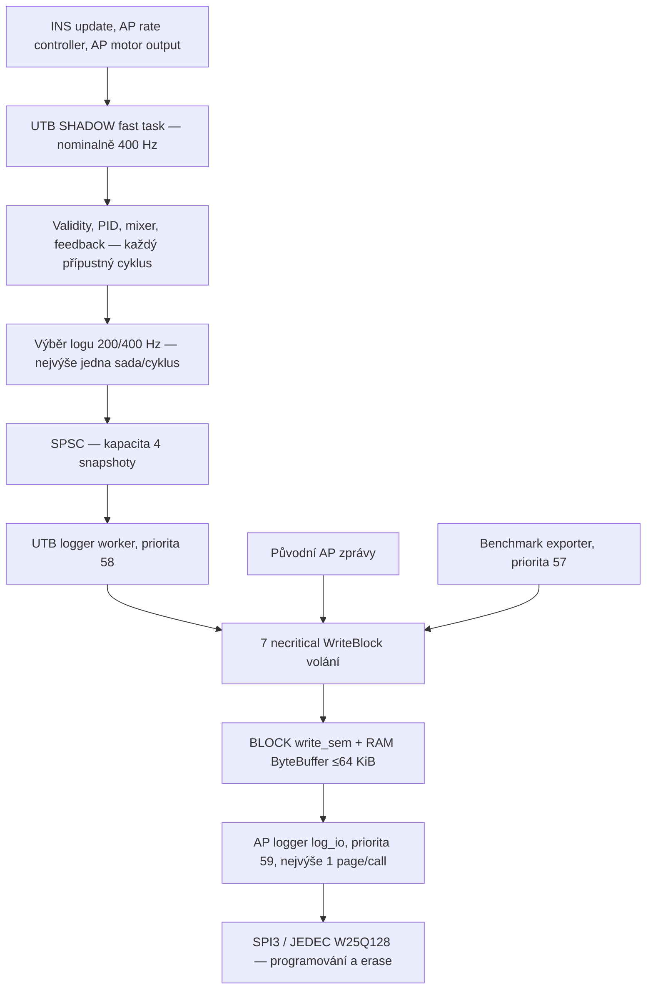

# Audit propustnosti UTB SHADOW loggeru na Skystars H743

Datum auditu: 11. 10. 2026. Větev: `test/skystars-5inch`. Auditovaný source HEAD: `ba793af194004418d7ff3e3460ae8f48df53fab8`. Cíl: SkystarsH7HD-bdshot, FRAME_CLASS=1 / FRAME_TYPE=18, hlavní scheduler 400 Hz.

## 1. Shrnutí a verdikt

**Doporučený pracovní režim je 400Hz SHADOW výpočet s 200Hz logováním. Plné 400Hz logování současného schématu na této konfiguraci Skystars není bezeztrátově udržitelné.** Platí pro diagnostický DISARMED experiment, nikoli pro aktivní letové řízení.

Nově dodané původní **C_.bin a D.bin byly nezávisle dekódovány**. Oba identifikují firmware ba793af1, správný board, FRAME 1/18, scheduler 400 Hz a BLOCK backend 4. C v [40,75) s obsahuje přesně **7000/7000 kompletních platných sad, 200 Hz**, bez růstu queue/Missing/DSF ztrát. D v [30,100) s obsahuje **23160/28000 kompletních platných sad, 330,857 Hz (82,714 %)**.

D prokazuje problém **za UTB frontou**: v dostupném ustáleném counter okně neroste queue Drop, ale Missing ano, a DSF volný RAM prostor se opakovaně dostává pod necritical rezervu 1024 B. Uložený tok všech zpráv je přibližně **130,810 kB/s**, proti modelovému požadavku kolem 157 kB/s. Klesá i tok původních AP zpráv. Není to izolovaná ztráta UTB diagnostiky.

Hlavní smyčka má v dostupných ustálených metrikách D průměr přesně 2500 µs, absolutní jitter 2,520 µs a prvních devět PM intervalů NLon=0. Přesto nelze z těchto statistik prokázat validitu všech neuložených výpočtů nebo nulové hard deadline misses. Pozdní dlouhé smyčky jsou v D skutečně přítomné; jejich vztah ke stahování bez synchronizovaného tlog zůstává neprokázaný.

Velikost kompletní BENCH ON sady je **339 B**, vlastní UTB fronta má čtyři snapshoty a BLOCK RAM buffer nejvýše 64 KiB. Zvýšení UTB fronty nebo worker priority není podložené jako první řešení. Preferovat 200Hz logování, případně menší nebo rozdělené diagnostické schéma; konkrétní podíl erase latencí versus service cadence vyžaduje další důkaz.

## 2. Důkazy, rozsah a dostupnost dat

V tomto dokumentu:

- **SOURCE** = ověřeno v lokálním zdrojovém kódu uvedeného HEAD.
- **BIN** = nezávisle přepočítáno z dostupného původního FC souboru.
- **SOUHRN** = původní experimentální údaj; nyní je pro čisté C/D nahrazen nebo zpřesněn raw BIN výpočtem.
- **ODHAD / HYPOTÉZA** = odvození s uvedenými předpoklady.
- **NEZNÁMÉ** = chybí data umožňující bezpečný závěr.

Prohledání repository mimo build, submodules, virtuální prostředí a Git našlo 613 souborů s příponou BIN; 97 mělo úvodní DataFlash FMT hlavičku. Obsahové hledání board identifikace ve startup části a následné dekódování identifikovalo těchto pět Skystars FC logů. Ostatní kandidáti patří k uloženým simulacím a příkladům; nebyly použity jako hardware důkaz. Ve Windows projektovém stromu `C:\jirka\skola\5__BP` nebyl nalezen další relevantní FC BIN. Nejde o tvrzení, že D neexistuje někde mimo prohledaný workspace.

Původní A0/A/B a oba staré C identifikují firmware feb5b683. Dodatečně dodané C_.bin a D.bin identifikují **ArduCopter V4.7.1 (ba793af1)** a stejný **SkystarsH7HD-bdshot 00240020 34305112 36333333**. Nejnovější raw C/D jsou tedy přímo relevantní pro auditovaný HEAD. Původní údaj o jejich nedostupnosti byl doplněním souborů překonán.

Adresář původních dat: /home/jirka/ardupilot_utb/tmp/skystars-5inch/LOG.

| Soubor | Velikost B | SHA-256 |
|---|---:|---|
| A0.bin | 1 342 246 | a5c22dc6b944b595382bee3c36d3d182b8608045e94cc821dde103125439dafd |
| A.bin | 1 242 246 | a142735f6f4bf7318146a69deee92d6bc9eb6e83fa630d8d1e3944678e43805a |
| B.bin | 1 208 496 | 89a7b80a6775484490fe78735fd254d7d5ddc29add0ffa40d3b4a1318c6aff0a |
| C_200Hz.bin — starý | 2 982 996 | 29605a10ef0c1c00e79fe8f9fc58b8db47147ab9a7d19ac6e208072ae52d7996 |
| C_200Hz_with_RC.bin — starý | 1 342 496 | f6ddb6387c557339dd1c25b7d15281ea4a09ba38dbee7efc9791cfe168c26656 |
| **C_.bin — nový čistý C** | **6 690 746** | b94e19f393f5ddcd16edc539525a19578d2d311c99df1680698eceac50fc3bd1 |
| **D.bin** | **16 259 496** | 59c1fcfce0399791be2aeeaf62ee0ceb04f0dc545fb88cc4883123f27c7d2811 |

### Ověření variant a výsledků

Všech sedm souborů má FRAME_CLASS=1, FRAME_TYPE=18, SCHED_LOOP_RATE=400, LOG_BACKEND_TYPE=4, LOG_DISARMED=1, LOG_BITMASK=180222, LOG_FILE_BUFSIZE=172 a LOG_BLK_RATEMAX/LOG_DARM_RATEMAX=0. Čteno z PARM; v dostupných logách nebyla zaznamenána jejich změna.

| Varianta / důkaz | UTB_ENABLE / SHADOW / LOG_RATE | UBST.Var | Vyhodnocení |
|---|---|---:|---|
| A0.bin — BIN | 0 / další UTB PARM nejsou emitované | bez benchmark FMT/UBST | Prvních 5 PM Load 17,36 %, NLon=0, MaxT ≤2560 µs. Pozdější PM v 65,07 s NLon=4, MaxT=184443 µs; oddělit od baseline. |
| A.bin — BIN | 0 / další UTB PARM nejsou emitované | 1 | Prvních 5 PM Load 18,36 %, NLon=0, MaxT ≤2577 µs, DSF.Dp=0. |
| B.bin — BIN | 1 / 0 / 200 | 2 | Prvních 5 PM Load 18,56 %, NLon=0, MaxT ≤2625 µs. Pipeline i DSF.Dp=0. |
| Starý C_200Hz.bin — BIN | 1 / 1 / 200 | 3 | 6384 kompletních, 0 platných; Calc=2/4. [10,30): 4000 sad, 200 Hz. |
| Starý C s RC — BIN | 1 / 1 / 200 | 3 | 2850 kompletních, 0 platných; končí v 19,25 s, Calc=2. |
| **C_.bin — BIN** | **1 / 1 / 200** | **3** | **[40,75): 7000 kompletních a platných, 200 Hz.** Všech 7 PM NLon=0. Startup DSF.Dp=154, queue Drop=19, Miss=28, pak bez růstu. |
| **D.bin — BIN** | **1 / 1 / 400** | **4** | **[30,100): 23160 kompletních a platných, 330,857 Hz.** Backend ztráty pokračují, queue Drop v ustáleném okně neroste. Prvních 9 PM NLon=0, pozdější MaxT až 171680 µs. |

A0/A nemají SHADOW/LOG_RATE PARM; jejich hodnoty se neodhadují. Absence zpráv sama není obecně důkaz compile-time konfigurace. A0 nemá benchmark FMT, A je má a uvádí Var=1, což podporuje jejich identifikaci.

### Metoda analýzy

Použit existující pymavlink DFReader v read-only režimu, čas **TimeUS od bootu**, intervaly **[start,end)**. Kompletní sada musí mít právě jednu UTBR pro Ax=0,1,2, právě jednu UTBM, UTBA, UTBT a UBEP se stejnými (TimeUS,Seq); UBEP nese Epoch. Duplicitní složky ani konečné fragmenty se za kompletní sadu nepovažují. Platnost vyžaduje Val=1 všech tří os a mixeru.

Frekvence v pevném okně = počet kompletních sad / celá délka okna; nepoužívá se jen interval mezi první a poslední úspěšnou sadou, který by skryl startup mezery. Datový tok = součet délek skutečně dekódovaných zpráv z FMT / délka okna. Jde o uložené logické zprávy, bez flash page headers, nikoli o přímé měření SPI rychlosti.

Jeden nekompletní konečný fragment v každém starém C nelze bez dalšího označit za runtime drop: může odpovídat hranici staženého/nezapsaného konce. Nepřenáší se automaticky do Missing nebo DSF.Dp.

## 3. Tok dat a frekvence výpočtu

**SOURCE:** Scheduler řadí INS → původní AP rate controller → původní AP motor output → UTB SHADOW → další fast tasks → update_flight_mode. UTB je FAST_TASK, ne úloha navázaná na LOG_RATE. [ArduCopter/Copter.cpp:115–139][S01]

Producer při povoleném SHADOW odebere stav a po samplingu validační čas. AP_UTB::update volá evaluate **před** výběrem logovacího intervalu. Evaluate inkrementuje Seq a při splnění validity/policy provede rate controller, mixer a feedback. LOG_RATE výpočetní frekvenci neřídí. To ovšem neznamená, že PID běží také v cyklech s nevalidním stavem, zakázaným FSTRATE, nepodporovaným rámem, primingem nebo latched time budgetem. [utb.cpp:16–47][S02], [AP_UTB.cpp:253–345][S04], [update:349–424][S03]

Log selector používá časový interval 1e6/rate a při zpoždění neposílá více doháněcích sad. Při jitteru není LOG_RATE=400 důkazem přesně jedné zvolené sady v každém fast cyklu. Speciálně se může vybrat i jednocyklická událost změny primárního gyra. Rozlišují se proto **Seq rate**, **Requested rate** a **uložená complete-set rate**. [AP_UTB.cpp:385–415][S03]

Po ztrátě backend zápisu se mění observační health; samotná tato událost nepřeruší jinak validní matematiku. Bez loggeru před prvním spuštěním experimentu naopak platí startup suppression policy. [evaluate:266–307][S04]

## 4. Velikosti zpráv a požadovaný tok

Struktury jsou PACKED; každá má tříbajtovou DataFlash hlavičku. Velikosti souhlasí s FMT v dostupných FC BIN. [Hlavička:117–119][S55], [UTB struktury:72–191][S11], [UBEP:78–82][S12]

| Zpráva | Počet v sadě | B / zpráva včetně hlavičky | B / sada |
|---|---:|---:|---:|
| UTBR | 3 | 55 | 165 |
| UTBM | 1 | 59 | 59 |
| UTBA | 1 | 36 | 36 |
| UTBT | 1 | 60 | 60 |
| UBEP — BENCH ON | 1 | 19 | 19 |
| **Celkem BENCH ON** | **7** | | **339** |

BENCH OFF nepřidává UBEP: šest zpráv má **320 B**. To je změna podmínky kompletnosti analyzátoru, nikoli totéž sedmipaketové schéma. [utb.cpp:174–212][S10]

| Režim | Požadované diagnostické zprávy/s | UTB B/s | UTB kB/s (1000 B) |
|---|---:|---:|---:|
| BENCH ON / 200 Hz | 1400 | 67800 | 67,8 |
| BENCH ON / 400 Hz | 2800 | 135600 | 135,6 |
| BENCH OFF / 200 Hz | 1200 | 64000 | 64,0 |
| BENCH OFF / 400 Hz | 2400 | 128000 | 128,0 |

### Benchmark a ostatní provoz

UBMT má 41 B, UBHI 64 B a UBST 21 B. Je 11 Metric a 37 stavových keys. Jeden úplný export tedy má `11×(41+64)+37×21 = 1932 B`. Exporter nejprve spí 1000 ms, potom provede export; skutečná frekvence je o dobu jeho práce nižší než přesně 1 Hz. Navíc zkouší 37 MAVLink NAMED_VALUE_FLOAT zpráv; tento přenos není dalších 37 DataFlash záznamů. [Metric enum:26–38][S14], [exporter:67–139][S13]

UTBS má 55 B a UTBQ 46 B. Při stabilních health flagách je heartbeat přibližně 1 Hz, takže obvykle asi **101 B/s**. Změny health jsou logované navíc: **UTBS není absolutně omezeno na 1 zprávu/s**. Oscilující stav může významně zvýšit datový tok. [Status/pipeline:233–261][S62]

**BIN:** v okně 15–55 s:

| Soubor | Všechny uložené zprávy B/s | Benchmark B/s | UTBS+UTBQ B/s | Běžné AP B/s |
|---|---:|---:|---:|---:|
| A0 | 19275,95 | 0 | 0 | 19275,95 |
| A | 21209,60 | 1932,00 | 0 | 19277,60 |
| B | 21276,90 | 1883,70 | 101,00 | 19292,20 |

Největší běžné jednotlivé typy v těchto oknech: IMU 2700 B/s, XKF1 1120, SURF 1000, XKF2 920, XKF4 880 a XKF3 840 B/s. Zbytek se rozděluje mezi další AP zprávy. To je **empirický tok pro LOG_BITMASK=180222 a DISARMED**, nikoli univerzální AP zátěž.

Starý C s RC v 10–19 s: **89456 B/s**, z toho UTB sada 67800, benchmark 1932, status 101 a ostatní 19623 B/s. Starý C bez funkčního validního experimentu v 25–35 s: **94953,60 B/s**, z toho statusy 5892,50 B/s při střídání Calc=2/4. Je tedy doložená dodatečná zátěž health oscilací.

**ODHAD:** při běžném AP toku 19,3 kB/s, benchmarku 1,932 kB/s a stabilních statusech 0,101 kB/s vychází celkový požadavek přibližně:

- 200 Hz: **89,133 kB/s**;
- 400 Hz: **156,933 kB/s**.

Neobsahuje startup FMT/FMTU/PARM bursty ani případné změny masky, health nebo režimu. Benchmark export samotný představuje asi 2,17 % tohoto 200Hz toku a 1,23 % 400Hz toku; tvoří však pravidelný burst a jeho instrumentace má také CPU/mutex režii.

## 5. UTB fronta, worker a čítače ztrát

### SPSC fronta

Kapacita je **4 celé Snapshot**, vlastní pevné úložiště (CAPACITY+1)×sizeof(Snapshot) kvůli pravidlům ByteBuffer. V ověřeném ARM layoutu tohoto commitu má Snapshot 336 B; úložiště tedy 1680 B a využitelná kapacita čtyři objekty. Status mailbox používá oddělený try-lock. Selhání mailboxu samo není odmítnutím datové sady. [Queue:109–144][S05], [publish/pop:189–221][S06], [ByteBuffer space:75–92][S49]

Při zaplnění se nová sada zahodí bez retry a bez čekání. Rate controller tím není resetován; zhorší se ShadowObservable. Čtyři místa pokrývají přibližně 20 ms příchodů při 200 Hz nebo 10 ms při 400 Hz, nikoli dlouhé zpoždění flash. [publish_diagnostics:428–444][S07]

Worker vzniká pouze při UTB_ENABLE=1 při startu. V každém průchodu zkusí nejvýše čtyři pop/write operace a potom spí 1 ms. Popnutý snapshot před zápisem kontroluje aktuální epoch a logging_requested. Obsolete sady jsou zahazované do Gone. Nominální strukturální limit čtyři sady za průchod není sám o sobě limitem 400 Hz; skutečný servisní čas zahrnuje sedm logger calls a případná čekání. [utb_log_init:98–117][S08], [worker:128–155][S09], [consumer:169–215][S10]

### Backend admission není transakční zápis sady

Worker volá sedm samostatných necritical WriteBlock_first_succeed. Operátor `complete &= call()` provede i zbývající volání po prvním neúspěchu. Není rollback, rezervace celé sady ani retry. Část zpráv proto může zůstat uložená, zatímco sada je Missing. [utb.cpp:174–212][S10]

WriteBlock_first_succeed vrací výsledek **backendu index 0**; další backendy zavolá také, jejich výsledky ale tento návrat nekontroluje. Při LOG_BACKEND_TYPE=4 je jediným zvoleným typem BLOCK. FILE=1, MAVLINK=2, BLOCK=4; nejde o FILE backend schovaný pod číslem 4. [Backend_Type:454–458][S31], [probe pořadí:244–277][S32], [WriteBlock_first_succeed:761–772][S15]

| Čítač | Jednotka a přesný význam | Co z něj neplyne |
|---|---|---|
| ReqN / UBST[19] | Vybrané sady před pokusem zařadit do UTB fronty. | Nepočítá všechny matematické cykly ani nezvolené samples. |
| EnqN / [20] | Sady přijaté SPSC frontou. | Neznamená přijetí loggerem. |
| Drop / [22] | Vybrané sady odmítnuté plnou UTB frontou. | Není počet DataFlash zpráv. |
| WrN / [21] | Sady, u nichž uspělo všech sedm backend-0 admission calls. | **Není potvrzené programování, fsync ani persistence na flash.** |
| Miss / [23] | Popnuté aktuální sady s alespoň jedním false logger návratem. | Není počet odmítnutých zpráv ani výhradně fyzická SPI write error. |
| Gone / [26] | Popnuté obsolete/disabled sady. | Není totéž jako queue overflow. |
| DSF.Dp | Kumulativní počet jednotlivých odmítnutí uvnitř backendu, reset při novém logu. | Neidentifikuje původce, počet celých UTB sad ani všechny před-backend odmítnuté calls. |

Zdroje čítačů: [výběr/publish][S03], [log_result:460–467][S34], [pipeline export:108–111][S13], [BLOCK odmítnutí:158–168][S20], [DSF:688–723][S33], [reset dropped:99–103][S53].

V ustáleném shodném bootu/epochu lze kontrolovat přibližné bilance:
`ΔReqN = ΔEnqN + ΔDrop` a
`ΔEnqN = ΔWrN + ΔMiss + ΔGone + změna backlogu/in-flight`.
Čítače nejsou odebrané jako jedna atomická transakce; krátké rozdíly jsou očekávané. **Drop, Miss a DSF.Dp se nesčítají jako nezávislé ztráty.**

False může vzniknout i před RAM bufferem: startup zprávy smějí zpracovat pouze main, logger je nepovolený/neinicializovaný, probíhá log transfer, nesplní se rate limiter nebo nelze emitovat FMT. Proto Miss může růst při DSF.Dp=0. [WritePrioritisedBlock:442–468][S17], [ShouldLog:471–513][S18]

Dokumentační nesoulady bez změny kódu:

- Inline popis Eff hovoří o enqueued sadách; implementace na AP_UTB.cpp:398 používá **_written_sets**, tedy všechny úspěšné backend admissions od začátku epochového měření. Ani tento Eff není persisted rate. [Výpočet Eff][S03], [inline popis:170–173][S58]
- Inline UTBQ Drop zmiňuje také lock contention; aktuální SPSC datové publish odmítá na plné frontě. Try-lock je jen best-effort status mailbox a neblokuje data publication. [Queue implementace][S06]

Tyto popisy se v tomto auditu neopravují.

## 6. BLOCK RAM buffer a skutečný flash zápis

### RAM admission

LOG_FILE_BUFSIZE=172 neznamená 172KiB buffer na Skystars. BLOCK jej **clampuje na 64 KiB**, při nedostatku paměti dále půlí. ByteBuffer ponechává jeden byte, takže při úspěšné plné alokaci je maximální space 65535 B. Dostupné DSF.FMx kolem 65500 B jsou s plnou 64KiB alokací konzistentní. [BLOCK Init:45–60][S19], [ByteBuffer space][S49]

Necritical zápisy jsou odmítnuty už při volném prostoru pod 1024 B; critical zprávy mohou pokračovat, pokud se celý packet vejde. UTB i benchmark zde používají necritical API. Krátký write_sem chrání multi-producer append; IO thread je jediný consumer RAM fronty. [WriteBlock false critical flag][S16], [reserved space:227–245][S21], [BLOCK append][S20]

API bufferspace_available() v BLOCK vrací celkovou flash kapacitu, nikoli okamžitý volný RAM buffer. Pro RAM tlak jsou relevantní DSF.FMn/FMx/FAv (v logu FMn,FMx,FAv), jejichž statistiky jsou sbírané při úspěšných admissions. **Nejsou to přesné časové watermarky průběhu flash IO ani stav v okamžiku odmítnutí.** DSF.Bytes/Blk jsou intervalové admission statistiky, jejich stats se po exportu mažou; DSF.Dp zůstává kumulativní do nového logu. [BLOCK bufferspace:76–80][S19], [df_stats_gather/log][S33]

**ODHAD pro úplně zastavený odtok:** asi 64,5 kB necritical kapacity pokryje při celkových 89,1 kB/s přibližně 0,72 s a při 156,9 kB/s přibližně 0,41 s příchodů. Není to časová garance; počáteční zaplnění, bursty a critical provoz rezervu zkrátí.

### Chip a velikost zápisu

Lokální hwdef umísťuje dataflash na samostatné **SPI3**, s požadovanými 32 MHz; IMU jsou na SPI1 a SPI4. Board bdshot tento hwdef dědí. Není zde přímé sdílení SPI bus mutexu s IMU, ale CPU, IRQ, DMA a memory bandwidth zůstávají společné. Požadovaných 32 MHz není měření skutečné SPI frekvence ani fyzické flash propustnosti. [Skystars hwdef:45–78][S30]

Default DATAFLASH driver je AP_Logger_Flash_JEDEC. Pro W25Q128 detekuje 256 bloků po 256 pages, page 256 B, sector 16 pages = 4 KiB, běžný erase command 64 KiB. Celkem 16 MiB, poslední 64KiB blok se rezervuje na format/version. Identifikace konkrétního JEDEC ID nebyla v tomto auditu nově odečtena z hardware. [JEDEC konfigurace:147–174][S26], [reserve:41–43][S19]

Každá flash page nese **6B PageHeader** (FilePage uint32 + FileNumber uint16, BLOCK_LOG_VALIDATE=0), takže obvykle **250 B logového payloadu**. První page logu navíc nese 4B FileHeader. IO bere z RAM maximálně 250 B a vytvoří 256B fyzickou page; nejsou to zápisy po jedné UTB sadě. Sada 339 B běžně překračuje hranici page a sousedí s AP/benchmark zprávami. [PageHeader:81–91][S22], [write_log_page:913–928][S24]

Jen page headers znamenají při plných pages násobek 256/250 = 1,024. UTB část samotná tedy potřebuje přibližně 69,43 kB/s fyzických page bytes při 200 Hz a 138,85 kB/s při 400 Hz. Celkový model z části 4 vychází asi 91,27 / 160,70 kB/s fyzických page bytes. Neobsahuje SPI příkazy, idle/polling, erase ani nevyužitou koncovou page.

### IO, programování, erase a zámky

AP logger má vlastní **log_io** thread s PRIORITY_IO+1. Jeho smyčka cílí na ≥1ms interval a vždy vloží nejméně 250 µs delay. BLOCK IO timer zapíše **nejvýše jednu page/call**, pokud má dostatek RAM dat; při stop/flush také postupuje po page. Z toho vychází ideální softwarový strop asi **250000 B/s logového payloadu**, před započtením programování, mazání, plánování a ostatní práce. Tento ideál není garantovaná rychlost W25Q128. Historické orientační rychlosti v komentáři AP_Logger_Block.cpp:829–834 nejsou hardware benchmark této konfigurace. [IO thread:1455–1501][S29], [BLOCK IO:836–908][S23]

BufferToPage provede WriteEnable → JEDEC PAGE_WRITE → přenos 256 B. WriteEnable nejprve volá WaitReady; ten polluje status s delay_microseconds(100) a až po více než 5000 ms označí flash_died. Page program ani erase není instantní operace. SectorErase po každých 256 pages vydá 64KiB erase; další WriteEnable čeká na jeho dokončení. Případná recovery maže také 4KiB sektory. [BufferToPage, SectorErase, WriteEnable:253–329][S27], [WaitReady:92–105][S28], [FinishWrite:89–115][S25], [recovery:864–881][S23]

Rozlišují se tři zámky:

1. **write_sem**: RAM admission, sdílený AP main / UTB worker / benchmark exporter. Právě ten instrumentuje BLOCK MutexProbe.
2. **sem**: společný staging buffer a flash read/write logika; IO i stahování logu jej používají a může zůstat držený přes WaitReady.
3. **dev_sem**: SPI zařízení/bus, jednotlivé status/command/data transfery.

Zdroj: [BLOCK locks:93–98][S22], [probe:135–138][S20], [IO sem][S23], [download sem][S40], [SPI transfers][S27].

Main má základní prioritu 180, UTB worker 58, AP log_io 59 a benchmark exporter 57. ChibiOS používá priority inheritance pro blocking mutexy; čekající main může dočasně zvednout vlastníka zámku. To neodstraňuje dobu programování/erase ani nedělá z low-priority workeru hard realtime službu. Zvýšení trvalé priority workeru může přesunout riziko na původní AP main a nemusí zvýšit flash service rate. [priority constants/map][S36], [thread priority offset][S37], [mutex HAL][S59], [ChibiOS inheritance][S60]

**Worker hold 247/274/369 µs měří RAM write_sem wall time, nikoli dobu fyzického page program nebo erase.** Main acquire 63/108 µs je čas získávání instrumentovaného zámku včetně overheadu/preemption; není to celá logger latence. Současná diagnostika proto sama neoddělí page program, erase a zpomalení IO plánováním. [MutexProbe:197–247][S35]

### Kapacita flash versus ustálená propustnost

Je nutné odlišit přetížení RAM při příliš velkém toku od dosažení kapacity jednoho dlouhého logu. FinishWrite při hrozícím přepsání vlastních headers nastaví chip_full; IO timer pak přestane odvádět RAM. WritesOK naproti tomu kontroluje jen CardInserted/erase_started, nikoli chip_full. RAM se může zaplnit, Written přestat růst a Missing pokračovat, zatímco kombinace logger.should_log/present/started stále ukazuje dostupnost. [FinishWrite:107–111][S64], [IO guard:885–887][S65], [WritesOK:118–124][S66], [UBST availability:129–131][S13]

UBST[36]=1 tedy **neprokazuje schopnost dál ukládat data na flash**. Dlouhý už zaplněný log není použitelný k odhadu trvalé service rychlosti. Při pozdějším experimentu je třeba sledovat i přírůstky Written/uložená data a log capacity. Tento audit nepřidává nový flag ani nemění logger policy.

## 7. Nezávislá analýza původních C a D BIN

### Startup a platnost

První kompletní sada nového C je v 5,055900 s; první platná v **24,825903 s**. D: první kompletní 5,029833 s, první platná **24,819825 s**. Předtím stav nepovoluje validní matematiku; jde o očekávané oddělení inicializace od ustáleného experimentu. [AHRS initialised][S56]

C má první nenulový DSF.Dp=154 v 5,823760 s. První dostupný pipeline export už má Drop=19, Miss=28; oba zůstávají stejné do konce. V [40,75) je 7000 platných sad a žádný částečný fragment. Celý C soubor obsahuje 14793 kompletních sad, z toho 10839 platných, a jeden nekompletní fragment. Ten není automaticky runtime ztráta.

D má první DSF.Dp=89 v 5,817936 s a dále ztráty pokračují. Celý soubor obsahuje 40941 kompletních sad, 34215 platných a 355 částečných skupin. V [30,100) je **23160 kompletních, všechny platné, a dalších 193 částečných skupin**. Úplně chybějící skupiny nelze spočítat jen z počtu částečných.

### Pevná porovnatelná okna a tok

| Metrika | C [40,75) s | D [30,100) s |
|---|---:|---:|
| Kompletní platné sady | 7000/7000 | 23160/28000 |
| Kompletní frekvence Hz | 200,000 | 330,857 |
| Kompletnost vůči požadavku | 100 % | 82,714 % |
| Všechny uložené logické zprávy B/s | 89499,943 | 130809,529 |
| UTBR/UTBM/UTBA/UTBT/UBEP včetně partial B/s | 67800,000 | 112721,514 |
| Benchmark UBMT/UBHI/UBST B/s | 1876,800 | 1559,671 |
| UTBS/UTBQ B/s | 101,000 | 267,543 |
| Ostatní AP zprávy B/s | 19722,143 | 16260,800 |

Původní AP payload v D je asi o 17,5 % nižší než v C. U společného backendu s rostoucím DSF.Dp je to další důkaz interference s běžným logováním. Nevypočítává se z toho přesný počet ztracených safety-critical zpráv. Benchmark export se také ztrácí, takže nelze předpokládat úplný záznam všech jeho metrik.

Uložený **celkový** D payload přibližně 130,81 kB/s je empirický výsledek tohoto okna, nikoli garantovaná rychlost flash. Model všech plných stránek by z něj dělal přibližně 133,95 kB/s fyzických page bytes; SPI příkazy/erase nejsou započtené. DSF.Bytes stále měří RAM admission, nikoli přímý flash service čas. Koncový download fragment, padding a FMT prefix znamenají, že file size / boot time není vhodný estimator ustálené rychlosti.

### Pipeline counter rozdíly

Použity první a poslední dochované UBST samples ve společném pevném okně s dostupnými keys 19–26. Všechny mají epoch 0 a HWM=4, Depth=0, Gone=0.

| Čítač / endpoint | C: 40,987474 → 74,034416 s | D: 32,849023 → 99,946474 s |
|---|---:|---:|
| Requested | 7234 → 13843; Δ6609 | 11213 → 38052; Δ26839 |
| Enqueued | 7215 → 13824; Δ6609 | 11171 → 38010; Δ26839 |
| Written — RAM admission kompletní sady | 7187 → 13796; Δ6609 | 9403 → 31571; Δ22168 |
| Queue Drop | 19 → 19; Δ0 | 42 → 42; Δ0 |
| Missing | 28 → 28; Δ0 | 1768 → 6439; **Δ4671** |
| Gone | 0 → 0 | 0 → 0 |

D má v tomto counter okně přesně ΔRequested=ΔEnqueued=26839 a ΔWritten+ΔMissing=26839. Fronta není místem trvalého deficitu. Rozsah endpointů není identický s počítáním sad [30,100), proto se 22168 a 23160 nesmějí přímo porovnávat jako dvě hodnoty stejného okna.

DSF.Dp v D roste **18546 → 70586** mezi 31,880121 a 99,042648 s: Δ52040, tedy přibližně 774,9 odmítnutých zpráv/s. Nejde o ztracené celé sady. V C zůstává DSF.Dp=154 ve všech dostupných ustálených samples.

### D po deseti sekundách

| Okno s | Kompletní platné sady | Hz | Uložený celkový B/s | DSF.Dp první → poslední dochovaný sample |
|---|---:|---:|---:|---|
| [30,40) | 3357 | 335,7 | 132690,7 | 18546 → 24401 |
| [40,50) | 3358 | 335,8 | 132575,4 | 24982 → 31634 |
| [50,60) | 3287 | 328,7 | 130582,5 | 32379 → 38486 |
| [60,70) | 3311 | 331,1 | 130589,5 | 41773 → 47250 |
| [70,80) | 3240 | 324,0 | 128649,4 | 48059 → 55601 |
| [80,90) | 3289 | 328,9 | 130297,6 | 56283 → 62651 |
| [90,100) | 3318 | 331,8 | 130281,6 | 63455 → 70586 |

DSF endpoints nemusejí pokrývat celých deset sekund; tabulka je popis dostupných samples, ne falešný rovnoměrný časový průběh. Podrobné čítače, endpoint časy, startup i pozdní intervaly jsou v tmp/skystars-5inch/logger-throughput-CD-analysis.json.

### RAM tlak a periodické ztráty

V C [40,75) je nejnižší dostupný DSF.FMn **45802 B**; nejvyšší FMx 65509 B. V D [30,100) je FMn opakovaně přibližně 900–1000 B, nejnižší **892 B**, tedy pod necritical reserved space 1024 B. FMx dosahuje jen přibližně 16–18 KiB; buffer se v dochovaných statistikách nevrací blízko prázdnému stavu. DSF hodnoty jsou vzorkované při úspěšných admissions, ne přesný continuous watermark. [BLOCK reserve/admission][S20], [DSF sampling][S33]

V D [30,100) je 143 mezer mezi kompletními sadami s Seq skokem alespoň 10. Průměrný rozestup jejich konců je **0,489331 s**. První příklady mají 57,5–132,5ms mezeru v zaznamenaných sadách. Není to důkaz stejně dlouhé main-loop pauzy: během nich dál rostou requested/enqueued, matematika a běžné 400Hz periody pokračují.

64KiB erase blok při logickém odtoku kolem 130,8kB/s vychází na přibližně 0,49 s po započtení page headers. To je **podpůrná shoda pro erase/service hypotézu**, nikoli přímé měření erase času nebo důkaz jediného bottlenecku. [FinishWrite erase][S25]

### Main loop, producer a consumer

Následující průměry jsou **ΔSum/ΔN** mezi dochovanými metrickými endpointy, nikoli průměry od bootu. Max/Min jsou naopak kumulativní. C endpointy 40,987474–74,034416 s; D 32,849023–99,946474 s.

| Metrika µs | C průměr | D průměr |
|---|---:|---:|
| Main period | 2500,000 | 2500,000 |
| Absolutní period jitter | 2,494 | 2,520 |
| Main logger acquire | 0,483 | 0,506 |
| Worker write_sem hold | 2,622 | 2,313 |
| Producer | **37,907** | **39,620** |
| Consumer invocation | 17,883 | 25,511 |
| Worker pass | 32,726 | 49,201 |
| Export pass | 734,455 | 746,582 |

Dodaný C producer průměr 34,2 µs odpovídá přibližně celému bootovému součtu zahrnujícímu nevalidní startup. Pro ustálené okno vychází **37,9 µs**. Rozdíl není regrese kódu: jsou to různá časová okna.

C kumulativní Max: main acquire 63 µs, worker hold 247 µs, producer do konce 54 µs, perioda 2653 µs, worker stack free minimum 1848 B. D před 100 s: main 108 µs, worker hold 274 µs, producer 55 µs, perioda kumulativně 2619 µs, stack 1848 B. Žádná potvrzená main/worker mutex kolize v dodaném C/D; nulová potvrzená hodnota nevylučuje riziko.

V C všech sedm PM NLon=0. V D prvních devět PM NLon=0; potom PM v 104,848374 s má NLon=2, MaxT=23821 µs, v 115,060123 s NLon=4, MaxT=171680 µs a v 125,270949 s NLon=4, MaxT=165412 µs. Pozdní část je skutečně odlišná a nepatří do čistého stabilního srovnání.

Nominal 400 Hz je 2500 µs. UBST[8] je task runtime budget overrun, UBST[9] počítá i periodu nominal+1 µs, PM.NLon používá přibližně 3000µs threshold a ignore_loop. Průměr 2500 µs a NLon=0 nejsou formální hard deadline důkaz. [Task overrun][S45], [benchmark period][S46], [PM semantics][S47], [PM threshold][S61]

### Download a pozdní incidenty

Pro BLOCK je in_log_download true při LISTING i SENDING, logger.should_log je odmítá. LOG_DISARMED=1 tedy neznamená automaticky současný zápis během každého aktivního downloadu. Po restartu před transferem se ale logování může rozběhnout. [in_log_download][S38], [ShouldLog][S18]

MAVLink download má main-thread obsluhu, přes USB až 250 LOG_DATA packets/call, EXPECT_DELAY_MS(5000), společný chip sem a WaitReady. Je možným zdrojem dlouhých smyček. Z původního D BIN však **není doloženo**, že právě download způsobil pozdní MaxT 171680 µs. Chybí tlog s LOG_REQUEST_LIST/DATA/END a společnou boot-time synchronizací. [Transfer handler][S39], [BLOCK read][S40]

Opakované MSG/FMT v souboru se neinterpretují samy jako jednoznačný marker počátku stahování. Růst ztrát a RAM tlak už v [30,100) jsou prokázány bez nutnosti odvozovat příčinu pozdní části.

## 8. Úzká místa: fakta, hypotézy a neznámé

| Hodnocení | Závěr |
|---|---|
| SOURCE | 339B sada, 135,6kB/s UTB při 400 Hz, BLOCK max64KiB RAM, 250B page payload. |
| BIN | C [40,75) má 7000 platných sad, bez růstu ztrát, RAM s velkou rezervou v dochovaných statistikách. |
| BIN | D ztrácí za UTB frontou, RAM opakovaně pod reserved threshold; klesá i uložený AP payload. |
| BIN | D main period průměr 2500 µs při pokračujícím Missing/DSF růstu, před pozdním incidentem. |
| Silná HYPOTÉZA | Service výkon/bursty BLOCK nestačí požadovanému toku. Periodické ~0,49s mezery jsou konzistentní s erase cadence. |
| NEZNÁMÉ | Přímý erase/program/service čas a podíl IO scheduling; přesný prospěch většího RAM bufferu versus trvalý deficit. |
| NEZNÁMÉ | Příčina pozdních 171,7ms main stalls v původním D. |

Běžný AP a benchmark sdílejí RAM buffer, write_sem i flash odtok. Instrumentace měří RAM admission mutex, nikoli chip sem držení během log_io program/erase. Nulové potvrzené kolize nevylučují blocking; UNKNOWN zahrnuje i nepotvrzené/uncontended acquisitions. [MutexProbe][S35], [UNKNOWN][S57]

## 9. Návrhy řešení v pořadí přínos/riziko

Žádná varianta není v tomto auditu implementovaná.

| Pořadí / varianta | Očekávaný přínos a nejistota | Rizika / složitost / dopad na AP | Schéma a ověření |
|---|---|---|---|
| **1 — A: 400Hz výpočet / 200Hz log** | UTB tok klesne o 67800 B/s; celkový model asi o 43 %. Raw C ověřuje 7000/7000 platných sad v 35s okně; delší opakování zůstává potřebné. | Nízké riziko, stávající runtime parametr. Ztráta detailu některých 400Hz/D-term jevů; původní AP beze změny. | Zachová sedmipaketové schéma. Unit log-selection/freshness; SITL 200/400 a frame/epoch; opakovaný čistý C bench přes více erase cyklů. |
| **2 — B: menší sada** | Návrhový cíl například 240–280 B/sada dává 96–112 kB/s při 400 Hz. Není hotový wire format ani ověřená udržitelnost. | Střední složitost: verze/IDs, packing, parser, metadata. Nezačínat kvantizací floats; nejprve odstranit prokazatelnou redundanci. Žádná změna AP matematiky. | Všechna současná pole nemusí zůstat ve stejných recordech. Neztratit TimeUS/Seq/Epoch/validity/axis identity. Unit roundtrip, velikosti a loss assembly, logger metadata, SITL a stejný HW protokol. |
| **3 — C: profily polí / rozdílné log rates** | Plný PID na požadované frekvenci, méně častý mixer/capture/timing detail může snížit tok. Přínos přesně spočítat podle schváleného profilu. | Střední složitost; asynchronní veličiny se nesmějí tvářit jako totožný sample. Povinné health/loss/timing a definice stáří jednotlivých skupin. AP control beze změny. | Zachovat FULL profil kompatibilní se současnou analýzou; nový profil má vlastní completeness pravidla. Unit profile-mask/joins; SITL změny za běhu/epoch; HW objem a observability. |
| **4 — E: koordinace ostatních logů / exportu** | Export samotný ≈1,932 kB/s; jeho odstranění má v lineárním modelu ekvivalent asi 5,7 současných sad/s, takže samo nevysvětluje celý deficit ~69 sad/s. Fázování exportu může zmírnit bursty. | Nízká až střední složitost. Neměnit critical/reserved policy. Nelze bez rozboru vypnout IMU/EKF/failsafe záznamy nebo globálním rate limiterem rozbít UTB úplnost. | Obvykle zachová schéma; omezování UBHI musí ponechat potřebné benchmark důkazy. Unit metric exports, SITL bounded calls, HW srovnání stejného main/LOG profilu. |
| **5 — D: fronta / buffer / worker** | Jen po prokázání příslušného bottlenecku. Větší UTB queue může pomoci krátkým service pause; větší BLOCK RAM může absorbovat erase burst. Neřeší trvale vyšší příchod než odtok. | Střední až vysoké riziko RAM a starších diagnostických samples; zásah BLOCK bufferu může ovlivnit všechny AP zprávy. Vyšší worker priorita může zvýšit main mutex kolize. | Wire formát lze zachovat. Unit backpressure, FIFO/epoch, bounded memory; SITL fault/delay backend; HW FMn/FAv, ΔDrop/Miss, acquisition/periods. |
| **6 — F: MicoAir SDMMC / FILE** | Možnost vyššího service výkonu a většího bufferu; žádný měřený hardware přínos tohoto auditu. | Nové HW/karta/FATFS latence, fsync a wear/tail behavior; vyšší propustnost se neodvozuje jen z MCU H743. Neměnit řízení ani arming. | UTB wire schéma může zůstat stejné. Unit/metadata a SITL FILE jsou funkční model, nikoli rychlost SDMMC. Vyžaduje samostatný A0/A/B/C/D hardware benchmark. |

Pro B není vhodné předpokládat jeden velký record se všemi poli: FMT má uint8 length, format[16] a labels[64]. Návrh musí respektovat limity logger metadat, přesně definovat společné identity/epoch a parser kompatibilitu. Odvozené Err/Raw nebo opakované TimeUS/Seq lze redukovat jen s doloženou možností rekonstruovat potřebné analýzy a s verzovaným schématem. [FMT limity:187–193][S50]

BENCH OFF má samostatný efekt: kromě exportu odstraní UBEP (19 B/sada) a instrumentační CPU overhead. Při 400 Hz by logický tok klesl asi o **9532 B/s** (7600+1932), tj. asi 6,1 % modelu, ale stále by byl přibližně 147,4 kB/s. Není to stejná změna jako pouhé vypnutí exporteru; vyžaduje jiné completeness pravidlo a neposkytne nové instrumentované metriky. Bez nového měření se netvrdí, že tím vznikne udržitelných 400 Hz.

### BLOCK versus plánovaný MicoAir FILE/SDMMC

MicoAir743v2 hwdef má SDMMC1 se čtyřmi datovými linkami a FATFS_HAL_DEVICE SDCD1. Při správně aktivovaném FILE backendu je LOG_BACKEND_TYPE=1; fyzický SDMMC není backend BLOCK. [MicoAir hwdef:112–119][S41], [backend enum][S31]

FILE nemá zdejší 64KiB clamp v Init; požadovaný buffer však může při nedostatku paměti zmenšit. Píše chunk podle HAL_LOGGER_WRITE_CHUNK_SIZE / FATFS get_io_size, zarovnává zápisy na 512 B, používá filesystem write a fsync. Odstraní 256B JEDEC page/64KiB erase model v této vrstvě, ale karta má vlastní interní flash management a dlouhé tail latency mohou zůstat. [FILE Init:74–95][S42], [chunk definice][S44], [FILE io_timer:941–1044][S43]

O skutečné rychlosti, buffer size po alokaci, stock thread rezervách ani mutex maximách MicoAir se bez konkrétní karty a hardware logů nedělá závěr.

## 10. Výslovné inženýrské odpovědi

1. **200Hz udržitelnost:** Ano pro prokázané ustálené C okno [40,75) a okolní platný záznam. Žádná obecná garance pro delší provoz, jiné parametry nebo zaplněnou flash.
2. **400Hz výpočet versus logging:** Source a ustálené main/producer metriky podporují pokračující 400Hz SHADOW výpočet při ztrátách logování. Uložených 23160 sad je platných; validitu každého neuloženého cyklu nelze dokázat. Není to experiment UTB uzavřené regulační smyčky.
3. **Optimalizace versus limit:** Současné plné 339B schéma nelze pro tuto konfiguraci označit za bezeztrátové 400Hz. Menší sady nebo 200Hz logging mají lepší podklad než zvýšení priority/fronty. Fyzický univerzální limit W25Q128 nebyl změřen.
4. **Další vývoj:** Nejdříve stabilizovat diagnostiku a vyřešit její dopad na původní AP záznamy. Neschvaluje se aktivní UTB ani další regulační fáze.
5. **Další minimální důkazy:** Opakovaný kontrolovaný bench s jednoznačně odděleným transferem, nevysvětlené pozdní main stalls, případně přímo IO service/erase timing, pokud stávající evidence nestačí pro konkrétní optimalizaci.

## 11. Doporučený další experimentální postup — návrh, neprovedeno

### Další offline analýza

Nové raw C/D jsou dekódované a jejich identita/PARM ověřené. Uchovat je s uvedenými hash. Zbývá synchronizovaný tlog pro původní D: LOG_REQUEST_LIST/DATA/END, restart a boot time. Bez něj se pozdní incident nepřipisuje downloadu.

Pro návrh změny bufferu/workeru využít uložené 10s bins, Δpipeline, DSF a gap periodicitu. DSF.Bytes není fyzický odtok. Případná další interpretace musí respektovat chybějící export records a kumulativní maxima.

### Pravidla kontrolovaného opakování na hardware

- Zachovat DISARMED, bez vrtulí, žádnou změnu řízení/arming. Použít jednoznačně identifikované existující firmware varianty; žádný nový firmware nebyl sestaven.
- Měřit s funkčním RC a dokončenými AHRS/health podmínkami, stejným LOG/AP mask profilem, stejným napájením a připojenými periferiemi.
- Použít pevná společná okna po inicializaci, například již použité C 40–75 s; jejich délka je konvence pro porovnání, nikoli bezpečnostní limit. Delší pozorování má pokrýt více 64KiB erase cyklů a nemá překročit log/file capacity bez sledování ring chování.
- Během měřicího okna žádný download/listing/erase. Před následným transferem explicitně ukončit měření a oddělit případně vzniklé nové logování po restartu. Konkrétní změny parametrů k bezpečnému exportu až v odsouhlaseném bench postupu.
- C je raw ověřené; pro dlouhodobý závěr jej opakovat. D použít jako krátký diagnostický experiment k identifikaci ztrát, nikoli jako prohlášený plně validní 400Hz recording.
- Zastavit session při restartu/watchdogu, chybě IO/flash/worker lifecycle, ztrátě kontrolované DISARMED/RC/health situace, nečekaném odchodu z původního AP režimu nebo velkých nevysvětlených periodických stalls. Po zachycení trvalého růstu ztrát už nepoužívat tento interval jako „bezeztrátový“ benchmark.
- Nepřidávat libovolný nový číselný bezpečnostní limit. Existující 125µs UTB execution budget a PM ≈3000µs indikátor jsou sémantikou diagnostiky; nenahrazují analýzu bezpečné main latency. Incident řádu 171,7 ms vyžaduje vysvětlení před další regulační fází.

Pokud dostupné DSF/UB metriky ani potom neoddělí příčiny, lze **navrhnout** oddělený compile-time diagnostický build pro page/erase/IO service timing pouze v logger IO threadu, s fixed atomickými summaries mimo chip mutex. To není nyní povolená změna a nemá přidat DataFlash zápisy do hlavní regulační cesty. Nejprve využít stávající data; dodatečný logger export by sám měnil zkoumanou propustnost.

## 12. Bezpečnost a stav práce

- Pouze SHADOW; diagnostické motor thrusty nejsou ESC výstupy.
- UTB_ACRO dál odmítá arming všemi metodami a vstup při armed/spool aktivním stavu. [Mode arming:437–446][S51], [mode init/run:16–34][S52]
- Nezměněny PID, filtr, anti-windup, mixer, reference, EKF, FSTRATE, AP_Motors, HAL/DShot, arming ani failsafe.
- Žádné navýšení priorit, žádné blokující čekání produceru na logger, žádné označení UTB diagnostiky jako critical na úkor původních bezpečnostních záznamů.
- Nebyl spuštěn build, SITL ani firmware upload. Nebyla doinstalována závislost. Nově povolené ověření na COM5 je uvedeno odděleně níže.
- Zdrojový kód a firmware nebyly změněny; žádná navržená optimalizace nebyla implementována. Offline analýzy a případné session artefakty jsou uloženy v ignorovaném tmp/skystars-5inch.

## 13. Kontrolované opakování D na COM5 — skutečně provedeno

### Příprava a izolace měření

Dne 11. 10. 2026 byl ověřen připojený Skystars přes MAVLink na COM5: firmware ba793af1, stejný UID2, parametry UTB 1/1/400, FRAME 1/18, scheduler 400, backend 4, maska 180222, LOG_FILE_BUFSIZE 172, oba rate limitery 0. Vrtule byly fyzicky sundané.

Při prvním připojení byl DISARMED, ale RC bez kanálů a aktuální log měl 16255996 B; Written už stál kolem 41423 a Missing rostl. To je konzistentní s kapacitním stavem popsaným výše, nikoli platný nový benchmark. chip_full nebyl přímo telemetricky exportovaný, proto se nespecifikuje jako přímo změřený flag.

Současný nejnovější log byl před novým pokusem plně archivován:

- tmp/skystars-5inch/COM5_prebench_20261011_154351.bin
- velikost 16255996 B;
- SHA-256 d6526c9c6ee66ca9b6443da28d96b52114bd7eb4b0265b76bb688ea84e033aa6.

První pomalý transfer byl přerušen a zopakován s větším přijímacím bufferem na PC a menšími download bloky. Nešlo o změnu FC RAM bufferu ani firmware. Neúplný tlog prvního transferu není měřicí důkaz.

Před restartem už RC_CHANNELS mělo 16 kanálů a platné vstupy 1–4 (1500,1502,988,1500 µs). Potom byl odeslán pouze DISARMED reboot do stejného firmwaru. Žádný upload, LOG_ERASE, arming, motor-test, RC override ani příkaz ke změně flight mode nebyl odeslán.

Po bootu přešel původní AP v 5,121448 s ze STABILIZE na ALT_HOLD podle standardního RC režimu. **V celém měřicím okně UTBT.Md=2**, stejně jako v dodaných čistých C/D. Nejde o UTB altitude controller ani aktivní UTB režim; UTB zůstává SHADOW. Přechod není součástí stabilního okna.

### Časové oddělení

- Měřicí okno přes hardware TimeUS: **[35,55) s**, 20 s, bez downloadu/listingu.
- Host měřicí sběr skončil při boot 55,889 s.
- Teprve potom byl LOG_DISARMED dočasně nastaven na 0 a potvrzen PARAM_VALUE, aby byl následující transfer oddělen od zápisu.
- Následoval LOG_REQUEST_LIST/DATA a úplný download.
- Nakonec LOG_REQUEST_END a **LOG_DISARMED=1 obnovený a znovu přečtený**.
- Všech 12 ověřovaných parametrů po session přesně odpovídá hodnotám před ní.
- Tlog obsahuje 109 FC heartbeatů; žádný s armed bit. Sériový port byl po session zavřený.

Během sběru probíhal standardní GCS heartbeat 1 Hz a příjem běžné/benchmark telemetrie. Setup requests byly před oknem, nové stream rates ani logger policies se nenastavovaly. Přesná host procedura je uložená jako textový artefakt, aby bylo možné zkontrolovat všechny odeslané příkazy. Tento krátký experiment nepotvrzuje dlouhodobou tail-latency bezpečnost.

### Výsledek nového BIN

| Metrika | Výsledek |
|---|---:|
| Požadované nominální sady [35,55) | 8000 |
| Kompletní platné sady | **6633** |
| Dosažená úplná logovací frekvence | **331,65 Hz** |
| Kompletnost vůči 400Hz požadavku | **82,9125 %** |
| Částečné skupiny v okně | 59 |
| Uložený celkový payload | 131412,75 B/s |
| UTB payload včetně partial | 113067,80 B/s |
| Původní AP payload | 16477,60 B/s |
| Benchmark payload | 1603,35 B/s |
| UTBS/UTBQ | 264,00 B/s |
| DSF.Dp v dochovaných endpointech | 23369 → 37977; Δ14608 |
| DSF endpoint časy | 35,899562 → 54,947106 s |
| Nejnižší dochovaný DSF.FMn | 899 B |
| Nejvyšší dochovaný DSF.FMx | 17456 B |
| PM.NLon | 0 ve všech 5 PM records |
| Max perioda kumulativně | 2633 µs |
| Worker stack free minimum | 1848 B |
| Worker create attempts/failures | 1 / 0 |
| Potvrzené main/worker kolize | 0 |

Z kompletních živých exportů mezi boot 35,860 a 54,888 s: ΔRequested=ΔEnqueued=7603, ΔWritten=6301, ΔMissing=1302, ΔQueueDrop=0, ΔGone=0. Bootové QueueDrop=42 zůstává beze změny. Nominal count 8000 je pro plné [35,55); živé endpointy pokrývají kratší interval a nesmějí se s ním přímo zaměnit.

ΔSum/ΔN z BIN UBMT mezi 35,860212 a 54,888120 s:

| Metrika µs | Průměr | Kumulativní Max |
|---|---:|---:|
| Main period | 2500,000 | 2633 |
| Absolutní jitter | 2,476 | 133 |
| Main logger acquire | 0,498 | 49 |
| Worker hold | 2,295 | **485** |
| Producer | 39,603 | 55 |
| Consumer invocation | 25,199 | 656 |
| Worker pass | 48,688 | 1493 |
| Export pass | 782,474 | 1581 |

Vyšší worker hold maximum 485 µs proti původnímu D 274 µs je zaznamenaný rozdíl, nikoli důkaz změny firmware nebo přímo doby flash programování. Jde o wall time včetně preemption. Main acquire maximum zde bylo 49 µs a potvrzené kolize 0; tím není odvozen obecný bezpečný mutex limit.

V ustáleném okně UTBS.Calc=0; Flg střídá 511/1023. Tyto hodnoty se liší pouze SHADOW_OBSERVABLE bitem, zatímco STATE_VALID/CONTROLLER_VALID/MIXER_VALID/SHADOW_HEALTHY zůstávají nastavené. Odpovídá zdravému SHADOW výpočtu se zhoršenou pozorovatelností při backend ztrátách. Validitu neuložených cyklů stále nelze nezávisle rekonstruovat. [HealthFlag:55–65][S63]

### Artefakty a verdikt

- **BIN:** tmp/skystars-5inch/COM5_D400_20261011_155139.bin — **6767996 B**.
- **SHA-256 BIN:** 54a51b70e7a2940afa5c63222e402f8fc9d05af232a80cb8d609622f04a0ea85.
- Tlog: COM5_D400_20261011_155139.tlog.
- Session metadata, původní/konečné parametry, živé exporty a transfer markers: COM5_D400_20261011_155139.json.
- Reprodukovatelná host procedura: COM5_D400_20261011_155139.procedure.txt.
- Offline výsledky: COM5_D400_20261011_155139_analysis.json a COM5_D400_20261011_155139_detail.json.
- Původní C/D offline výsledky: logger-throughput-CD-summary.json a logger-throughput-CD-analysis.json.
- Všechny tyto artefakty jsou v ignorovaném tmp/skystars-5inch; žádná změna C++ ani build konfigurace.

**Nové měření nezávisle reprodukuje původní D: platný SHADOW výpočet pokračuje, ale kompletní logging dosahuje jen přibližně 331 Hz a zároveň ztrácí původní AP záznamy.** Pro současné schéma/backend proto zůstává doporučení 200Hz logování s 400Hz SHADOW výpočtem. Nenastavoval se automaticky nižší LOG_RATE; po testu je zachovaná původní konfigurace 400 Hz.

Nebyla provedena další session, aktivní UTB řízení ani FÁZE 2. Source HEAD a tracked pracovní strom zůstávají nezměněné. Hardware příčina pozdních dlouhých smyček v původním D a přímé erase/program latency zůstávají otevřené.

## Zdrojové odkazy

Odkazy níže směřují na přesné lokální soubory/počáteční řádky auditovaného HEAD; související rozsahy jsou uvedené v textu.

[S01]: <\\wsl$\Ubuntu\home\jirka\ardupilot_utb\ArduCopter\Copter.cpp:115>
[S02]: <\\wsl$\Ubuntu\home\jirka\ardupilot_utb\ArduCopter\utb.cpp:16>
[S03]: <\\wsl$\Ubuntu\home\jirka\ardupilot_utb\libraries\AP_UTB\AP_UTB.cpp:349>
[S04]: <\\wsl$\Ubuntu\home\jirka\ardupilot_utb\libraries\AP_UTB\AP_UTB.cpp:253>
[S05]: <\\wsl$\Ubuntu\home\jirka\ardupilot_utb\libraries\AP_UTB\AP_UTB.h:109>
[S06]: <\\wsl$\Ubuntu\home\jirka\ardupilot_utb\libraries\AP_UTB\AP_UTB.cpp:189>
[S07]: <\\wsl$\Ubuntu\home\jirka\ardupilot_utb\libraries\AP_UTB\AP_UTB.cpp:428>
[S08]: <\\wsl$\Ubuntu\home\jirka\ardupilot_utb\ArduCopter\utb.cpp:98>
[S09]: <\\wsl$\Ubuntu\home\jirka\ardupilot_utb\ArduCopter\utb.cpp:128>
[S10]: <\\wsl$\Ubuntu\home\jirka\ardupilot_utb\ArduCopter\utb.cpp:160>
[S11]: <\\wsl$\Ubuntu\home\jirka\ardupilot_utb\ArduCopter\utb_log.h:72>
[S12]: <\\wsl$\Ubuntu\home\jirka\ardupilot_utb\ArduCopter\utb_bench_log.h:78>
[S13]: <\\wsl$\Ubuntu\home\jirka\ardupilot_utb\ArduCopter\utb_bench.cpp:67>
[S14]: <\\wsl$\Ubuntu\home\jirka\ardupilot_utb\libraries\AP_Logger\AP_Logger_UTBBench.h:26>
[S15]: <\\wsl$\Ubuntu\home\jirka\ardupilot_utb\libraries\AP_Logger\AP_Logger.cpp:761>
[S16]: <\\wsl$\Ubuntu\home\jirka\ardupilot_utb\libraries\AP_Logger\AP_Logger_Backend.h:64>
[S17]: <\\wsl$\Ubuntu\home\jirka\ardupilot_utb\libraries\AP_Logger\AP_Logger_Backend.cpp:442>
[S18]: <\\wsl$\Ubuntu\home\jirka\ardupilot_utb\libraries\AP_Logger\AP_Logger_Backend.cpp:471>
[S19]: <\\wsl$\Ubuntu\home\jirka\ardupilot_utb\libraries\AP_Logger\AP_Logger_Block.cpp:31>
[S20]: <\\wsl$\Ubuntu\home\jirka\ardupilot_utb\libraries\AP_Logger\AP_Logger_Block.cpp:126>
[S21]: <\\wsl$\Ubuntu\home\jirka\ardupilot_utb\libraries\AP_Logger\AP_Logger_Backend.h:227>
[S22]: <\\wsl$\Ubuntu\home\jirka\ardupilot_utb\libraries\AP_Logger\AP_Logger_Block.h:81>
[S23]: <\\wsl$\Ubuntu\home\jirka\ardupilot_utb\libraries\AP_Logger\AP_Logger_Block.cpp:836>
[S24]: <\\wsl$\Ubuntu\home\jirka\ardupilot_utb\libraries\AP_Logger\AP_Logger_Block.cpp:913>
[S25]: <\\wsl$\Ubuntu\home\jirka\ardupilot_utb\libraries\AP_Logger\AP_Logger_Block.cpp:89>
[S26]: <\\wsl$\Ubuntu\home\jirka\ardupilot_utb\libraries\AP_Logger\AP_Logger_Flash_JEDEC.cpp:147>
[S27]: <\\wsl$\Ubuntu\home\jirka\ardupilot_utb\libraries\AP_Logger\AP_Logger_Flash_JEDEC.cpp:253>
[S28]: <\\wsl$\Ubuntu\home\jirka\ardupilot_utb\libraries\AP_Logger\AP_Logger_Flash_JEDEC.cpp:92>
[S29]: <\\wsl$\Ubuntu\home\jirka\ardupilot_utb\libraries\AP_Logger\AP_Logger.cpp:1455>
[S30]: <\\wsl$\Ubuntu\home\jirka\ardupilot_utb\libraries\AP_HAL_ChibiOS\hwdef\SkystarsH7HD\hwdef.dat:58>
[S31]: <\\wsl$\Ubuntu\home\jirka\ardupilot_utb\libraries\AP_Logger\AP_Logger.h:454>
[S32]: <\\wsl$\Ubuntu\home\jirka\ardupilot_utb\libraries\AP_Logger\AP_Logger.cpp:244>
[S33]: <\\wsl$\Ubuntu\home\jirka\ardupilot_utb\libraries\AP_Logger\AP_Logger_Backend.cpp:688>
[S34]: <\\wsl$\Ubuntu\home\jirka\ardupilot_utb\libraries\AP_UTB\AP_UTB.cpp:460>
[S35]: <\\wsl$\Ubuntu\home\jirka\ardupilot_utb\libraries\AP_Logger\AP_Logger_UTBBench.cpp:197>
[S36]: <\\wsl$\Ubuntu\home\jirka\ardupilot_utb\libraries\AP_HAL_ChibiOS\Scheduler.h:26>
[S37]: <\\wsl$\Ubuntu\home\jirka\ardupilot_utb\libraries\AP_HAL_ChibiOS\Scheduler.cpp:682>
[S38]: <\\wsl$\Ubuntu\home\jirka\ardupilot_utb\libraries\AP_Logger\AP_Logger.cpp:665>
[S39]: <\\wsl$\Ubuntu\home\jirka\ardupilot_utb\libraries\AP_Logger\AP_Logger_MAVLinkLogTransfer.cpp:215>
[S40]: <\\wsl$\Ubuntu\home\jirka\ardupilot_utb\libraries\AP_Logger\AP_Logger_Block.cpp:427>
[S41]: <\\wsl$\Ubuntu\home\jirka\ardupilot_utb\libraries\AP_HAL_ChibiOS\hwdef\MicoAir743v2\hwdef.dat:112>
[S42]: <\\wsl$\Ubuntu\home\jirka\ardupilot_utb\libraries\AP_Logger\AP_Logger_File.cpp:74>
[S43]: <\\wsl$\Ubuntu\home\jirka\ardupilot_utb\libraries\AP_Logger\AP_Logger_File.cpp:941>
[S44]: <\\wsl$\Ubuntu\home\jirka\ardupilot_utb\libraries\AP_Logger\AP_Logger_File.h:17>
[S45]: <\\wsl$\Ubuntu\home\jirka\ardupilot_utb\libraries\AP_Scheduler\AP_Scheduler.cpp:278>
[S46]: <\\wsl$\Ubuntu\home\jirka\ardupilot_utb\libraries\AP_Logger\AP_Logger_UTBBench.cpp:178>
[S47]: <\\wsl$\Ubuntu\home\jirka\ardupilot_utb\libraries\AP_Scheduler\PerfInfo.cpp:113>
[S48]: <\\wsl$\Ubuntu\home\jirka\ardupilot_utb\libraries\AP_UTB\AP_UTB.cpp:447>
[S49]: <\\wsl$\Ubuntu\home\jirka\ardupilot_utb\libraries\AP_HAL\utility\RingBuffer.cpp:75>
[S50]: <\\wsl$\Ubuntu\home\jirka\ardupilot_utb\libraries\AP_Logger\LogStructure.h:187>
[S51]: <\\wsl$\Ubuntu\home\jirka\ardupilot_utb\ArduCopter\mode.h:437>
[S52]: <\\wsl$\Ubuntu\home\jirka\ardupilot_utb\ArduCopter\mode_utb_acro.cpp:16>
[S53]: <\\wsl$\Ubuntu\home\jirka\ardupilot_utb\libraries\AP_Logger\AP_Logger_Backend.cpp:99>
[S54]: <\\wsl$\Ubuntu\home\jirka\ardupilot_utb\libraries\AP_UTB\AP_UTB.cpp:224>
[S55]: <\\wsl$\Ubuntu\home\jirka\ardupilot_utb\libraries\AP_Logger\LogStructure.h:117>
[S56]: <\\wsl$\Ubuntu\home\jirka\ardupilot_utb\libraries\AP_AHRS\AP_AHRS.cpp:2431>
[S57]: <\\wsl$\Ubuntu\home\jirka\ardupilot_utb\libraries\AP_Logger\AP_Logger_UTBBench.cpp:242>
[S58]: <\\wsl$\Ubuntu\home\jirka\ardupilot_utb\ArduCopter\utb_log.h:170>
[S59]: <\\wsl$\Ubuntu\home\jirka\ardupilot_utb\libraries\AP_HAL_ChibiOS\Semaphores.cpp:46>
[S60]: <\\wsl$\Ubuntu\home\jirka\ardupilot_utb\modules\ChibiOS\os\rt\src\chmtx.c:55>
[S61]: <\\wsl$\Ubuntu\home\jirka\ardupilot_utb\libraries\AP_Scheduler\PerfInfo.cpp:227>
[S62]: <\\wsl$\Ubuntu\home\jirka\ardupilot_utb\ArduCopter\utb.cpp:233>
[S63]: <\\wsl$\Ubuntu\home\jirka\ardupilot_utb\libraries\AP_UTB\AP_UTB.h:55>
[S64]: <\\wsl$\Ubuntu\home\jirka\ardupilot_utb\libraries\AP_Logger\AP_Logger_Block.cpp:107>
[S65]: <\\wsl$\Ubuntu\home\jirka\ardupilot_utb\libraries\AP_Logger\AP_Logger_Block.cpp:885>
[S66]: <\\wsl$\Ubuntu\home\jirka\ardupilot_utb\libraries\AP_Logger\AP_Logger_Block.cpp:118>
