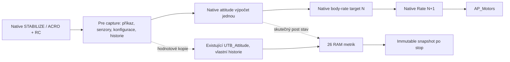

# FÁZE 3E-1 – Nativní Attitude SHADOW

Datum: 2026-10-23. Větev `test/skystars-5inch`, HEAD `070c189cdfa8357307ee1aebe8f3677cd849d520` + necommitnutý pracovní strom.

**Implementováno a unit/SITL/build ověřeno. Hardware neověřeno.** Kandidát je připraven k samostatně schválenému prvnímu DISARMED testu 3E-2; není tím schválen upload, aktivní UTB řízení ani let.

Artefakty: `tmp/utb-3e1-20261023_203945/`. Původní zdroje v `checkpoint.tar.gz` a `checkpoint-manifest.json` (7638 souborů); aktuální změny v `phase-manifest.json` a `phase.patch`. Nic nebylo commitnuto, nahráno do FC ani instalováno. COM5 se nepoužíval.

## 1. Audit skutečné regulační cesty

Pevné pořadí [scheduler_tasks](../ArduCopter/Copter.cpp#L113): INS update → native rate (117) → AP motor output (125) → původní Rate SHADOW (127) → AHRS (130) → kontrola EKF resetu → update_flight_mode (139). Nový modul nepřidává FAST_TASK.

[STABILIZE](../ArduCopter/mode_stabilize.cpp#L57) volá `input_euler_angle_roll_pitch_euler_rate_yaw_rad`. [ACRO](../ArduCopter/mode_acro.cpp#L60) používá `input_rate_bf_roll_pitch_yaw_2_rads` při RATE_LOOP_ONLY; jinak normal `input_rate_bf_roll_pitch_yaw_rads` (63). Zachycují se již skutečně zpracované AP pilotní příkazy, nikoli duplikát RC/trainer mapování.

Capture je přímo na vstupu a návratu těchto tří funkcí ([native source](../libraries/AC_AttitudeControl/AC_AttitudeControl.cpp#L420)). Vstupy: command, dt, aktuální AHRS view quaternion, přesná AHRS yaw hodnota, poslední gyro použité native rate smyčkou, účinné angle-P scale, P/accel/rate limity, FF/sqrt přepínače a shaping TC. `get_latest_gyro()` na Copteru čte `_rate_gyro_rads`; nepoužívá se místo něj nově odebraný INS gyro sample. AHRS quaternion se počítá ze stejné main-thread view matice, která se uvnitř těchto funkcí nemění.

Historie zahrnuje target quaternion, quaternion attitude error, Euler target/rate, target angular velocity/acceleration, výstupní body rates, thrust angle/error a yaw FF scalar. Native input nejprve integruje předchozí target a potom provádí shaping/attitude výpočet. RATE_LOOP_ONLY obchází attitude correction a předává shaped body rates.

**Attitude(N) vytváří target pro Rate(N+1).** Nové porovnání patří výhradně konkrétnímu Attitude(N) volání. Nesrovnává jeho výstup s targetem, který již spotřeboval Rate(N). Main-loop `loop` a pořadí operací `seq` jsou oddělené; reset není další regulační perioda. Souběžný test obou modulů neznamená, že jejich samostatně spuštěné session čítače mají totožné číslo cyklu.

Vnější landed/throttle gain reduction se nepočítá podruhé: účinné `_angle_P_scale` je skutečný per-call vstup. Neověřuje se zde matematika RC mapy, landed gain reduction ani celý end-to-end řetězec s párováním Rate(N+1).

## 2. Architektura a synchronizace



- One-step importuje native **pre** historii každé operace. Continuous ji importuje pouze na začátku epochy, dále ji vyvíjí vlastní výpočet. Vstupem není hotový native target po porovnávaném výpočtu.
- Epochy: začátek session, změna podporovaného módu a návrat z nepodporovaného provádění. Změna trvalé konfigurace je DESYNC se stopem; scalar/vector fingerprint je bitově přesný. `dt` a účinné gain scale jsou per-call vstupy, nikoli důvod synchronizovat každý cyklus.
- `reset_target_and_rate`, `reset_yaw_target_and_rate`, `relax_attitude_controllers` a `inertial_frame_reset` se zachycují jako skutečné externí příkazy a přehrávají existující UTB funkcí. Post-reset AP target se do UTB nekopíruje. Resetové operace se počítají samostatně.
- Před kontinuálním krokem se kontroluje shoda vlastní a native prehistorie. Seq mezera, chybějící/duplicitní primary volání, neplatné hodnoty a změna konfigurace se neskrývají. Záporné/nečíselné relevantní limity jsou odmítnuty; quaterniony musí projít původním AP `is_unit_length()` kritériem. To je diagnostická validace, nikoli nová letová obálka.
- Quaternion skupiny target/error se porovnávají po sjednocení znaménka; počítá se počet ekvivalentních reprezentací. Ostatní veličiny, zejména body rates, se porovnávají přímo. Surové max/RMSE se neanulují tolerancí; mismatch práh je `1e-6 * max(1, abs(native))`. Ve všech úplných podporovaných SITL profilech byla skutečná max i RMSE **0**.
- Chyba vypne pouze diagnostiku. Nemění mód, arming, spool, throttle ani původní failsafe.

Podporováno je main-thread Copter STABILIZE/ACRO, nominálně 400 Hz, včetně RATE_LOOP_ONLY a skutečných výše uvedených resetů. Jiný mód, FSTRATE nebo jednou spuštěný rate thread jsou `UNSUPPORTED`. Nepodporovaná konfigurace heli trimu se neoznačuje validní. Nový Attitude modul nepožaduje SMAX/notch=0: nepoužívá rate PID filtr/slew historii; omezení původního samostatného Rate SHADOW zůstávají beze změny.

## 3. Izolace, životní cyklus a API

Compile flag `AP_UTB_ATTITUDE_SHADOW_ENABLED`, default **0**, build option `UTB_ATTITUDE_SHADOW`. Runtime `UAS_RUN=0` po každém bootu, `1` one-step, `2` continuous. `UAS_COUNT=4000`, rozsah 1–200000 main-loop pokusů. Nový AP_Param root klíč **263**; původní indexy se neposouvají. `UNS_RUN` a historický `UTB_ENABLE` nejsou řídicími přepínači této samostatné session.

Jeden konečný snapshot za boot. Export `@SYS/utb_attitude_shadow.txt` poskytuje statistiky až po stopu a pouze DISARMED. Během okna vrací pending, nečte měněné statistiky. Publikace používá lock-free atomic bool release/acquire; po publikaci se data nepřepisují. Další session vyžaduje nový boot; opakované zadání RUN nepovažovat za důkaz nového běhu.

Writer je pouze main thread; guard kontroluje identitu threadu před čtením capture polí. Neexistuje queue, nový worker ani sdílený čekací zámek. Ve fast path nejsou DataFlash/MAVLink zápisy, text, mutexy, heap alokace nebo konstrukce regulátoru. `ExpandingString` se používá pouze pro export mimo okno.

`UTB_State` má hodnotový režim bez živého AHRS odkazu. Inertní `UTB_Attitude` konstruktor nemá motorový objekt a nepublikuje singleton. Původní borrowed view a motorové použití ostatních UTB modulů zůstávají funkční. Volitelný pointer je nutný pro explicitní nepřítomnost motorového logging objektu; není to nová cesta k výstupům. Math adapter implementuje rate/throttle virtuální výstupy jako no-op.

## 4. Přesný manifest změn této fáze

15 upravených + 6 přidaných souborů vůči vstupnímu checkpointu. Celkový Git diff navíc obsahuje původní necommitnutou práci 3B–3D5; nesmí být zaměněn s tímto manifestem.

| Soubor | Stav | Zásah |
|---|---|---|
| `ArduCopter/Attitude.cpp` | upraven | Příprava main-loop kontextu před rate smyčkou; stará Rate SHADOW větev zachována. |
| `ArduCopter/Copter.h` | upraven | Samostatný pevný diagnostický objekt za compile guardem. |
| `ArduCopter/Parameters.cpp` | upraven | Root parametrická skupina UAS_. |
| `ArduCopter/Parameters.h` | upraven | Nový volný root klíč 263; ostatní klíče se neposouvají. |
| `ArduCopter/mode.cpp` | upraven | Ukončení/zaúčtování okna po skutečném flightmode->run(). |
| `ArduCopter/system.cpp` | upraven | Inicializace, RUN vždy 0 po bootu. |
| `Tools/scripts/build_options.py` | upraven | Default-OFF volba UTB_ATTITUDE_SHADOW. |
| `Tools/utb/tools/test_utb_attitude_shadow_sitl.py` | přidán | Oddělené skutečné SITL scénáře a post-window export. |
| `docs/UTB_PHASE_3E1_ATTITUDE_SHADOW_CS.md` | přidán | Tento audit, výsledky a omezení. |
| `libraries/AC_AttitudeControl/AC_AttitudeControl.cpp` | upraven | Hodnotové pre/post hooks, resetové události, read-only motor audit; původní rovnice zachovány. |
| `libraries/AC_AttitudeControl/AC_AttitudeControl.h` | upraven | Read-only projekce historie/konfigurace/senzorů. |
| `libraries/AC_AttitudeControl/AC_AttitudeControl_Shadow.h` | přidán | Lehké hodnotové rozhraní bez AP objektových odkazů. |
| `libraries/AP_Filesystem/AP_Filesystem_Sys.cpp` | upraven | Read-only soubor utb_attitude_shadow.txt. |
| `libraries/AP_UTB/AP_UTB_AttitudeShadow.cpp` | přidán | Nezávislá historie, replay skutečných resetů, metriky, finite session a immutable publication. |
| `libraries/AP_UTB/AP_UTB_AttitudeShadow.h` | přidán | Pevný math adapter/engine/wrapper, bez motorového sinku. |
| `libraries/AP_UTB/AP_UTB_config.h` | upraven | Samostatná dostupnost a zpřístupnění existující matematiky. |
| `libraries/AP_UTB/UTB_Attitude.cpp` | upraven | Snapshot adapter, motorless logging guard; doplněny původní AP normal ACRO a relax funkce. |
| `libraries/AP_UTB/UTB_Attitude.h` | upraven | Motorless konstruktor bez singleton publikace; projekce stavu. |
| `libraries/AP_UTB/UTB_Rate.cpp` | upraven | Pouze syntaxe přístupu k volitelnému motorovému odkazu (. → ->), nikoli matematika. |
| `libraries/AP_UTB/UTB_State.h` | upraven | Hodnotový snapshot vedle původního borrowed AHRS view rozhraní. |
| `libraries/AP_UTB/tests/test_utb_attitude_shadow.cpp` | přidán | 30 diferenciálních a lifecycle testů proti skutečnému AP. |

Původní `UTB_Attitude` neměl normal ACRO vstup ani relaxaci. Tyto dvě relevantní funkce jsou převzaty z místního native AP zdroje, za novým guardem. Ověřené původní UTB rovnice, filtry a shaping se nemění. Licence a původ převzatého kódu zůstávají uvedeny.

## 5. Unit, SITL a bezpečnostní regrese

C++: **175 PASS**, jeden volitelný OfflineVectors SKIP. Z toho **30 nových** Attitude/lifecycle testů, 23 původních Rate SHADOW, 47 základních UTB, 3 UTB math, 5 native AP/UTB, 1 původní 50Hz native bench, 20 ACRO RC, 13 ANGLE RC, 9 allocation, 14 SITL-attitude math a 10 SITL-rate math. Synthetic test binary v této konfiguraci obsahuje 0 aktivních testů; jeho funkční pokrytí se netvrdí.

Python: 164 případů, **159 PASS / 5 SKIP**. Parametrická metadata prošla parserem, `UAS_RUN`/`UAS_COUNT` jsou v `metadata/apm.pdef.json`. Flake8 nového runneru, astyle nových C++ souborů a `git diff --check` prošly.

Následující tabulka je pouze poslední acceptance série (`sitl-acceptance-*`), nikoli součet opakovaných vývojových běhů. Invalid i numerický mismatch jsou ve všech uvedených bězích 0. `valid` zahrnuje primary výpočty i samostatně porovnané resetové operace; jejich počty jsou v exportovaných `command_0..6`.

| Scénář | Main pokusy | Valid operace | DESYNC | Unsupported main | Synchronizace | Reset replay |
|---|---:|---:|---:|---:|---:|---:|
| DISARMED, one-step | 8000 | 16000 | 0 | 0 | 16000 | 8000 |
| DISARMED, continuous | 8000 | 16000 | 0 | 0 | 2 | 8000 |
| Let, one-step | 16000 | 16000 | 0 | 0 | 16000 | 0 |
| Let, continuous | 16000 | 16000 | 0 | 0 | 3 | 0 |
| ACRO RATE_LOOP_ONLY, let | 16000 | 16000 | 0 | 0 | 3 | 0 |
| Attitude + Rate SHADOW, let | 16000 | 16000 | 0 | 0 | 3 | 0 |
| Záměrná změna ATC_INPUT_TC | 911 | 1821 | 1 | 0 | 2 | 910 |
| FSTRATE/rate thread | 8000 | 0 | 0 | 8000 | 0 | 0 |
| RC failsafe | 16000 | 1749 | 0 | 14251 | 1 | 0 |
| GCS failsafe | 16000 | 5514 | 0 | 10486 | 1 | 0 |
| Runtime OFF, let | — | — | — | — | — | — |
| Attitude-only build, let | 16000 | 16000 | 0 | 0 | 3 | 0 |

Sedm úplných podporovaných profilů má dohromady **112000/112000 valid operací**, všech 26 maximálních chyb i RMSE 0. Letové profily mají 16000 skutečných primary výpočtů, žádné reset replay a nenulové požadavky, orientace i attitude chyby. Continuous STABILIZE→ACRO→STABILIZE má tři importy epochy, nikoli 16000 importů. Samostatný build bez Rate SHADOW úspěšně provedl tentýž dynamický let.

V parallel profilu původní Rate SHADOW současně dosáhl 16000/16000 valid a max/RMSE 0. Jde o koexistenci dvou nezávislých porovnání, ne o nové párování jejich čítačů do celého řetězce.

Config test skončil v main pokusu 911: 1821 valid operací + 1 DESYNC, stop reason 3. To je očekávaný ochranný výsledek, nikoli kompletní numerický PASS. Záměrná seq mezera, neoznámená změna historie a vadné quaterniony jsou navíc pokryty unit testy.

RC failsafe použil skutečný AP LAND fallback; GCS při `FS_OPTIONS=16` pokračoval v pilotním řízení a LAND byl přikázán až při ukončování testu. Nepodporované LAND intervaly jsou výslovně zaúčtované. Inertial-frame reset a relax replay jsou diferenciálně ověřeny v unit testech; skutečný EKF reset za letu se tímto testem netvrdí.

Také prošly původní native Rate SHADOW dynamická regrese, FÁZE 0 skeleton regrese a native let na compile-OFF firmware. Původní počáteční RC-failsafe pokus ve vývojové sérii selhal na nesprávném požadavku runneru na nenulový shaping při neutrálu; firmware měl nulové odchylky. Assert byl opraven a samostatné acceptance běhy jsou zachované. Původní známá logger-OFF chyba `AC_CustomControl` se neopravovala.

## 6. Motorová izolace

`isolation-audit.json`: původní native attitude rovnice se po vynechání nových guardovaných bloků přesně shodují s checkpointem. Totéž platí pro existující UTB matematiku po mechanické změně logging odkazu. Native Rate/PID SHADOW, AC_PID a všechny chráněné AP_Motors/HAL/arming/logger zdroje jsou nezměněné: **2064 souborů**. Není odstraněn žádný původní zdroj.

Každý capture provádí bitový audit šesti native motorových R/P/Y+FF polí a native body-rate targetu před/po inertním výpočtu. Všechny acceptance capture mají `motor_changes=0`. To není měření fyzického PWM/DShot, throttle/spool ani letová kvalifikace.

Native standardní BIN logy ON/OFF potvrzují skutečný pohyb: max požadované R/P/Y rates ON přibližně 17,41/18,62/30,41 °/s; native roll/pitch dosáhly 32,90/43,74°. OFF: 17,39/18,58/30,42 °/s a 33,26/43,99°. Tyto hodnoty popisují celé ozbrojené STABILIZE/ACRO úseky, nikoli přesnou hranici RAM okna. Ve čtyřech shodných skupinách mód+RC setpoint se průměr motorových PWM lišil nejvýše o 0,607 µs (`motor-groups-off-on.json`). Samostatné uzavřené běhy nemají bitově stejnou senzorovou historii a načasování doručení RC; nulová odchylka celých motorových trajektorií se netvrdí. Izolaci dokládá hlavně absence motorové cesty a audit téhož volání.

## 7. Buildy, paměť a časování

PASS: SITL ON/OFF, H743 ON/OFF; v této matici původní Rate SHADOW zůstává ON. Navíc SITL Attitude-only s Rate SHADOW compile-OFF a SITL compatibility s původními aktivními UTB moduly/50Hz bench pouze pro software unit regrese. H743 neobsahuje aktivní UTB mode42/43/Core output symboly. OFF neobsahuje Attitude SHADOW engine ani jeho parametry/export.

Reprodukovatelné příkazy z kořene repozitáře (použít samostatné nové build adresáře; board konfigurace nespouštět souběžně):

```sh
export PATH="$PWD/.venv/bin:/opt/gcc-arm-none-eabi-10-2020-q4-major/bin:$PATH"
./waf configure --board SkystarsH7HD-bdshot --enable-UTB \
  --disable-UTB_RATE_SITL --disable-UTB_NATIVE_BENCH --disable-UTB_LOGGER_TRACE \
  --enable-UTB_NATIVE_SHADOW --enable-UTB_ATTITUDE_SHADOW --out=tmp/utb-3e1-build-on
./waf copter -j6
# OFF: stejný configure, --disable-UTB_ATTITUDE_SHADOW a jiný --out.
# SITL: --board sitl; Attitude-only navíc --disable-UTB_NATIVE_SHADOW.
```

Skutečné příkazy a exit kódy jsou v `*-results.json`, `qualification.json`, `build.py` a `build-compat.py`; H743 buildy navíc použily `CXXFLAGS=-fstack-usage`.

| ELF sekce | H743 OFF | H743 ON | Rozdíl |
|---|---:|---:|---:|
| `.text` | 1248644 | 1261500 | +12856 B |
| `.data` | 4172 | 4172 | 0 B |
| `.bss` | 122536 | 124840 | +2304 B |
| main stack | 7168 | 7168 | 0 B rezervace |
| ISR stack | 1536 | 1536 | 0 B rezervace |

Použity skutečné ELF sekce, nikoli waf agregát zahrnující více sekcí. Největší samostatný `.su` rámec je start statistik 600 B; engine process přibližně 592 B, native STABILIZE hook funkce 288 B a post-capture/audit 176 B. Nejde o kumulativní stack ani změřený watermark. Skutečná rezerva stacku H743 s novým modulem je neověřená.

Časy jsou oddělené: pre capture; post capture+audit bez vnořeného consume; validace/synchronizace; UTB math; porovnání; celý consume. `native_capture` je zvláštní překrývající se span obsahující původní AP výpočet, nesmí být vydáván za dodatečnou režii ani přičítán k ostatním jako disjunktní čas. Timer účetnictví a samotné časovací volání také něco stojí; úplný WCET se netvrdí. Consume ≥2500 µs zastaví diagnostiku, ne původní AP; toto kritérium samo nedokazuje dostatečnou rezervu smyčky.

SITL AP_HAL čas je během výpočtu zmrazený: exportované výpočetní časy 0 nejsou nulová režie. Virtuální capture perioda úplných letových profilů byla průměrně 2499,989 µs, min 2499 / max 3332 µs; nejsou to H743 timing výsledky. Samostatné host `steady_clock` měření je v `host-only-attitude-benchmark.log`, 2000 kroků: process průměr 1,882 µs, medián 1,572 µs, P95 2,224 µs, P99 19,606 µs, maximum 41,548 µs. Host wall span zahrnuje možné preempce OS. Nelze z něj odvodit H743 čas, CPU load nebo WCET. H743 math/capture/consume, jitter, PM, CPU a stack watermark této fáze **nebyly měřeny**.

H743 ON APJ: `tmp/utb-3e1-20261023_203945/H743_ON/SkystarsH7HD-bdshot/bin/arducopter.apj`, board ID 1075, **1143607 B**, SHA-256 `1e62b800a7dc57f9c3ce88e597050bfd4c65752386314339524cfae868bcb7c4`.

H743 OFF APJ: **1131335 B**, SHA-256 `89479a2b7851b175b46c32692eb970633238ac32ae14dc0100088a44d440ddee`. Žádný z těchto buildů nebyl nahrán do FC.

## 8. Omezení a návrh samostatně schvalovaného 3E-2

1. Nejprve USB-only DISARMED, bez LiPo/vrtulí; ověřit identitu, senzory/AHRS a stav konfigurace. Před případným uploadem vyžádat souhlas s přesným APJ/SHA. Dosavadní logger prodlevy se touto změnou neopravují.
2. Stejný firmware, baseline `UAS_RUN=0`, `UNS_RUN=0`, potom pouze jeden krátký one-step běh `UAS_COUNT=1000`, `UAS_RUN=1`. Native STABILIZE, skutečný main 400 Hz, FSTRATE/rate thread OFF. Neměnit AP tune kvůli shodě.
3. Během okna žádný MAVFTP, log listing/download, tasks.txt ani změny loggeru/parametrů. Po stopu ověřit DISARMED/RUN0 a teprve potom exportovat snapshot a stav stacku.
4. Vyhodnotit všechny primary/reset operace, invalid/desync/unsupported/mismatch, synchronizace, max/RMSE, motor audit, oddělené timing spans a nezávislé main-loop/CPU/PM údaje, pokud jsou nerušivě dostupné.
5. Při změně motorových hodnot, numerické neshodě, neočekávaném DESYNC, InternalError, problému senzorů/loggeru, restartu nebo významné periodové anomálii ukončit diagnostiku a vyhodnotit. Neopakovat automaticky a nesnižovat ochrany kvůli PASS.
6. DISARMED STABILIZE resetuje yaw historii; ani případný úspěch nebude důkazem samostatného vývoje attitude historie za letu. Continuous HW a budoucí pasivní let vyžadují samostatné rozhodnutí, nové měření režie/stacku a případně rozšíření podporovaných native funkcí.

**Závěr:** software kandidát pro omezené samostatně schválené DISARMED 3E-2 je připraven. Pasivní let, aktivní H743 UTB řízení a jejich bezpečnost nejsou ověřeny. Původní výsledky 3D4/3D5 prošly SHA kontrolou; pracovní index je prázdný a HEAD zůstává původní.
