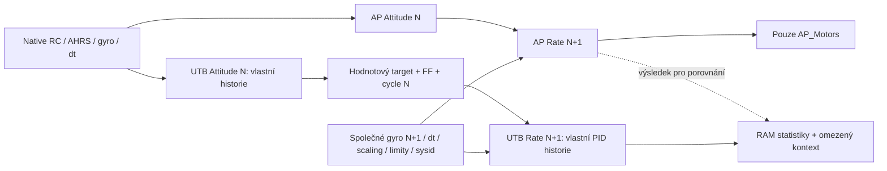

# FÁZE 3F-1 – Integrovaný Attitude → Rate/PID SHADOW

**Implementováno, unit/SITL a čtyři build varianty ověřené. Hardware neověřeno.** Žádný přístup k COM5, upload nebo fyzický ARM. ArduPilot řídil také všechny simulované lety; UTB zůstalo pasivní.

## Předimplementační návrh a hranice

Výchozí HEAD 1a76160fc4527dbb8aae6a3454b143fa73c42ebb; reporty 3E4/3E5 uložené samostatně v commitu 90b24237c94d935fbc7907488155d07d87fc3934. Kapitola zůstává mimo index. Tato sekce je návrh před změnami C++; výsledky budou uvedené odděleně až po skutečném ověření.

Native pořadí v `ArduCopter/Copter.cpp`: INS → Rate → motor output → AHRS → EKF reset → flight mode / Attitude. Native Rate lokálně kopíruje `_ang_vel_body_rads`, přidá sysid reference, pak přesně jednou volá PID na každé ose. Attitude později přepisuje `_ang_vel_body_rads` pro následující Rate. Mezi cykly mohou nastat externí resetové operace; ty se musí přehrát v pořadí native volání.



Integrační engine bude vlastnit existující `UTB_AttitudeShadowEngine` a `UTB_RateShadow`, oba continuous. Getter vlastního Attitude výsledku a Rate výsledku bude hodnotový/read-only; algoritmy zůstávají stejné. Capture rozhraní budou distribuovat stejné kopie nezávislým samostatným i integrovanému consumeru, bez nutnosti zapnout samostatné runtime sessions.

V prvním cyklu není předchozí UTB target: Rate se výslovně označí jako warmup, nikoliv validní chain krok s native targetem. První Attitude provede počáteční synchronizaci, vytvoří vlastní target a FF. Další Rate musí spotřebovat slot právě z předchozího main ID. `UTB input.target = vlastní slot.body + skutečný společný sysid vstup`, nikoliv native body target. Native target slouží pouze k porovnání a měření odchylky. Yaw FF scale pochází rovněž z vlastního Attitude výsledku. Gyro/dt/PD/I scaling/actuator/saturation jsou společné skutečné vstupy native Rate capture.

ACRO zachovává skutečný native command/shaping vstup (normal nebo RATE_ONLY podle AP nastavení), nikoliv uměle doplněný angle target. Přechod podporovaného módu je explicitní Attitude epocha s počítanou synchronizací; PID historie zůstává kontinuální, pokud AP pouze přehrál zachycené externí I/filter události. Změna trvalé konfigurace, chybějící/duplicitní capture nebo neshoda návaznosti se neskrývá importem native targetu. Při upstream odchylce se následující Rate vypočítá ze skutečně odlišného UTB targetu a odchylka se vykáže s upstream příčinou, poté diagnostika skončí.

Samostatný default-OFF compile/runtime guard, konečná session, pevná RAM, žádný fast-path logger/MAVLink/heap/mutex/worker. Export až po immutable publikaci, DISARMED. Nepodporované SMAX/notch/rate thread a ostatní módy nejsou validní. H743 má pouze pasivní diagnostiku; aktivní UTB zůstává compile-out. V této fázi není žádná práce s fyzickou FC.

## 1. Skutečně implementovaný tok

`AP_UTB_ChainShadow.*` obsahují malý transportní engine a konečnou main-thread session. Vlastní `UTB_AttitudeShadowEngine` a `UTB_RateShadow`, tedy existující skutečné výpočty `UTB_Attitude`, `UTB_Rate::shadow_rate_step` a `UTB_PID`. Nový PID, attitude algoritmus ani mixer nevznikl. Přidané getters zpřístupňují jen vlastní hodnotové výsledky; nemění matematiku.

Integrační místa:

- `ArduCopter::run_rate_controller_main()` připraví diagnostický main ID a kontext před skutečným native Rate. Counter přibude jednou při každém volání této FAST_TASK, nejde o zaměnitelný pořadový index Attitude resetů.
- `AC_AttitudeControl_Multi::rate_controller_run_dt()` zachytí reference **po** přidání společného sysid vstupu, gyro, skutečné dt, PD/I scale, actuator sysid, yaw FF scale a skutečné motorové limit flags. Snapshoty tří native PID jsou před a po jejich původním jediném výpočtu. Po něm proběhne inertní UTB výpočet a audit native hodnot.
- Původní Attitude value hooks ve `AC_AttitudeControl.cpp` přes namespace `UTBAttitudeCapture` fan-out předají stejné hodnoty samostatné i integrované diagnostice, jen pokud je daný consumer aktivní. Native reference vzniká uvnitř původních input funkcí v `_ang_vel_body_rads`, nikoliv v novém transportu.
- `Copter::update_flight_mode()` dokončí a zkontroluje diagnostický main krok po původním `flightmode->run()`.
- `AP_Filesystem_Sys.cpp` přidává jediný post-window soubor `@SYS/utb_chain_shadow.txt`. V průběhu session je pouze pending; po immutable publikaci je dostupný DISARMED.

Jediná cesta do vstupu UTB PID v `UTB_ChainShadowEngine::rate()`:

```cpp
_target = _attitude.history();           // při předchozím primary Attitude kroku
_consumed = _target.body + sysid;        // společný externí sysid, nikoliv native target
frame.input.target = _consumed;
frame.input.yaw_ff_scale = _target.feedforward;
_rate.process(frame);                   // uvnitř UTB_Rate::shadow_rate_step a UTB_PID
```

První řádek se skutečně vykonává při produkci slotu v předchozím cyklu, další při jeho spotřebě. Native target v kopii frame zůstává pouze oracle pro čtyři upstream metriky a poslední diagnostický kontext. **Před voláním `_rate.process` je výpočetní target vždy nahrazen vlastním UTB výsledkem.** Neexistuje fallback, který by při chybě použil native target.

Slot musí existovat a platí `rate_loop == source_loop + 1U` v unsigned 32bit aritmetice. Dvojí primary/Rate, chybějící dokončení nebo nesprávné párování jsou chyby, ne validní vzorky. Unit test pokrývá wrap hlavních ID i časů. První native Rate po spuštění je explicitní **warmup**, bez UTB Rate výpočtu a bez fake valid kroku. Na konci N pokusů je běžně N−1 spárovaných Rate a poslední Attitude target zůstává mimo konečné okno nespotřebovaný. Nejde o skrytou ztrátu posledního cyklu.

STABILIZE dostává skutečné native Roll/Pitch angle a yaw-rate příkazy. Normal ACRO používá `input_rate_bf_roll_pitch_yaw_rads`; RATE_LOOP_ONLY používá `input_rate_bf_roll_pitch_yaw_2_rads`. Nevkládá se do ACRO umělý stabilizační úhel. RC kalibrace/trainer/mapování, landed/throttle gain boost, INS/AHRS/EKF a AP_Motors nejsou znovu implementované: sdílejí se jejich skutečné příkazy, senzorové hodnoty a účinné scale. Tato fáze neověřuje vlastní RC mapu ani vlastní rozhodování o armingu/reset policy.

## 2. Historie, epochy a resetové události

Oba existující enginy běží continuous. Rate/PID má ve všech přijatých scénářích **jednu plnou synchronizaci**. Další změny integrátoru a filtrů jsou pouze skutečné native pending `i_set`/`reset_filter` události. Neimportuje se AP integrátor na obyčejných armed krocích. I-event je zde událost na ose při vstupu Rate, nikoliv počet všech C++ setter volání, která se před ním mohla sloučit.

Attitude importuje historii na začátku epochy. Přechody podporovaných módů jsou **explicitní nové epochy** podle zachovaného Attitude enginu: běh STABILIZE→ACRO→STABILIZE proto hlásí **3 synchronizace, z toho 2 dodatečné**, nikoliv jednu. Je to záměrná a viditelná hranice návrhu; native mode-init může změnit historii mimo otevřený capture krok. **Nepotvrzuje se nepřerušená nezávislá Attitude historie přes mode-init.** Uvnitř epoch se celé historie průběžně nekopírují; Rate historie se na přechodech módů neimportuje znovu.

Skutečné Attitude reset příkazy se přehrávají stejnou UTB funkcí; native post stav se nekopíruje místo výsledku resetu. DISARMED zachytil 6000 yaw resetů, jejich vliv na omezenou yaw historii je stejným omezením jako v 3E5. Full target/rate reset, relax a inertial reset prošly deterministickými testy proti skutečné native AP funkci; jejich výskyt za běžných dynamických SITL letů se netvrdí. Auxiliary PID objekt Attitude math není vlastní Rate větev; skutečné externí PID resetové flags se přehrávají do samostatné Rate instance.

Změna konfigurace nebo gyro instance, neplatné hodnoty, ztráta historie či kroku diagnostiku zastaví. Nepodporovaný mód, rate thread/FSTRATE, notch nebo SMAX jsou explicitně UNSUPPORTED (reason 6 a příslušné komponentní čítače). Chyba mění jen UCS_RUN/diagnostiku. Nevyvolá změnu flight módu, disarm nebo motorový setter.

Upstream metriky porovnávají tři skutečně spotřebované body rates a yaw FF scale; downstream metriky zahrnují 18 stavových/výstupních veličin na každé ose. `upstream_mismatch=1` společně s následným downstream rozdílem ukáže přítomnost odchylky už před PID, nikoliv důvod automaticky obvinit PID matematiku. Downstream rozdíl při shodném targetu je oddělený případ. Souběžnou kombinaci více nezávislých chyb nelze z těchto dvou čítačů vždy jednoznačně kauzálně rozložit.

## 3. Parametry, výpis a omezený export

- `AP_UTB_CHAIN_SHADOW_ENABLED`, build option **UTB_CHAIN_SHADOW**, default **0**. Závislosti UTB, UTB_NATIVE_SHADOW a UTB_ATTITUDE_SHADOW zpřístupňují jejich capture/value API, nevyžadují zapnout jejich runtime sessions.
- **UCS_RUN=0** vypnuto; **UCS_RUN=1 znamená continuous**. Není to UAS_RUN=1 one-step a UCS_RUN=2 není podporovaný příkaz.
- **UCS_COUNT=4000** default, rozsah 2–200000 main pokusů. Root AP_Param klíč **265**, skupinové indexy RUN=0, COUNT=1; původní klíče se nepřesouvají.
- RUN je při boot init vynulovaný. Jedna immutable session za boot; druhý požadavek ji nepřepíše. Samostatné UAS/UNS mohou zůstat 0. Historické UTB_ENABLE/UTB_SHADOW nejsou runtime ovladače této nové skupiny.

Export obsahuje celkové/componentní seen/valid, warmup/pairing, importy, resety, chyby, reason, motor audit, poslední source/consumer main ID, Rate sequence a časové statistiky. Akumuluje **26 Attitude + 4 upstream + 3×18 PID metrik = 84 max/RMSE**. PID projekce obsahuje LPF target/error, obě derivace, integrátor, P/I/D/FF/D_FF/Dmod, control/FF output, limit/PD_limit/reset/I-event flags a actual. SMAX wall-time telemetry se při SMAX=0 neporovnává; aktivní SMAX/notch nejsou podporované.

Raw export drží **poslední spárovaný kontext**, ne neomezený seznam všech floatů: source příkaz/AHRS, vlastní target/error quaternion a oba skutečně spotřebované Rate targety, gyro/dt/flags, native/UTB PID složky a výstupy. Source snapshot je z N, Rate z N+1; nejde o poslední novější Attitude, které už nespotřeboval žádný měřený Rate. Každý podporovaný krok je porovnaný v RAM, ale nelze všechny jednotlivé float vektory z finálního souboru znovu offline přepočítat. Toto omezení není prezentováno jako plný raw audit.

Max/RMSE Attitude se exportují na 9 desetinných míst, mismatch tolerance je zachovaná `1e-6 * max(1, abs(native))`. PID a upstream mismatch jsou strict numerické nenulové rozdíly. Exportované nuly nejsou tvrzení o bitovém auditu pod rozlišením textu. Quaternion znaménková ekvivalence a finite/unit-length kontroly zůstávají zachované.

## 4. Unit a skutečné SITL výsledky

**121 C++ PASS / 1 SKIP**: 18 nových Chain, 30 původních Attitude SHADOW, 23 Rate SHADOW, 47 základních UTB a 3 math. Volitelný OfflineVectors je SKIP. Timing target v tomto compile profilu obsahuje 0 aktivních testů, protože Timing je vypnuté; nepřičítá se fiktivních 14 PASS.

Nové testy pokrývají párování N→N+1, počáteční import a warmup, vlastní continuous historii, skutečné native full/yaw/relax/inertial reset výpočty, PID I/filter pending replay, mode epochu, konfigurační změnu, missing/duplicate/wrong pair, NaN/dt=0, unsupported/notch, unsigned clock/main-ID wrap, motor audit a společný nenulový sysid/actuator.

Klíčový negativní test změní **vlastní UTB slot body.x o 0,25 rad/s**: ověří změnu skutečně spotřebovaného UTB Rate targetu i následný PID mismatch. Kdyby Rate používal native target, tento test by neprošel. Druhý test poruší kopii už vypočteného UTB PID výstupu při shodném Attitude targetu a ověří stejný comparator, který používá runtime; navíc záměrně poruší output oracle pro ověření downstream účetnictví. Testovací injekce nemění původní regulátory nebo produkční matematiku.

Přijaté skutečné procesy jsou `sitl-release-*`, s výjimkou RATE_ONLY, kde je rozhodující pozdější **sitl-rate-only-verified**. Každý měl vlastní loopback proces, parametry, TLOG/BIN, frozen snapshot, JSON a konzoli. Simulované standardní ARM/let povolené; žádné force-arm. Generický model **bfxrev** bez změny fyziky. AP byl jediným aktivním regulátorem.

| Scénář | Main attempts | Spárované Rate | Valid Attitude operace | Att/PID importy | Externí I events | Unsupported / reason |
|---|---:|---:|---:|---:|---:|---:|
| DISARMED, native přechody | 6000 | 5999 | 12000 | 3 / 1 | 17994 | 0 / 1 |
| Dynamický let STABILIZE↔ACRO | 16000 | 15999 | 16000 | 3 / 1 | 0 | 0 / 1 |
| Skutečný RATE_LOOP_ONLY | 16000 | 15999 | 16000 | 3 / 1 | 0 | 0 / 1 |
| Souběh Chain + UAS + UNS | 16000 | 15999 | 16000 | 3 / 1 | 0 | 0 / 1 |
| Nenulové FF/D_FF | 16000 | 15999 | 16000 | 3 / 1 | 0 | 0 / 1 |
| RC failsafe | 1690 | 1688 | 1689 | 1 / 1 | 0 | 1 / 6 |
| GCS failsafe + dokončení LAND | 4725 | 4723 | 4724 | 1 / 1 | 0 | 1 / 6 |
| Vysoký collective, blízkost PWM limitu | 16000 | 15999 | 16000 | 3 / 1 | 0 | 0 / 1 |

**Ve všech podporovaných porovnáních všech 84 max/RMSE = 0; invalid, mismatch, DESYNC, missing/duplicate a motor_changes = 0.** V každém běhu je jeden warmup. U failsafe jsou navíc jednotlivé nepodporované main pokusy správně odmítnuté, nikoliv připočtené jako validní. Reason 1 je dokončení počtu, reason 6 nepodporovaný kontext. V běžném letovém profilu má Rate 15998 intervalů, 2499–3332 µs, průměr 2499,989 µs **virtuálního SITL času**. Clock/seq hodnoty a jejich počty jsou ve snapshotu, neodvozují se pouze z nastaveného SCHED_LOOP_RATE.

RC ztráta skutečně vyvolala native failsafe přechod (BIN MODE reason 3 do RTL/LAND); nový modul skončil UNSUPPORTED. GCS případ skutečně vyvolal ERR subsystem 8/code 1 a hlášení Continuing Pilot Control při původním FS_OPTIONS=16. Zůstal STABILIZE a Chain pokračoval; UNSUPPORTED nastalo až při následném řízeném LAND. Nejde o implementaci UTB RTL/LAND. Důkazy jsou v `native-failsafe-evidence.json` a events/BIN příslušných případů.

Runtime OFF profil a samostatné původní Rate/Attitude SITL regrese prošly; compile OFF navíc prošlo native Attitude regresí. V parallel profilu byly zvlášť vyexportované a ověřené **obě staré sessions** (`old-modules.json`), nikoliv pouze zjištěné jejich RUN parametry. Celkem přijatých scénářů hlavní sady 11; corrected RATE_ONLY nahrazuje původní chybně označený běh, nesčítá se jako další nezávislé potvrzení stejné větve.

### Měřitelná excitace a I historie

- Native STABILIZE část základního letu skutečně naměřila Roll **−3,545 až +2,580°**, Pitch **−2,468 až +2,916°**, kladné i záporné desired hodnoty. Jsou to odečty ATT logu, ne jen odeslané páčky. Celkový let včetně ACRO dosáhl Roll +28,178° a Pitch −36,593°. ATT je decimovaný; nejsou to garantované špičky všech 400Hz sample.
- Normal ACRO prokazuje **1767 command_1**, skutečný RATE_ONLY profil **1760 command_2 a 0 command_1**. Původně převzaté ACRO_OPTIONS=1 je AIR_MODE, nikoliv RATE_LOOP_ONLY; `mode.h` definuje RATE_LOOP_ONLY jako bit1, tedy **2**. Po zjištění byl opraven jen nový runner a větev nově ověřena. Staré záznamy nejsou přepsané ani přeznačené na RATE_ONLY PASS.
- Letový profil: **1762 shaping operací**, gyro norm peak **0,511598 rad/s**. RATE_ONLY 1780 shaping operací. Neutral, obě znaménka a rychlejší změny referencí jsou skutečně v datech; samotný ARM se nepoužívá jako důkaz dynamiky.
- PIDs měly **15999 kroků s nenulovým vlastním I bez pending I resetu**, jednu synchronizaci a 0 I events/filter resets. Nejde jen o nenulové počáteční I: native PIDR integrátor prošel rozsahem **−0,00132856 až +0,00170044**, PIDP **−0,00159235 až +0,00169924**, PIDY **−0,00300770 až +0,00855791**; po sobě jdoucí logové hodnoty se změnily 15998/15998/15997krát. Vlastní I je v každém spárovaném kroku numericky shodné podle RAM metrik. CSV průběhy jsou původní native data; nevyrábí se z nich falešná nezávisle zaznamenaná UTB křivka.
- Samostatný FF fixture použil pouze v daném SITL procesu native R/P FF=0,02, Y FF=0,01 a R D_FF=0,001. Je to excitace konkrétního podporovaného členu, nikoliv nový tune nebo doporučení pro hardware. Naměřené own FF peak **0,00652869**, D_FF peak **0,01261742**, přesná shoda s AP. Production/default gains se neměnily.
- Vysoký collective 1950 a kombinované páčky vyvolaly skutečné RCOU **C1 1950, C2 1921, C3 1921, C4 1949** při MOT_PWM_MIN/MAX=1000/2000. Max. **95 % nakonfigurovaného rozsahu** pochází z 18 RCOU vzorků uvnitř skutečného RCIN high-collective intervalu, ne z takeoffu. 90% kritérium runneru je jen popsaná diagnostická značka excitace blízko konce rozsahu, nikoliv bezpečnostní limit.
- **Ozbrojené R/P/Y saturation flags se nevyvolaly (limited=0).** Proto není tvrzeno armed saturation/anti-windup PASS. Limited=5999 v DISARMED znamená shutdown limit flags, nikoliv ekvivalent letové saturace. Algoritmické směrové limity/anti-windup a jejich transport ověřily unit testy; skutečný armed saturation případ zůstává otevřený.

Pole `command_norm_peak` mísí u STABILIZE úhly a yaw rate; používá se pouze jako indikátor nenulového příkazu, nepřisuzuje se mu jednotná fyzikální jednotka. Gyro a body-rate hodnoty jsou v rad/s, PID I/FF výstupy v původních AP control units.


## 5. Motorová izolace a bezpečnost

Audit ověřil **2454 chráněných souborů** beze změny proti report commit parentu: AP_Motors, HAL, arming, AC_PID, původní Attitude rovnice, UTB_PID/Rate/Attitude, Copter task table a příslušné safety zdroje. Sekvence původních `_motors.set_*` a `.update_all` ve Multi controlleru je identická. Změny v něm jsou pouze hodnotové capture/audit bloky.

V dynamických bězích **32000 native auditů**, motor_changes=0; DISARMED 18000 auditů. Audit kontroluje motorové R/P/Y a FF i native body-rate target před/po inertním výpočtu. Srovnání native RCOU sad při runtime Chain OFF/ON v DISARMED je v obou případech přesně **[1000,1000,1000,1000]**. U armed transientů se netvrdí bitově totožný průběh dvou oddělených simulací; použit je přímý audit stejného native call i source izolace.

Writer je pouze main thread, jiné vlákno se odřízne dříve, než čte running-owned pole. Fixed slot a pevné struktury; žádný nový worker nebo heap/mutex/logger/MAVLink ve 400Hz výpočtu. Immutable publikace používá lock-free atomic bool release/acquire. Dump kontroluje publikaci a DISARMED; nekopíruje živé 64bit statistiky. Po stopu se engine nemění a druhý RUN neobnovuje session. Exportní ExpandingString/FTP alokace jsou až mimo měřicí okno.

H743 ON/OFF neobsahují **UTB_Core, UTB_Output, ModeUTBAcroSITL ani ModeUTBAngleSITL**. OFF neobsahuje ani Chain funkce; SITL ON/OFF symbol audit rovněž prošel. Kompilátor v SITL inlinuje některé engine funkce, proto důkaz přítomnosti používá stabilní wrapper `complete_rate`, nikoliv předpoklad o samostatném symbolu každé funkce.

## 6. Buildy, časování a paměť

**SITL ON, SITL OFF, SkystarsH7HD-bdshot ON, OFF všechny PASS.** ON/OFF zde znamená pouze Chain feature; legacy Rate/Attitude capture jsou v obou dostupné, Timing/logger trace/native bench a aktivní UTB jsou vypnuté. Nové parametry prošly metadata parserem; flake8 nového runneru, astyle nových C++/testů a git diff --check prošly.

| H743 ELF sekce | Chain OFF [B] | Chain ON [B] | Rozdíl |
|---|---:|---:|---:|
| .text | 1261500 | 1268032 | +6532 |
| .data | 4172 | 4172 | 0 |
| .bss | 124840 | 131640 | +6800 |
| main .pstack | 7168 | 7168 | 0 |
| ISR .mstack | 1536 | 1536 | 0 |
| rezervovaný .heap | 124424 | 117624 | −6800 |

Zarovnání mění celkový flash přírůstek z build summary na 6528 B. OFF má shodné .text/.data/.bss/main/ISR sekce jako archivovaný 3E3 OFF. Není zaměňován souhrn Waf (zahrnuje další sekce) s jednotlivými ELF sekcemi.

`-fstack-usage`: nový `complete_rate` vlastní frame **832 B** (předání hodnotového Rate frame), engine rate **200 B**, `after_attitude` **368 B**, engine attitude **120 B**, start **176 B**, dump **288 B**. Jsou to vlastní statické framy, nikoliv kompletní transitive peak nebo nově změřený watermark H743. Kopie frame a dvojí persistentní kontext jsou záměrná cena hodnotové izolace; původní regulátory se kvůli ní neupravují. Starých 4352 B volných z 3E5 nelze prezentovat jako novou rezervu Chain.

K dispozici jsou AP_HAL brackety Attitude math/sync/compare, vlastní Attitude consume, capture pre/post bez nested Chain Attitude consume, PID math/consume a native+capture span, plus Rate process bracket. Část transportních kopií před `_rate.process` není v jeho consume span; native+capture zahrnuje původní AP PID a nejde o přidaný overhead. Při parallel běhu sdílený capture bracket zahrnuje také druhého consumera. Překrývající se součty se nesčítají.

**V SITL všechny tyto CPU brackety vracejí 0 virtuálních µs. Neznamená to nulový výpočetní čas. Nový H743 CPU/stack/časový benchmark nebyl proveden.** Host délky scénářů jsou jen reprodukční údaje v session.json. Žádné nové tvrzení WCET, CPU rezervy za letu nebo fyzické letové bezpečnosti.

ON APJ: **1 148 707 B**, SHA-256 **e4e763e121d0ae5390a9f34d456ca2970bf82ffb1545bd092d1a790d1f94005d**. OFF APJ: **1 143 611 B**, SHA-256 **6b0000cc7efab3e6c1a6bb44b9cde028430aba8d103cac7ea9b0def7c3daf7ca**. Oba board_id=1075. Pouze build, nic nenahráno. Binární git identity vychází z parent report commitu; přesné zdroje se identifikují staging manifestem této implementace.

Reprodukce z kořene repo (pro OFF nahradit enable za disable a použít jiný out):

```sh
export PATH="$PWD/.venv/bin:/opt/gcc-arm-none-eabi-10-2020-q4-major/bin:$PATH"
export CXXFLAGS=-fstack-usage
./waf configure --board SkystarsH7HD-bdshot --out=tmp/novy-chain-h743-on \
  --enable-UTB --enable-UTB_NATIVE_SHADOW --enable-UTB_ATTITUDE_SHADOW \
  --enable-UTB_CHAIN_SHADOW --disable-UTB_RATE_SITL \
  --disable-UTB_NATIVE_BENCH --disable-UTB_LOGGER_TRACE --disable-UTB_TIMING
./waf copter -j6
```

SITL použije `--board sitl`, vlastní out, stejné feature flags a běžný host CXXFLAGS. Přesné unit targety, argumenty skutečných SITL procesů a return codes jsou v `*-results.json`. Čtyři varianty jsou oddělené adresáře, nikoliv přepsaný jediný firmware.

## 7. Přesný manifest zásahů

**13 upravených + 5 přidaných souborů** implementačního commitu:

| Soubor | Zásah |
|---|---|
| `ArduCopter/Attitude.cpp` | prepare kontextu a main ID před Rate |
| `ArduCopter/Copter.h` | guardovaný pevný Chain objekt a include |
| `ArduCopter/Parameters.cpp` | UCS_ group |
| `ArduCopter/Parameters.h` | nový volný klíč 265 |
| `ArduCopter/mode.cpp` | finish po native flightmode run |
| `ArduCopter/system.cpp` | boot init s RUN=0 |
| `Tools/scripts/build_options.py` | default-OFF feature a závislosti API |
| `Tools/utb/tools/test_utb_chain_shadow_sitl.py` (nový) | pouze owned loopback SITL, scénáře a reálné metriky |
| `libraries/AC_AttitudeControl/AC_AttitudeControl_Multi.cpp` | společné pre/post value capture a přímý motor/target audit |
| `libraries/AP_Filesystem/AP_Filesystem_Sys.cpp` | post-window export |
| `libraries/AP_UTB/AP_UTB_AttitudeShadow.cpp` | fan-out pouze aktivním consumerům, OFF zachovává původní cestu |
| `libraries/AP_UTB/AP_UTB_AttitudeShadow.h` | hodnotový getter vlastního výsledku |
| `libraries/AP_UTB/AP_UTB_NativeShadow.cpp` | guardovaná vlastní output observace |
| `libraries/AP_UTB/AP_UTB_NativeShadow.h` | guardovaný getter vlastního output/history |
| `libraries/AP_UTB/AP_UTB_ChainShadow.cpp` (nový) | transport, synchronizace/párování, metriky, session/export |
| `libraries/AP_UTB/AP_UTB_ChainShadow.h` (nový) | pevné vlastní instance a value rozhraní |
| `libraries/AP_UTB/tests/test_utb_chain_shadow.cpp` (nový) | 18 deterministických testů se skutečným AP oracle |
| `docs/UTB_PHASE_3F1_CHAIN_SHADOW_SITL_CS.md` (nový) | tento návrh, výsledky a meze ověření |

## 8. Evidence, vývojové chyby a Git

Artefakty: **tmp/utb-3f1-20261024_155715/**. Základní strojové přehledy `verification-summary.json`, `scenario-summary.csv`, `history-excitation.json`, `excitation-evidence.json`, `isolation-footprint.json`, `unit-results.json`, `release-sitl-results.json`, metadata a jednotlivé session/result JSON. Native PID/ATT/RATE CSV a původní BIN/TLOG jsou u scénářů. Neexistující jednotlivé UTB časové průběhy nejsou dopočítané jako falešná měření.

Zůstaly zachované i vývojové chyby: první compile varování float-equal bylo opravené fpclassify bez změny matematiky; nové textové `%g` řádky byly změněné na `%f` kvůli nevhodnému exponentovému exportu. První audit chybně předpokládal neinlinovaný engine symbol. První limits test nevyvolal saturation flag; finální výsledek je prokázané přiblížení k limitu, nikoliv přeznačená saturace. První RATE_ONLY fixture měl nesprávný bit; přijatý je pouze opravený běh s command_2. Neúspěšné vývojové pokusy nejsou započítané jako PASS.

První lokální commit: **90b24237c94d935fbc7907488155d07d87fc3934**, `docs(utb): record verified H743 attitude timing and continuous tests`, právě 2 reporty 3E4/3E5. Druhý commit používá `feat(utb): add integrated attitude to rate shadow validation`. Jeho konkrétní hash je po vytvoření uložený v **tmp/utb-3f1-20261024_155715/commits.json** a v závěrečném reportu; vlastní hash nelze vložit do obsahu téhož commitu. Manifest SHA-256/Git blobů, staged diff/check, stat a konečný status jsou ve stejném adresáři.

`kapitoly/historie.txt`, oba starší commity, předchozí reporty i artefakty jsou zachované. Tmp/binaries/kapitoly se nestagují. Bez reset/clean/rebase/push, bez přístupu k fyzické FC a bez další regulační fáze.

## 9. Závěrečná rozhodnutí a neověřené stavy

1. **Ano, Rate skutečně spotřebovává vlastní vypočtený Attitude target**, prokázáno datovou cestou, nulovými upstream metrikami i záměrnou upstream fault injekcí. Native výstup je oracle, nikoliv náhradní Rate reference.
2. **Ano, párování N→N+1 je kontrolované při každé spotřebě**, warmup a koncový nezpracovaný slot jsou oddělené, main/clock wrap testovaný. Agregace všech kroků není úplný raw offline audit všech floatů.
3. **Ano v uvedených dynamických SITL profilech**, včetně skutečného normal ACRO i RATE_ONLY, obou znamének a neutral. Nejde o aktivní UTB let, fyzickou platformu ani rozsahy mimo testované profily.
4. **Rate historie je nepřerušená po jednom seed; Attitude vlastní v rámci explicitních epoch.** Dvě dodatečné plné Attitude synchronizace při mode-init nejsou skryté, ale omezují tvrzení o kontinuitě přes přechody. Celková nezávislost na původních senzorových datech, bezpečnostní infrastruktuře a společných externích resetech není cílem.
5. **FF/D_FF, shaping a skutečná nenulová měnící se I bez resetů prokázané.** Limity/anti-windup a reset replay ověřené unit, DISARMED i běžný armed profil; ozbrojená saturace není prokázaná. Notch/SMAX/rate thread a jiné módy nejsou nově podporované. Gyro failover, dynamický HW a všechny typy reálných EKF resetů zůstávají neověřené.
6. **Motorová izolace zachovaná** zdrojovým auditem, binárními guardy a přímými audity hodnot. Původní arming/spool/failsafe i AP_Motors beze změny; fyzický elektrický výstup se neměřil.
7. **Kandidát je připravený k návrhu samostatně schváleného krátkého DISARMED H743 ověření podporovaného profilu.** To musí nejprve změřit skutečné transport/math/capture časy, main jitter a nový stack watermark; staré HW hodnoty nelze přebírat. Žádný upload nebo HW experiment tímto neproběhl ani se automaticky nezahájí.
