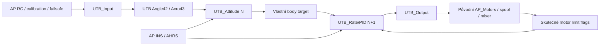

# FÁZE 3G-1 – Aktivní UTB Attitude → Rate/PID pouze v SITL

## Předimplementační audit a návrh

Stav před změnami: HEAD po samostatném report commitu 8a6dd796564c70d1888d49b31c6bb32ed83514f0. Zdrojový výchozí stav odpovídá 89e81d94763f. Fyzický hardware není součástí této fáze.

Aktivní cesta již existuje z FÁZE 3A. ModeUTBAngleSITL/ModeUTBAcroSITL jsou historická označení; skutečné objekty mode_utb_angle_sitl a mode_utb_acro_sitl mají třídy UTB_Angle a UTB_Acro v libraries/AP_UTB/Copter/UTB_Angle.cpp a UTB_Acro.cpp. Čtení pouze mode_utb_rate_sitl.cpp by chybně vedlo k hodnocení starého mode41 jako současného pilotního řešení.

- UTB_Core vlastní jednu UTB_Rate, která dědí vlastní UTB_Attitude, a její tři UTB_PID. Nevolá AC_PID/AC_AttitudeControl řídicí výpočet.
- UTB_Angle::run vytváří RC angle/yaw referenci a volá vlastní quaternion/shaping výpočet. UTB_Acro::run používá vlastní AP-derived RATE_LOOP_ONLY mapu/shaping bez traineru. ACRO_OPTIONS bit1 je pro native srovnání nutný; původní stabilized ACRO není totožný profil.
- Copter::run_rate_controller_main v UTB42/43 volá UTB_Core::update_rate a vrací se před původním AP Rate. AP custom controller se ve stejných režimech také přeskočí. Rate(N+1) spotřebuje target vytvořený v pozdějším flightmode run(N).
- UTB_Rate::rate_controller_run_dt provádí vlastní P/I/D/FF/D_FF výpočet, původní scaling/gain boost/mix, přidává sysid a používá skutečné AP motor limit flags. UTB_Output jedině volá původní AP_Motors R/P/Y a FF setters. Copter::motors_output následně provede původní mixer/spool/HAL výstup.
- Native Rate zapisuje R/P/Y/FF v AC_AttitudeControl_Multi::rate_controller_run_dt. Tento call musí být za aktivní UTB autority runtime prokazatelně nepoužitý, ne pouze označený konstantou APN=0 v logu.
- Přechod native→UTB dnes explicitně resetuje attitude/filter historii, přebírá živé I s IMAX clamp a throttle mix; UTB→native před mode-init nastaví throttle cache, mix, I a reset target/filter. Mezi42↔43 zůstává společná instance. Není to přesná úplná kopie PID filtrů ani příslib nulového přechodového impulsu. Přechody s nenulovými páčkami a jejich skutečné transienty vyžadují test; při neobhajitelném předání se aktivní dokončení zastaví.
- ARM/DISARM/spool, RC/GCS/EKF failsafe, sensor health policy a scheduler zůstávají původní AP. SHUT_DOWN a GROUND_IDLE ve vlastních režimech přehrávají původní target/I reset politiku; nejde o pasivní import ze SHADOW.
- UT3_ je oddělená banka parametrů podle AP. Pro A/B se musí výslovně srovnat účinné gain/filter/reference nastavení; copter.parm mění native Yaw na .3/.02, konstruktor UTB default je .18/.018. Automatická průběžná kopie bank není zavedena.
- AP_UTB_RATE_SITL_AVAILABLE vyžaduje AP_UTB_ENABLED, opt-in feature a CONFIG_HAL_BOARD==HAL_BOARD_SITL. Na H743 se objekt Core, režimy a aktivní dispatcher nekompilují. Pasivní matematiky a SHADOW zůstávají oddělené.

Nejmenší plánovaná změna využije existující funkční matematiku a režimy. Doplní skutečné počítání native/UTB rate volání, zachycení právě spotřebovaného targetu se source ID, kontrolu předaných motorových hodnot a SITL diagnostiku místo dosavadního konstantního APN. Deterministický negativní motorový test musí prokázat vazbu vlastního výsledku do skutečného in-memory AP_Motors; injekce jen v testu. Dynamické A/B scénáře oddělí uzavřenou odezvu od přesné numerické regrese identických vstupů.

Nové unit/integration testy pokryjí autoritu, target timing, own gains, I reset/limity, předání/uvolnění, ARM/spool a skutečné failsafe. Saturace se označí PASS jen při skutečných flags; pouhé PWM blízko limitu nestačí. Podporovaný execution context se vymezí podle auditu, ne tichým přepnutím controlleru. Native/Rate/Attitude/Chain regrese a ON/OFF symbol/build kontroly zůstanou povinné. Žádná změna ověřené PID/Attitude matematiky bez doložené příčiny.

## Implementováno a skutečně ověřeno

Aktivní řetězec byl převzat z existující 3A, nikoliv znovu napsán. Tato fáze doplnila průkaznou SITL integraci, měření autority a automatizované lety. `UTB_PID.cpp`, `UTB_Rate.cpp` a `UTB_Attitude.cpp` jsou po bytech stejné jako před touto fází. Žádný tuning ani změna výchozích gains. H743 nebyla připojena.

### Autorita, pořadí a historie

- `UTB_Output` zaznamená hodnoty skutečně předané původním šesti setters R/P/Y + FF. Kontrola po původním motor slotu porovná jejich bitové kopie s AP_Motors. Nevolá vlastní mixer ani HAL output.
- `AC_AttitudeControl_Multi::rate_controller_run_dt` obsahuje SITL-only skutečný čítač volání. APN není konstanta. Ve vlastních epochách je APN=0, přesně šest vlastních setters/cyklus, žádný audit fault. Původní AP Rate se ve native režimech opět vykonává; UTB přestane zapisovat.
- UGA1 vzniká hned po vlastním Attitude a zachycuje target, Seq, mode a skutečnou shaping acceleration/velocity. UGC1 po motor slotu nese spotřebovaný source Seq, skutečný target, limit flags a motor audit. UARX.Tar je právě spotřebovaný target, nikoliv pozdější target. Dynamic IDs přiděluje původní logger, nemění se fixed IDs. FMT rozměry UGC1 mají compile-time kontrolu.
- První Rate krok každé explicitní mode epochy používá target založený mode-init. Další kroky musejí mít Src=Seq−1 a přesnou shodu float targetu s předchozí UGA1. Chybějící, duplicitní nebo opožděné kroky, osy i motor audity test odmítne; žádná selekce jen úspěšných řádků.
- Vlastní UTB historie není každokrokově importována z AP. Native→UTB a UTB→native používají existující explicitní seed I/throttle mix a reset target/filter; I je oříznuto vlastním IMAX. UTB42↔43 sdílí Rate/PID historii, mění se mode epoch. SHUT_DOWN/GROUND_IDLE provádějí původní reset/smooth reset politiku. Kompletní filtr historie se při native handoff nekopíruje.
- Nepodporovaný rate-thread kontext (i již spuštěný thread) a alternativní `ATT_ENABLE` cesta jsou při vstupu/arming vlastního režimu odmítnuty. Původní AP arming/failsafe nebyl změněn. Thread guard byl ověřen skutečným FSTRATE scénářem; alternativní ATT_ENABLE guard má source audit, samostatný letový scénář této varianty neproběhl.

### Skutečný negativní test a vlastní gains

Čtyři nové C++ testy ověřují motor setters, vlastní Rate/gain, skutečný AP_Motors limit v anti-windup a FF setter. Při identickém testovém vstupu změna pouze vlastního roll outputu změnila skutečný AP_Motors getter. Po ustálení skutečného input shaperu zdvojení vlastního P zdvojnásobilo motorový roll vstup.

Mutation test dočasně přerušil pouze roll setter ve zvláštním unit sestavení: test skutečně selhal (exit 1). Zdroj byl přesně obnoven podle SHA-256 a stejný test opět prošel (exit 0). Mutant nebyl použit pro lety ani hardware. Podklady: `mutation-result.json`, mutant/restored logy.

Ve dvou reálných SITL scénářích se měnilo pouze UT3_RAT_RLL_P 0,135→0,0675→0,135, nikoliv native ATC gain. Medián skutečného PIDR.P/PIDR.Err v UTB klesl z 0,1350000054 na 0,0675000026; v native scénáři zůstal 0,1350000055 i při změně UT3. Hraniční sample u PARAM zápisu sdílí časový cyklus, proto se neinterpretuje jako další gain. Výsledek je v `gain-authority.json`; nejde o nový tune.

## Aktivní SITL scénáře

Model bfxrev, stejné copter.parm, FRAME_TYPE=18, běžný ARMING_CHECK=1, FS_THR_ENABLE=1 a FS_GCS_ENABLE=1. Čerstvé oddělené instance, vlastní UT3 banka je v každém běhu srovnána s reálně načtenou ATC bankou; seznam je v parameter-alignment.json. ACRO_OPTIONS=2 nastavuje native RATE_LOOP_ONLY pro odpovídající srovnání. FS_OPTIONS=0 je společná testovací konfigurace s převzetím RTL místo výchozí volby pokračovat v pilotním řízení při GCS ztrátě. Produkční failsafe kód ani výchozí parametry se nemění.

SITL speedup=2, stejný LOG_FILE_BUFSIZE=512 KiB u native i UTB; export UGA1/UGC1 je pouze SITL. Žádný force-arm. Standardní takeoff v native STABILIZE, vlastní manuální throttle, self-level a standardní LAND/DISARM. Návrat na neutral používá existující testové kritérium 3A: po 5 s musí být absolutní roll/pitch pod 3°. Není to nový letový limit ani univerzální požadavek kvality. Runtime obálka 35° je jen ochrana testovacího runneru, nikoliv nový letový guard. Legacy UTB_RAT_* položky zděděné z BASE patří neaktivní historické matematice, aktivní UT3 banku netuní.

| Scénář | Vlastní Rate kroky | Spárované Attitude→Rate | Inicializované epochy | Výsledek |
|---|---:|---:|---:|---|
| native-acro | 0 | 0 | 0 | OVĚŘENO |
| native-angle | 0 | 0 | 0 | OVĚŘENO |
| utb-angle | 25598 | 25597 | 1 | OVĚŘENO |
| utb-acro | 7200 | 7198 | 2 | OVĚŘENO |
| native-ff | 0 | 0 | 0 | OVĚŘENO |
| utb-ff | 25600 | 25599 | 1 | OVĚŘENO |
| utb-gate | 4074 | 4072 | 2 | OVĚŘENO |
| utb-transitions | 6478 | 6472 | 6 | OVĚŘENO |
| utb-saturation | 3921 | 3919 | 2 | OVĚŘENO |
| utb-gain | 8800 | 8799 | 1 | OVĚŘENO |
| utb-unsupported | 0 | 0 | 0 | OVĚŘENO |
| native-gain | 0 | 0 | 0 | OVĚŘENO |
| utb-angle-rc | 4967 | 4965 | 2 | OVĚŘENO po opravě offline časového zařazení |
| utb-acro-rc | 4639 | 4636 | 3 | OVĚŘENO po opravě offline časového zařazení |
| utb-angle-gcs | 6684 | 6682 | 2 | OVĚŘENO |
| utb-acro-gcs | 6374 | 6371 | 3 | OVĚŘENO |

Celkem **104335 vlastních Rate kroků, 104310 přesně spárovaných pokračování a 25 explicitních prvních kroků**. DSF.Dp=0 ve všech přijatých scénářích, APN=0 a Bad=0 ve vlastních epochách. Ground gate doložil spool 0/1 a nulové I, lety spool 3. OFF build odmítl mode42/43 bez aktivního exportu.

RC i GCS výpadek byly vyvolány skutečným zastavením příslušného vstupu/heartbeat. Oba vlastní režimy přešly do původního RTL: MODE.Rsn=3 pro RC a 5 pro GCS. Do explicitního návratu pilotem nejsou další UTB Rate zápisy. Test ověřuje celý native interval, nikoliv jen první okamžik. Kontakt byl obnoven, nebyl automatický návrat UTB, následoval explicitní mode-init a běžné přistání.

Dva RC lety skončily původně nenulovým exit kódem pouze kvůli chybě offline interpretace MODE timestampu: dokončený motor slot starého režimu a pozdější mode transition v témže main cyklu mají shodné loop-start TimeUS. Zdrojové pořadí a zachovaný BIN dokazují, že tento jeden starý slot předchází změně režimu. Opravený test připouští tento slot, odmítá jakýkoliv pozdější vlastní zápis v native intervalu. Původní session/log/exit 1 zůstaly zachovány; `corrected-offline-angle-rc.json` a `corrected-offline-acro-rc.json` obsahují úspěšnou analýzu stejných dat, bez opakovaného letu. Jedenáct Python testů zahrnuje negativní případy sekvence a uvolnění autority. Souhrn `accepted-active-results.json` rozlišuje původní a opravené offline vyhodnocení.

## Native AP vs UTB: uzavřená odezva

Nejde o numerické odečítání dvou samostatných simulací. Použitá konfigurace/model/povely jsou shodné, okamžité gyro/AHRS a fáze příjmu RC se mohou lišit. Přesná numerická shoda má samostatné SHADOW regrese. Pro orientaci se používá původní **ANG při looprate**, nikoliv pouze 10Hz ATT. RATE/PID jsou také ve vysoké frekvenci.

Rise je první průchod 10→90 % podepsané změny vůči počáteční hodnotě a konečnému požadavku. Překmit je maximum nad tímto požadavkem; settling je pásmo ±2 % se zbývající dobou alespoň 0,25 s. To jsou definice metrik, nikoliv nově stanovené bezpečnostní limity. IAE integruje absolutní chybu proti skutečnému shaped targetu. Úhel: deg·s; rate: deg. Tail error je průměr posledních 0,3 s; za ustálenou chybu jej lze považovat jen u ustáleného kroku.

Počátek RC kroku je omezen dvěma RCIN sample, obvykle asi 100 ms. Absolutní settling od začátku kroku a překrytí křivek proto mají tuto nejistotu. Rise 10→90 neobsahuje pevný offset počátku. Krátké kroky neprokazují dlouhodobé ustálení.

| Profil, osy a obě znaménka | Rise 10–90 [s] | Překmit [%] | Settling ±2 % [s od posledního neutral RCIN] | Max. absolutní tail error |
|---|---:|---:|---:|---:|
| native-angle, R/P | 0.2849–0.3299 | 0.4323–1.5293 | 0.6048–0.6447 | 0.0301 deg |
| utb-angle, R/P | 0.2849–0.3299 | 0.4311–1.4745 | 0.6322–0.6722 | 0.0257 deg |
| native-acro, R/P | 0.0650–0.0650 | 2.2461–2.5493 | nepozorováno; část neustálena | 0.2866 deg/s |
| utb-acro, R/P | 0.0650–0.0650 | 1.9448–2.5011 | 0.2674–0.3349; část neustálena | 0.3091 deg/s |
| native-ff, R/P | 0.2407–0.2924 | 0.0000–0.4505 | 0.5456–0.6073 | 0.0706 deg |
| utb-ff, R/P | 0.2399–0.2924 | 0.0000–0.4355 | 0.5373–0.6073 | 0.0764 deg |

Angle kroky odpovídají přibližně ±5° a ±17,5°, včetně combined R/P a yaw a návratu do neutral. Roll/Pitch Acro targety přibližně ±21,54°/s, yaw ±16,875°/s. V krátkém yaw kroku nebylo dosaženo 90 % ani ustálení u obou větví; skutečná špička byla přibližně ±12°/s. To není PASS velkých rates nebo plných rotací. Max. tail rate error yaw je přibližně 6,55°/s. V R/P nebyl zjištěn výrazný rozdíl vyžadující změnu matematiky; rozdíly settling zahrnují výše uvedenou RC časovou nejistotu. PID nebyl laděn.

Při vlastní dynamice je peak shaping acceleration 16,1626 rad/s². V běžném Angle je přes 25 tisíc nenulových I vzorků bez I_TERM_SET. Peak I R/P/Y v dynamickém FF běhu 0,003167 / 0,003469 / 0,005226. Ve zvláštním FF profilu mají obě banky RP_FF=0,02, Y_FF=0,01 a R_D_FF=0,001: skutečný vlastní PIDR FF peak 0,026302, D_FF 0,014924; nejde o výchozí gains. Tyto parametry byly pouze testovací fixture.

### Saturace, anti-windup a přechody

**Aktivní letová saturace: NEOVĚŘENO.** Krátký combined full-stick/throttle scénář nevyvolal skutečné R/P/Y limit flags. Nenulový peak I 0,0422/0,0423/0,0549 sám saturaci nedokazuje. Není tvrzeno letové ověření anti-windup pouze podle PWM. Ground limity bez letu také nejsou náhradou.

**Deterministický anti-windup: OVĚŘENO.** Unit test používá skutečný AP_Motors.limit.roll: při stejném směru chyby se I nezvětší, po obrácení skutečně shaped chyby může klesat a reset ho vynuluje. Dřívější PID/SHADOW testy prověřují vlastní historii a filtry. Příští fáze musí při potřebě letové saturace navrhnout cílený scénář, nikoliv měnit motorové limity pro získání PASS.

Přechody s nenulovými roll/pitch/yaw páčkami prošly bez překryvu vlastní/native autority a bez zdvojených Rate kroků. Přenos je výše popsaný seed+reset, nikoliv identická kopie všech filtrů. Soubor `release-utb-transitions/response-metrics.json` uvádí skutečný první skok výstupu a špičku v dalších 100 ms každého přechodu. Zaznamenané transienty nevedly k poruše, ztrátě původního failsafe nebo překročení runner obálky; není tím dokázán nulový impuls ani bezpečnost libovolného handoff za libovolných gains.

## Časování, paměť, stack a buildy

Mean period vlastních epoch je 2499,82–2500,03 µs, pozorované periody 2499/3332 µs. Native A/B má stejnou dvojici period: Angle mean 2499,9785 µs, UTB 2499,9763 µs; Acro 2499,9925 a 2499,9917 µs. Absolutní jitter vůči 2500 µs je u těchto čtyř profilů přibližně 1,97–1,99 µs. Vysvětlení každého simulačního clock ticku není předmětem tohoto měření; 3332 µs se nevydává za změřený H743 deadline miss ani za nulový jitter. Seq audit dokazuje jeden vlastní Rate na evidovaný main krok, nikoliv pevnou fyzickou periodu 2500 µs.

SITL virtuální math microseconds v SHADOW bývají 0 a nejsou CPU časem. **Dodatečný CPU čas této instrumentace na H743 se neměřil.** Nový export/probe/audit je na H743 compile-out. Diagnostické logování a source copies představují režii SITL testu; první vývojové běhy se speedup=5 a menším bufferem skutečně měly drops a nejsou použity jako PASS.

| Build | .text [B] | .data [B] | .bss [B] | Aktivní Core/Output/mode symboly |
|---|---:|---:|---:|---|
| SITL_ON | 3289029 | 6373 | 240736 | 59 |
| SITL_OFF | 3251461 | 6373 | 239200 | 0 |
| H743_ON | 1268032 | 4172 | 131640 | 0 |
| H743_OFF | 1268032 | 4172 | 131640 | 0 |

Všechny čtyři buildy prošly. H743_ON znamená požadovanou aktivní build volbu; platformní guard ji i tak odstraní. H743 ON/OFF ELF jsou bitově totožné: SHA-256 `9e66eed80a6daa8929ad2000657f7bd85c2a7b2d391daa7e999a8a9a5186e19e`. APJ obou má 1 148 711 B a SHA-256 `757a31e7cad7ad6e1b18f9521ad3bbd909582f9176fa09fff588ed076436f650`. Žádné z těchto sestavení nebylo nahráno. Aktivní H743 Core/Output/mode symboly nejsou přítomny; pasivní matematika/SHADOW zůstávají podle vlastní volby.

Rozdíl SITL ON/OFF reprezentuje celou aktivní funkci, nikoliv pouze cenu této diagnostické změny. .bss není celková živá RAM ani heap. Statické -fstack-usage: Core::update_rate 64 B, native call probe 16 B, setters 16–32 B, note_attitude 128 B dynamic bounded, log_cycle 448 B dynamic bounded na hostu. To nejsou součty celého call-chainu ani runtime watermark. H743 nemá nové aktivní Core frames; skutečná runtime rezerva stacku aktivního řízení nebyla na fyzickém procesoru měřena a není zde schválena.

Reprodukce: přesné configure/build argv a výsledky jsou v `{SITL_ON,SITL_OFF,H743_ON,H743_OFF}-results.json`. Aktivní volba `--enable-UTB_RATE_SITL` / `--disable-UTB_RATE_SITL`; společně `--enable-UTB --disable-UTB_NATIVE_BENCH --disable-UTB_LOGGER_TRACE --enable-UTB_NATIVE_SHADOW --enable-UTB_ATTITUDE_SHADOW --enable-UTB_CHAIN_SHADOW --disable-UTB_TIMING`, cíle sitl / SkystarsH7HD-bdshot a oddělené --out. Buildy používají -fstack-usage. H743 nebyla flashována.

## Regrese a integrita

- C++ ON: 130 PASS, 1 SKIP (externí OfflineVectors fixture není nastavena); timing test target při vypnuté timing funkci má 0 testů. OFF jednotkové binárky také exit 0; aktivní unit při OFF nemá aktivní testy.
- Python: 170 PASS, 5 SKIP, 2 subtests PASS. Z toho 11 nových offline negativních kontrol sekvence/uvolnění. Přesné důvody skip jsou v uloženém pytest výstupu/testech, nejsou přepsány jako PASS.
- Rate SHADOW continuous: 8000 valid, mismatch/desync/invalid/unsupported=0, motor_changes=0, všechny exportované max/RMSE=0.
- Attitude SHADOW continuous: 8000 main / 16000 valid operations, všechny exportované max/RMSE=0, bez mismatch/desync/invalid.
- Chain SHADOW ve skutečném simulovaném letu: 16000 main / 15999 PID pokračování, všechny exportované max/RMSE=0, bez mismatch/desync/invalid/unsupported a změn native motorů.
- Native baseline, aktivní ON/OFF odmítnutí, skutečný FSTRATE unsupported kontext, ARM/DISARM, přechody a RC/GCS výpadky výše.
- flake8 nových Python souborů, astyle pouze změněných C++ řádků a nového unit souboru, git diff --check: OVĚŘENO. Původní regulační matematika, AP_Motors, HAL, arming, failsafe, scheduler a logger zdroje nebyly měněny. Nový zásah do native Rate je pouze chráněný call probe.
- Známá původní kombinace SITL bez loggeru / AC_CustomControl nebyla rozšiřována ani označena za novou regresi.

Vývojové neúspěšné artefakty zůstaly zachovány: příliš dlouhé FMT labels byly opraveny a nová metadata mají kontrolu rozměrů; původně chybně zvolené místo měření producer targetu bylo nahrazeno UGA1 po skutečném Attitude; neúplné logy se speedup=5 nebyly přijaty; paralelní pokusy kolidovaly na pomocném SITL portu a konečná sada běžela sériově. Nejde o zamlčené PASS ani fyzické poruchy FC.

## Přesný manifest této implementace

- `libraries/AC_AttitudeControl/AC_AttitudeControl_Multi.cpp` — SITL-only skutečný native Rate call probe.
- `libraries/AP_UTB/Copter/UTB_Acro.cpp` — Capture po vlastním Attitude; explicitní podporovaný execution context při entry/arming.
- `libraries/AP_UTB/Copter/UTB_Angle.cpp` — Stejný capture a context guard pro Angle.
- `libraries/AP_UTB/Copter/UTB_Core.cpp` — UGA1/UGC1, skutečný motor audit, spotřebované targety a opravený význam APN.
- `libraries/AP_UTB/Copter/utb_sitl_log.h` — Dokumentace skutečného APN probe.
- `libraries/AP_UTB/UTB_Attitude.h` — Read-only SITL getter existující target acceleration; bez změny výpočtu.
- `libraries/AP_UTB/UTB_Core.cpp` — Sekvence/source IDs, skutečný native probe a kopie spotřebovaných vstupů.
- `libraries/AP_UTB/UTB_Core.h` — Pevné SITL diagnostické stavy/rozhraní.
- `libraries/AP_UTB/UTB_Output.cpp` — Pozorování již předaných skutečných setters hodnot pod SITL guardem.
- `libraries/AP_UTB/UTB_Output.h` — SITL-only RAM observer bez nové motorové cesty.
- `libraries/AP_UTB/UTB_Rate.h` — Read-only observer rozhraní existujícího Output.
- `libraries/AP_UTB/tests/test_utb_active.cpp` — Čtyři nové C++ testy skutečné autority, gains, limitů a FF.
- `Tools/utb/tools/test_utb_active_chain_sitl.py` — Reprodukovatelné native/vlastní lety a striktní kontrola skutečných dat.
- `Tools/utb/tests/test_active_chain_evidence.py` — Negativní kontroly sequence a phase-aware release.
- `docs/UTB_PHASE_3G1_ACTIVE_CONTROL_SITL_CS.md` — Tento návrh, audit, výsledky a omezení.

## Artefakty, grafy a Git

Úplné BIN/TLOG, parametry, CSV, JSON a příkazy jsou v `tmp/utb-3g1-20261024_210139/`. Index: accepted-active-results.json, closed-loop-metrics.json, gain-authority.json, AB-periods.json, binary-audit.json, source-isolation.json, mutation-result.json, unit-results.json, unit-off-results.json, regressions.json. Každý přijatý běh má vlastní session a log adresář. Offline pomocné skripty i SHA manifest jsou zachovány zde; do zdrojového commitu se tmp ani binárky nepřidávají.

První samostatný commit hotových HW reportů: `8a6dd796564c70d1888d49b31c6bb32ed83514f0`, `docs(utb): record verified H743 integrated chain tests`. Implementační commit má předepsanou message `feat(utb): enable active attitude and rate control in SITL`; jeho výsledné SHA, staged manifest a stav jsou po vytvoření uloženy v commits.json / after-commit.json vedle artefaktů a v Git historii. Report nevkládá vlastní budoucí SHA do sebe.

`kapitoly/historie.txt` zůstává mimo staging a po bytech nezměněn, SHA-256 `3bcacd44527c67c44ea88b2cdfd2eb7edfd02705d88787c27ead2e74c45c293b`. Oba starší HW reporty mají původní SHA. Žádný push/reset/clean/rebase, žádné mazání historických dat a žádná instalace.

## Závěrečná rozhodnutí a limity

1. **ANO, v ověřených SITL profilech řídí vlastní UTB řetězec.** Native AP Rate za jeho autority nebyl volán; skutečný výstup byl ověřen až na AP_Motors a negativním mutation testem.
2. **ANO, Attitude(N)→Rate(N+1)** je doloženo source IDs, přesným transportem float targetu a úplností všech 104335 vlastních kroků včetně explicitních prvních seed kroků.
3. **ANO v testovaných profilech**, vlastní I/filter historie, mode-init a spool/reset jsou pokryty. Handoff používá seed+reset, nikoliv úplnou kopii filtrů; nelze tvrdit nulový impuls za libovolných podmínek.
4. **ANGLE i ACRO prošly skutečným SITL letem**, oběma znaménky, combined povely, neutral a přechody. Acro je vymezená AP RATE_LOOP_ONLY varianta; plné rotace a vysoké rates nebyly v této fázi ověřeny.
5. **Dynamická odezva je v měřených R/P profilech blízká native**, výše jsou konkrétní metriky a nejistota RC zarovnání. Dlouhé yaw ustálení neověřeno, žádný tuning.
6. **Nenulové shaping, FF/D_FF a vlastní I jsou prokázány.** Průběžné nulování I za letu nebylo použito.
7. **Saturace v aktivním letu není ověřena**; deterministický limit/anti-windup test prošel. Je to výslovná mez uzavření této fáze, ne skrytý PASS.
8. **AP arming/spool/failsafe jsou zachovány** a vybrané RC/GCS scénáře přešly do původního RTL. Nejde o úplnou certifikaci všech AP failsafe kombinací či libovolných gain konfigurací.
9. **H743 active compile-out potvrzen** symboly a shodnými ON/OFF binárkami. Nebyl fyzický test ani upload.
10. Další vývoj má nejprve cíleně doplnit aktivní saturaci/anti-windup v letu, větší ACRO manévry a náročnější handoff podmínky podle samostatného zadání. H743 aktivní řízení, letová bezpečnost a runtime timing/stack aktivního řízení na H743 nejsou schválené ani ověřené touto fází.
